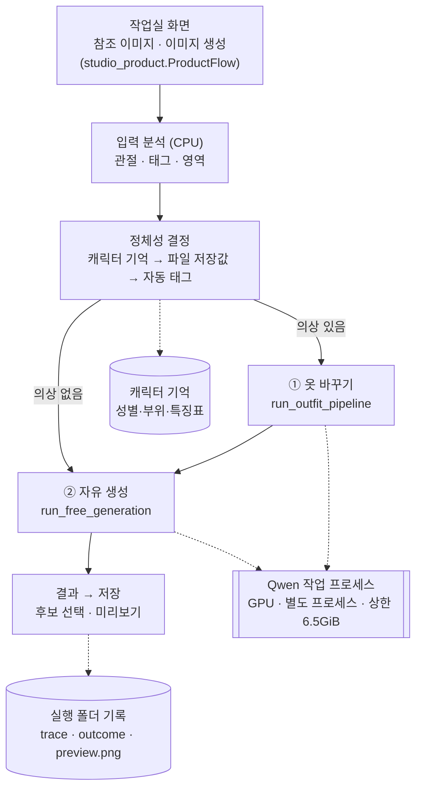
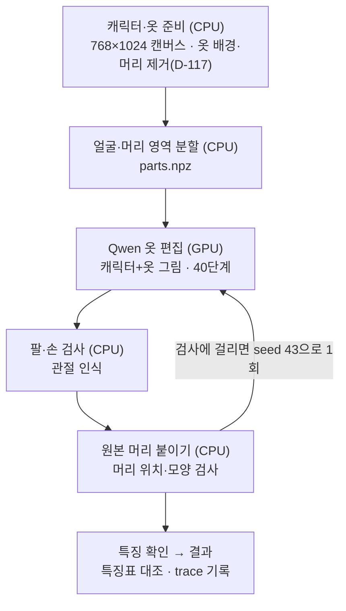
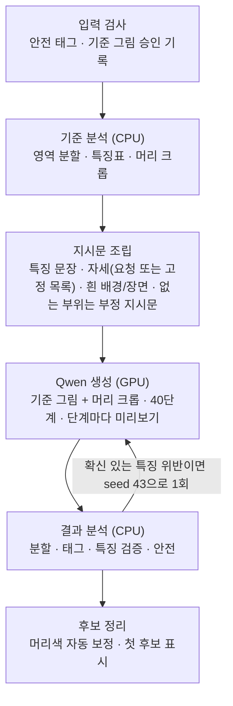

# 활성 제품 계약과 전체 흐름

> **2026-10-13 목표 갱신(사용자 승인, D-109):** 아래 '제품 목표'의 완성 판정 기준 6단계를 프로젝트 목표로 확정합니다. 진행 순서는 **편집(편집 결과) → 자유 생성(새 작품의 동일성·새로운 연출) → 그림체 반영**이며, 구조적 완성도와 새 입력 대응은 모든 단계에 적용합니다. 동일성은 픽셀 일치가 아니라 캐릭터·의상을 식별하는 특징의 유지로 판단합니다. 2026-10-12의 머리 원본 픽셀 합성은 편집 단계의 수단이며 이 기준을 대신하지 않습니다. 배포 목표(독립 실행 앱 + 향후 외부 API 호출, 공통 로직은 GUI·HTTP에 독립)는 [배포 목표와 외부 API 호환성](DEPLOYMENT_API_COMPATIBILITY.md)(D-110)을 따릅니다.

> **2026-10-14 자유 생성 경로 계약 갱신(사용자 승인, D-123):** 2단계·3단계(새 작품의 동일성·새로운 연출) 경로를 추가합니다. 흐름은 기준 이미지(편집 승인 결과 또는 원본 캔버스) + 확정된 캐릭터 특징표 + 요청 문장(자세·구도·시점·배경·상황, 없으면 코드 고정 목록의 무작위 전신 자세) → Qwen-Image-Edit → 결과 분할 → 특징 유지 관찰(결과 마스크, 부위 실제 개수·연결은 확인 불가로 사람 판정) → 사람 승인입니다. 머리 원본 픽셀 합성은 쓰지 않습니다(동일성 = 특징 유지). 요청 문장은 연출에 한정하며 외형·의상을 바꾸는 문장은 거부합니다. 배경은 요청이 있으면 허용, 없으면 흰 배경입니다. 이 경로에 한해 아래 제외 목록의 "자세 지정·변경 제외"와 "배경 생성 제외"를 적용하지 않습니다. 계약 본문: [FREE_GENERATION_CONTRACT.md](FREE_GENERATION_CONTRACT.md). 공통 진입점 `run_free_generation`(작업실·외부 API 공용, 확인 창 대신 검토 대기 반환).
>
> **2026-10-14 편집 단계 잠금·운영 전환(사용자 결정 (가), D-118):** 원본 편집형 옷 바꾸기는 지금 규칙으로 잠급니다 — 머리는 원본 픽셀로 붙거나 이유와 함께 거부를 알리고, 옷 참조는 공통 전처리(배경·머리 제거, D-117)를 거치며, 결과에는 기존 옷 잔존 확인 체크가 있습니다. 계획된 GPU 시험은 요청 19가 마지막이며 이후 새 그림은 시험이 아니라 사용입니다. 작업실 판정 기록이 20건쯤 모일 때마다 반복 실패 유형만 공통 규칙으로 고치고 저장된 실행 전체로 CPU 회귀합니다(그림별 조정 금지). 옷 교체 80~90%는 운영 목표로 남기고 다음 단계 진입 조건에서는 뺍니다. 2단계(새 작품의 동일성)는 [캐릭터 특징표 설계](CHARACTER_FEATURES_DESIGN.md)부터 시작합니다.
>
> **2026-10-12 계약 갱신(사용자 승인, D-094):** **원본 편집형 의상 교체** 경로를 추가합니다. 흐름은 원본 캐릭터 + 의상 그림 → Qwen-Image-Edit 편집 → 머리(머리카락·얼굴·선택한 머리 장식) 원본 픽셀 합성 → 결과 1장 사용자 확인입니다. 이 경로에 한해 아래 '제외'의 픽셀 합성 금지를 적용하지 않습니다. 합성은 머리 영역에만 하며, 다음 경우에는 붙이지 않고 그 사실을 표시합니다.
>
> - 특징점 정렬(얼굴 일치점 8개 이상, 되돌린 뒤 위치 2px·크기 2%·기울기 1° 이내)을 통과하지 못한 경우
> - 머리 형태·연결 검사(지지율 0.5 이상, 떠 있는 조각 0.2 이하)를 통과하지 못한 경우
>
> 의상·몸·배경은 Qwen 결과를 씁니다. 머리 장식 유지 여부는 사용자가 체크로 고르며, 머리 장식에만 적용합니다. 편집 결과를 기준 이미지로 삼는 자유 생성(자세·구도·시점·배경·문장)은 별도 단계에서 계약을 다시 갱신합니다. [연결 계획](OUTFIT_EDIT_GUI_PLAN.md).

> **2026-10-09 범위 결정:** 원하는 자세로 바꾸기는 이번 완성 범위에서 제외하고 향후 외부 LLM·이미지 편집 연동 단계로 미룹니다. 기본 생성은 자세를 따로 지정하지 않습니다. 원본 체형·비율을 유지하는 골격·머리 윤곽 기능은 유지합니다. 기존 자세 코드·시험 기록을 삭제하거나 생성 설정을 바꾸는 결정은 아닙니다.

> **2026-10-08 원본 비율 참고:** 사용자 승인으로 선택형 GUI를 연결했습니다. 기본 OFF이며 ON에서만 원본 자세·머리 범위 지정·윤곽 확인 후 기존 2단계 제품 생성으로 이어집니다. 외부 자세 사진 GUI는 연결하지 않았습니다. 내부 GPU 재현은 6 seed 통과했고, 새 GUI의 실제 GPU 검사는 남아 있습니다. [사용 흐름과 검증 범위](PROPORTION_GUI_HANDOFF.md).

> **2026-10-08 작업실 연결:** 생성 모델 해제 뒤 CPU 흰 배경 합성을 수행하고 정리본을 미리보기·승인·저장에 사용합니다. 의상 설명의 모순과 부정 문구 겹침은 경고·기록하며 자동 삭제하지 않습니다. 배경 처리 실패는 원본 표시와 함께 안내합니다. 자동 노출 검사는 연결하지 않았습니다. [변경 범위와 CPU 검증](GUI_RESULT_FIXES_HANDOFF.md)을 참고하세요.

> **2026-10-04 구현 대조 안내:** 아래 제품 계약에는 GUI·CLI가 `GenerationOrchestrator`를 공유하고 자동 진단을 수행한다는 이전 경로 설명이 남아 있습니다. 현재 작업실은 `StudioController`에서 1회 생성으로 진입하며 자세 미적용, 사용자 결과 승인 경로를 사용합니다. 계약과 구현의 이 차이는 아직 정리할 항목입니다. 이번 문서 편집으로 제품 계약을 새로 승인하거나 자동 검사 기능이 연결됐다고 간주하지 않습니다. 현재 동작은 [데이터 흐름](CODE_FLOW.md), 검증 범위는 [검증 기록](ENGINEERING_REPORT.md)에 정리했습니다.

이 문서는 GenAI Lab의 유일한 활성 제품 계약이다. 다른 문서에 기록된 CatVTON 합성, Human-Agnostic 신체 복원, hard paste, 픽셀 병합, 다단계 Inpaint 계약은 과거 실험 또는 문제 해결 기록이며 현재 제품 흐름을 변경하지 않는다.

## 제품 목표

캐릭터 참조 이미지와 의상 참조 이미지를 입력받아, 기준 캐릭터가 새로운 의상을 입은 이미지를 일관되게 생성한다.

사용자는 팬아트를 만들거나 자신이 기준으로 삼는 캐릭터의 얼굴·체형·헤어·선택적 동물 특징을 유지하면서 새로운 의상을 적용할 수 있어야 한다. 결과를 자동으로 정답이라고 확정하지 않고, 생성 조건과 진단값을 공개해 사용자가 최종 이미지를 승인한다.

### 완성 판정 기준 (2026-10-13 사용자 확정, D-109)

두 참조 이미지는 역할이 다르다. 캐릭터 참조에서는 외형·체형을, 의상 참조에서는 옷의 디자인을 따른다. 캐릭터 참조의 기존 옷까지 남기는 것은 성공이 아니다. 새 구도와 그림체에서는 픽셀·명암·윤곽 표현이 달라지므로, 동일성은 픽셀 일치가 아니라 캐릭터와 의상을 식별하는 특징의 유지로 판단한다.

| 단계 | 반드시 충족할 기준 |
|---|---|
| 편집 결과 | 캐릭터 참조의 얼굴·머리·체형·고유 신체 특징을 유지하고, 의상 참조의 형태·색·주요 장식을 반영한다. 교체 대상인 기존 의상은 남지 않아야 한다. |
| 새 작품의 동일성 | 승인된 편집 결과와 같은 캐릭터·같은 의상이어야 한다. 자세와 시점에 따라 옷 주름·머리 흐름·원근은 달라질 수 있다. |
| 새로운 연출 | 구도·자세·표정·배경·조명·상황을 요청에 맞게 바꿀 수 있어야 한다. 배경만 바꾼 결과로 자유 생성을 입증하지 않는다. |
| 그림체 반영 | 사용 허가를 받은 자료로 학습한 목표 그림체가 결과에 나타나면서, 캐릭터와 의상 특징도 유지돼야 한다. 학습 실행 성공만으로 통과하지 않는다. |
| 구조적 완성도 | 얼굴 소실·중복, 신체 일그러짐, 잘못된 팔다리, 합성 경계 파손, 의도하지 않은 잘림이 없어야 한다. 구도상 자연스러운 가림은 오류와 구분한다. |
| 새 입력 대응 | 조정에 사용하지 않은 캐릭터·의상에도 공통 절차가 적용돼야 한다. 캐릭터마다 코드나 설정을 다시 맞추는 방식은 최종 목표 충족으로 보지 않는다. |

진행 순서: 편집 → 자유 생성 → 그림체 반영. 구조적 완성도와 새 입력 대응은 모든 단계에서 입증한다. 그림체 반영은 사용 허가 자료가 준비된 뒤 시작한다. 아래 '제품 경계'의 배경·자세 제외는 편집 단계에 적용되며, 자유 생성 단계에서 계약을 갱신할 때 다시 정한다.

## 제품 경계

### 포함

- 캐릭터 참조 이미지 한 장
- 의상 참조 이미지 한 장
- 캐릭터와 의상 영역 마스크 분석
- 마스크 영역을 기준으로 한 태그와 프롬프트 추출
- 두 이미지의 시각 조건과 승인된 텍스트 조건을 사용한 새 이미지 생성
- 한 명의 캐릭터와 단순 배경
- 얼굴·체형·헤어·동물 특징·의상·색상·구조 유사도 진단
- 후보 비교, 사용자 승인, 실행 조건 저장
- 승인된 결과만 사용하는 후속 미세조정

### 제외

- 이번 완성 범위의 자세 지정·변경과 새로운 자세 GUI 연결(향후 외부 연동 단계에서 별도 검증) — **편집 단계에 한함**. 자유 생성 경로(D-123)에서는 요청 문장으로 자세·구도·시점을 바꾼다.

- 캐릭터와 의상 이미지의 픽셀을 잘라 붙이는 합성 (예외: 2026-10-12 원본 편집형 의상 교체의 검사 통과 머리 합성 — 편집 단계에만 적용, 자유 생성 경로는 픽셀 합성 없음)
- `hard paste`, crop 붙이기, 마스크 기반 최종 이미지 병합
- 이전 요청의 캐릭터 프롬프트나 분석 캐시 재사용
- 동물귀·꼬리·특정 성별·특정 체형을 모든 요청에 강제
- 낮은 유사도 점수 하나만으로 정상 이미지를 폐기하는 자동 미적 판정
- 승인되지 않은 결과의 학습 데이터 사용
- 배경 생성과 다중 인물 생성 — 배경은 **편집 단계에 한함**. 자유 생성 경로(D-123)에서는 요청 문장의 배경을 허용한다(요청 없으면 흰 배경). 다중 인물은 모든 경로에서 제외.
- (2026-10-13, D-113) 원본 편집형 옷 바꾸기의 **지원 범위 밖**: 앉거나 웅크린 자세, 어깨에 걸친 겉옷·망토, 기계 몸·기계 의상. 자동 태그에서 보이면 시작 전에 경고하고 그대로 진행할 수 있되, 실패하면 알린다. 조건은 바꾸지 않는다. [지원 범위와 사례표](SUPPORT_RANGE.md)

## 시스템 흐름도 (2026-10-22, D-150·D-151 기준 현재 구현)

> 현재 코드가 실제로 도는 순서다. 아래 '전체 시나리오'·'단계별 책임'에는 예전 경로 설명이 섞여 있으니, 구현 순서는 이 절을 기준으로 본다. 진행 단계(기획)는 [ROADMAP.md](ROADMAP.md) '지금 지도'에 있다.

### 1. 전체 구조



- 사용자 화면은 확인 창 없이 자동으로 돈다(D-151).
  - ①→②는 사람 승인이 아니라 `reviewer: automatic_chain`이고, 입력 확정 출처는 `automatic_product`로 기록한다.
- 개발·평가 화면(`GENAI_STUDIO_DEVELOPER=1`)은 같은 파이프라인을 확인 창·체크 판정과 함께 쓴다.
  - ① 결과 승인 → '② 승인한 옷 바꾸기 결과로 자세·장면 만들기'(D-150).
- GPU는 두 'Qwen 생성' 단계만 쓴다. 분석·검사는 CPU 작업 프로세스다.
- 작업 프로세스는 생성 단계마다 `preview.png`(잠재값 → 색 근사, `generation_preview.py`)를 쓰고, 작업실이 1.5초마다 띄운다.

### 2. ① 옷 바꾸기 (`outfit_edit_pipeline.run_outfit_pipeline`)



### 3. ② 자유 생성 (`free_generation_pipeline.run_free_generation`)



**알려진 구조상 한계:**
- ②에 들어가는 그림은 '기준 그림 + 그 그림의 머리 크롭' 두 장이다. 의상을 바꿨으면 기준 그림은 ① 결과라서, 원래 캐릭터 그림은 ②에 직접 들어가지 않는다(ROADMAP 보류 목록).
- 의상이 있으면 최악의 경우 Qwen 생성이 4번(①·② 각 재시도 1회) 돈다.

## 전체 시나리오

```text
[1] 캐릭터 참조 + 의상 참조 선택
    ↓
[2] 입력 검증과 요청 격리
    ↓
[3] 두 이미지의 영역 마스크 분석
    ↓
[4] 마스크 영역별 태그·프롬프트 추출
    ↓
[5] 사용자가 참조·마스크·추출 조건 확인
    ↓
[6] 두 참조 이미지 + 승인 태그·프롬프트로 새 이미지 생성
    ↓
[7] 기술적 손상 검사 + 항목별 유사도 진단
    ↓
[8] 후보 비교와 사용자 승인
    ↓
[9] 승인 결과·Seed·설정·해시 저장
    ↓
[10] 필요할 때 승인 결과만 미세조정 자료로 이동
```

## 단계별 책임

### 1. 참조 입력

사용자가 캐릭터 이미지와 의상 이미지를 각각 선택한다. 두 입력의 역할을 바꾸거나 한 이미지가 다른 입력을 대신하게 하지 않는다. 자세 변경용 이미지는 이번 완성 범위의 입력에서 제외한다. 선택형 원본 비율 참고 기능에서 캐릭터 원본의 골격을 사용하는 것은 유지한다.

### 2. 입력 검증과 요청 격리

- 파일 존재 여부, 이미지 형식, 크기와 SHA-256을 기록한다.
- 새 요청은 새 요청 식별자와 독립 상태를 사용한다.
- 이전 캐릭터의 프롬프트, 태그, 성별, 동물귀·꼬리와 의상 캐시를 상속하지 않는다.
- GUI·CLI·GPU 검증은 같은 `GenerationOrchestrator` 요청 객체를 사용한다.

### 3. 영역 마스크 분석

캐릭터 이미지에서는 전경, 얼굴·헤어, 체형과 실제로 존재하는 선택적 특징을 분석한다. 의상 이미지에서는 적용할 의상 영역을 분석한다.

- 사람 귀는 얼굴 영역에 포함된 해부학적 특징이다.
- 동물귀는 별도 선택적 특징이며 사람 귀와 같은 클래스나 같은 마스크로 취급하지 않는다.
- 꼬리도 별도 선택적 특징이다.
- 검출되지 않은 동물귀나 꼬리를 존재한다고 가정하지 않는다.
- 검출 불확실은 `없음`으로 확정하지 않고 진단 상태로 남긴다.
- 마스크는 정보 추출과 참조 조건 제한에 사용하며 최종 픽셀 합성에는 사용하지 않는다.

### 4. 태그와 프롬프트 추출

캐릭터와 의상 조건을 독립적으로 만든다.

- 캐릭터: 얼굴 인상, 체형, 헤어 형태·색상, 눈, 실제 존재하는 동물 특징과 장식
- 의상: 종류, 길이, 실루엣, 주색, 보조색, 소재, 장식
- 의상 이미지의 인물 성별·얼굴·헤어·포즈 태그는 의상 조건으로 전달하지 않는다.
- 캐릭터 이미지의 기존 의상 태그는 새 의상 조건과 충돌하지 않도록 분리한다.
- 추출값은 모델의 확정 판정이 아니라 사용자가 검토할 후보 정보다.
- 실제 생성에 전달된 최종 프롬프트와 토큰 잘림 여부를 기록한다.

### 5. 입력 승인

사용자는 원본 두 장, 분석 마스크, 승인 태그와 실제 프롬프트를 확인한다. 잘못된 마스크나 태그는 생성 전에 수정하거나 제외할 수 있어야 한다. 내부 PASS 단계마다 반복 승인을 요구하지 않고, 결과 의미가 바뀌는 입력만 확인한다.

### 6. 새 이미지 생성

현재 구현은 승인된 입력으로 Animagine Base 후보를 만들고, 승인 Base와 같은 Seed를 사용해 FLUX.2 Klein 전체 이미지 정밀화를 한 번 실행한다. 다른 생성 모델로 자동 폴백하지 않는다.

- 캐릭터와 의상 참조는 시각 조건으로 전달한다.
- 승인된 프롬프트와 태그는 텍스트 조건으로 전달한다.
- 결과는 두 원본을 픽셀 합성한 이미지가 아니라 새롭게 생성된 한 장의 이미지다.
- FLUX 입력, Seed, 모델, 설정, 프롬프트와 출력 경로를 기록한다.

정밀화는 하나의 강한 조건으로 정답을 고정하지 않고 다음 세 유도를 순서대로 적용한다.

- **시간적 유도**: 초기 구간은 인체·구도·캐릭터 정체성, 중간 구간은 의상 종류·길이·실루엣, 후반 구간은 색상·소재·장식의 상대 강도를 높인다. 모든 조건을 처음부터 최대 강도로 동시에 주입하지 않는다.
- **공간적 유도**: 생성된 Base 좌표에서 편집 범위를 다시 검출한다. `soft_guidance`가 실제 영역별 조건 강도를 결정하며, 참조 이미지의 분석 좌표를 Base에 직접 투영하지 않는다.
- **단계적 유도**: `Base → 의상 실루엣 → 색상·소재 → 세부 장식` 순서로 진행한다. 다음 단계는 직전 단계의 기술적으로 정상인 결과를 앵커로 사용하고, 단계마다 입력·출력 해시와 적용 강도를 기록한다.

`hard_edit_domain`은 하위 호환 산출물 이름으로만 유지하며, 실제 픽셀을 강제로 잘라내는 정밀 마스크가 아니라 넓은 최대 유도 범위의 진단값으로 취급한다. 이 값을 이용한 마스크 외부 latent 덮어쓰기, 원본 RGB 강제 복원, hard paste 또는 최종 픽셀 합성은 실행하지 않는다.

얼굴·헤어·사람 귀·검출된 동물귀·헤어 장식 같은 보호 영역은 편집 마스크에서 일괄 제거하지 않는다. 보호 지도는 해당 위치의 조건 강도를 감쇠하는 데 사용하며, 완전한 0 강도는 사용자가 승인한 요청 또는 기술적 안전상 필요한 경우에만 적용하고 실제 값을 기록한다.

엔진이 시간·공간 유도 기능을 지원하지 않으면 적용한 것처럼 기록하지 않는다. 실행 보고서에 `requested`, `applied`, `unsupported`를 구분하고, 지원되지 않은 유도는 진단으로 남긴다.

### 7. 검사와 진단

반환을 막는 항목과 결과 비교용 진단을 분리한다.

자동 차단 항목:

- NaN 또는 비정상 latent
- 디코딩된 RGB 이미지의 명백한 손상
- 다중 인물 또는 신체의 명백한 구조 붕괴
- 실행 입력 해시나 승인 설정 불일치

자동 차단은 기술적으로 안전한 결과를 판별하는 데만 사용한다. 캐릭터·헤어·의상·색상 유사도 부족이나 미적 선호 차이는 단독 차단 사유가 아니다. 한 정밀화 단계가 유사도 목표를 달성하지 못해도 기술적 안전 검사를 통과한 최신 결과를 반환하고 부족한 항목을 다음 미세조정 대상으로 기록한다.

진단 항목:

- 캐릭터·얼굴·헤어·체형 유사도
- 사람 귀와 동물귀 구분 결과
- 동물귀·꼬리 존재와 색상 유사도
- 의상 종류·실루엣·색상 유사도
- 전체 구조와 인상 유사도
- 계산 불가 또는 검출 불확실

참조 분석 정확도는 생성 결과로 추정하지 않는다. 생성·학습 자료와 분리한 고정 검증 세트에서 동물귀·헤어 장신구·꼬리를 각각 `present`, `absent`, `ambiguous`로 사람이 표기하고, 검출 정밀도·재현율·오검출률·불확실률과 마스크 IoU/Dice를 계산한다. 검출 후보가 없다는 `no_detection`은 자동으로 `absent`로 승격하지 않으며, `uncertain`은 자동 조건 주입에서 제외한다. 동물귀와 헤어 장신구 마스크가 겹치면 두 마스크를 독립 보존하고 `overlap_ambiguous`로만 기록하며, 승자 선택·마스크 차감·생성 정책 변경은 수행하지 않는다. 실행 방법과 자료 계약은 [참조 분석 검증 계약](REFERENCE_ANALYSIS_VALIDATION.md)을 따른다.

진단 점수는 확률, 정확도 또는 자동 합격률이 아니다. 정상 이미지가 목표선보다 낮아도 결과와 점수를 사용자에게 공개한다.

이 계약 변경은 문서 우선 변경이다. 시간·공간·단계 유도 실행 코드와 보고서 스키마가 적용되기 전까지 기존 실행 결과를 새 유도 계약을 충족한 결과로 표시하지 않는다.

### 8. 결과 비교와 사용자 승인

공통 오케스트레이터가 최종 후보를 만든 뒤 다음 증거를 `stage8-review-evidence.json`에 기록하고 GUI의 같은 화면에 표시한다.

- 캐릭터 참조, 의상 참조, 승인 Base와 최종 후보
- 기술 안전 검사와 인물 수 진단
- 캐릭터·헤어는 캐릭터 참조, 의상·색상은 의상 참조를 기준으로 한 항목별 비교값
- 요청한 유도, 실제 적용한 유도, 미지원 또는 기록되지 않은 유도
- 다음 미세조정 대상으로 제안된 항목

사용자 결정은 `승인`, `결과 보존 후 미세조정`, `거절` 세 가지다. 점수는 결정을 돕는 진단값이며 자동 승인으로 바꾸지 않는다. 조건부 승인은 현재 결과를 보존하고 선택한 항목만 후속 미세조정 대상으로 기록한다.

거절에는 사유가 필요하다. 픽셀 손상·구조 실패·복수 인물·미적 선호는 새 Seed 재생성 대상으로, 캐릭터·헤어·의상·색상 불일치는 동일 Base·Seed의 해당 부위 유도 대상으로, 참조 분석 오류와 요청하지 않은 부위는 입력 검토 대상으로 기록한다. 8단계는 자동 GPU 재시도를 시작하지 않으며, 거절 후보를 최종 선택과 학습 자료에서 제외한다. 1~7단계 실행 보고가 없으면 적용된 유도로 간주하지 않는다.

외부 편집 후보도 수동 비교와 승인은 가능하지만 자동 게이트·유사도·유도 과정은 `미실행` 또는 `계산 불가`로 명시한다. 결과를 숨긴 채 내부 점수만으로 최종 이미지를 확정하지 않는다.

### 9. 승인 결과 저장

9단계는 새 승인을 수행하지 않는다. 8단계에서 승인한 이미지에 대해 사용자가 "저장 위치 선택 후 저장" 또는 "저장하지 않음"을 결정한다. 폴더 선택을 취소하면 후보를 메모리에 유지하며 저장 결정도 확정하지 않는다.

저장 루트는 GUI에서 사용자가 매번 선택할 수 있다. 선택하지 않은 경우 파일을 만들지 않는다. 최종 승인은 선택한 루트의 approved/날짜에, 조건부 승인은 refinement-pending/날짜에 저장한다. 거절 결과는 저장할 수 없다.

PNG와 같은 이름의 JSON에는 다음 재현 정보를 기록한다.

- 캐릭터·의상 참조 파일 경로, 크기와 SHA-256
- 8단계 비교 증거와 사용자 결정
- 실제 프롬프트와 부정 프롬프트
- 모델, 엔진과 참조 어댑터
- Seed, 해상도, 주요 강도와 자세 제어값
- 항목별 진단과 정밀화 실행 보고서
- 저장 결과 이미지 SHA-256
- 최종 결과 또는 미세조정 대기 결과 구분
- 학습 사용 미승인 상태

원래 실행 진단 폴더에는 stage9-storage-decision.json을 별도로 기록한다. 저장 위치를 바꾸더라도 공통 오케스트레이터의 실행 manifest에는 실제 PNG·JSON 경로가 남는다. 9단계 저장 승인은 10단계 학습 사용 승인을 포함하지 않는다.

### 10. 미세조정 연결

미세조정 자료는 개념별로 분리한다. 캐릭터 정체성, 체형, 헤어, 동물 특징과 의상을 한 데이터 묶음에서 동시에 강하게 학습하지 않는다. 승인된 이미지와 사용 권한이 확인된 자료만 사용하며, 학습에 사용하지 않은 고정 평가 입력과 Seed로 전후를 비교한다.

## 변경 규칙

1. 한 실험에서 한 가지 핵심 조건만 바꾼다.
2. 변경 전후는 같은 입력과 Seed로 비교한다.
3. GPU 실행 성공과 이미지 품질 성공을 분리해 기록한다.
4. 새 게이트를 추가하기 전에 입력, 마스크, 실제 프롬프트와 Base를 확인한다.
5. 특정 참조 한 장을 통과시키는 하드코딩을 공통 계약으로 추가하지 않는다.
6. 실패한 변경은 해당 변경만 되돌린다.
7. 이 문서의 목표나 흐름을 바꾸는 작업은 코드보다 먼저 이 문서를 수정한다.

## 구현 연결점

- 공통 애플리케이션 서비스: `genai_lab/generation_orchestrator.py`
- Base 후보 생성과 진단: `genai_lab/visual_reference.py`
- 캐릭터·의상 영역 분석: `genai_lab/reference_regions.py`
- 요청별 참조 조건: `genai_lab/reference_conditions.py`
- Native 실행 계약: `genai_lab/native_pipeline_contract.py`
- FLUX 결과 판정: `genai_lab/native_refinement_policy.py`
- FLUX 실행기: `scripts/run_native_refinement.py`
- 원본 편집형 옷 바꾸기(공통): `genai_lab/outfit_edit_pipeline.py` `run_outfit_pipeline`
- 자유 생성(공통, D-123): `genai_lab/free_generation_pipeline.py` `run_free_generation` (작업실 자유 생성 버튼 연결, GPU 품질 미측정)
  - 기준 원본/승인 편집본 종류·SHA와 사용자 확정 특징표 → 같은 기준의 파생 머리 크롭을 포함한 Qwen 시각 참조 → 생성 결과 자체 분할·특징 관찰 → 조건별 판정·사람 검토 대기. 머리 합성 없음. 무작위 연출은 재시도에도 고정. 자동 특징 관찰은 동일성/품질 승인이 아니다. HTTP 서버는 미구현.
- GUI 진입점: `gui_main.py`
- CLI 제품 실행: `scripts/run_product_generation.py`

## 기술 근거

- [Diffusers IP-Adapter와 공간 마스크](https://huggingface.co/docs/diffusers/using-diffusers/ip_adapter)
- [Diffusers Image-to-Image](https://huggingface.co/docs/diffusers/using-diffusers/img2img)
- [FLUX.2 Klein 모델 카드](https://huggingface.co/black-forest-labs/FLUX.2-klein-4B)
- [CLIP 논문](https://arxiv.org/abs/2103.00020)
