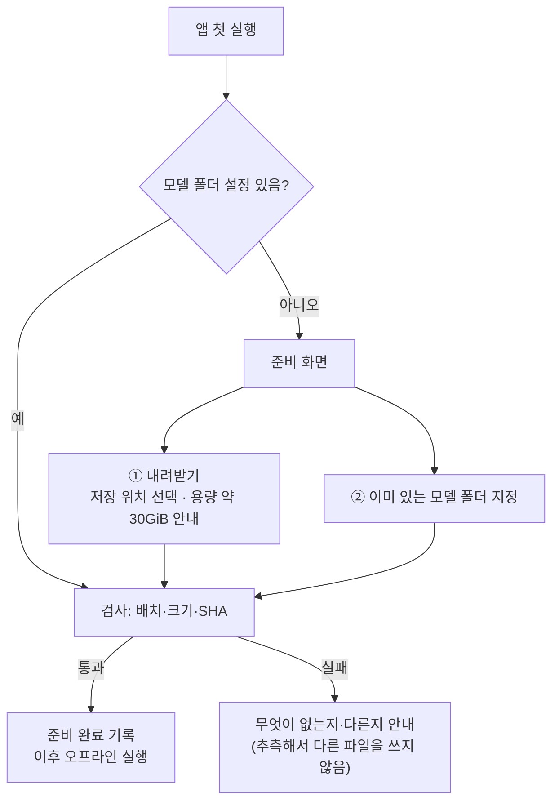

# 설치형 앱 패키징 준비 (2026-10-23)

> 지도 4절 병행 갈래(D-165·D-166). 새 GPU 시험·구매·외부 발송·공개 배포는 하지 않았다. 공유 캐시·기존 실행 환경은 지우거나 옮기지 않았다.
> 목표 형태: **무료 설치형 Windows 앱 + 최초 모델 준비, 준비 뒤에는 서버 없이 오프라인 실행**(사용자 결정 10/23).

## 결론

- **설치 방식은 '앱 + 최초 모델 준비'로 설계한다**(4절). 최초 준비는 ① 내려받기 ② 이미 있는 모델 폴더 지정 두 길이 있고, 준비가 끝나면 네트워크 없이 실행한다.
- **제품 의존 파일 목록은 '최소 목록'까지 확인했다**(2절). 완전한 목록이라고 확정하지 않는다.
  - 실행 관찰: 제품 단계가 실제로 연 모델 파일 11개(재시도 경로 포함). **첫 관찰은 GPU가 켜져 있었다(정정, 2-1).**
  - 조건부 경로(옷 바꾸기 재시도·머리색 복원·자동 보정·기억 연결) 관찰: 새 모델 파일 없음, 기억 연결은 사용자 데이터만(2-4).
  - 정적 확인: Qwen 작업 프로세스가 여는 파일(이번 관찰에서는 기존 결과 그림으로 대신해 실행하지 않음).
  - 조건부·미관찰: 실행 조건에 따라 열릴 수 있으나 이번에 지나가지 않은 경로.
- **경로 수정(모델만) 반영:** `GENAI_MODEL_HOME`(모델 폴더 한 곳)을 정하면 제품 모델을 그 아래 정해진 배치에서 찾는다(3절). 정하지 않으면 지금 경로를 그대로 쓴다 — 이 PC 동작은 바뀌지 않는다.
- 실행 환경 점검(1-3, CPU): **세 환경 모두 시스템 Python 3.10.6에 기대고**, Qwen 환경은 `.pth`로 주 환경 패키지를 쓴다(사실상 두 환경). 관절 분석 환경은 분리 유지(사용자 결정). Qwen 생성 호환은 GPU 확인 전.
- **독립 실행 방식 추천: 공식 내장형 Python 3.10 두 벌(주·관절)**(4-1). 하위 프로세스 환경 변수는 필요한 이름만 명시적으로 넘기도록 코드 반영·CPU 검증(4-2). 제품 최소 패키지 목록 초안과 대조 도구(4-3). GPU 확인은 최종 패키징 검증 계획(4-4)에 넣었다.

## 1. 조사 목록 — 모델과 실행 환경을 나눈다

### 1-1. 모델 (용량·출처·라이선스는 HF 표시, 2026-10-23)

| 구성 요소 | 지금 위치 | 용량 | 출처·리비전 | 라이선스 | 제품 필요 근거 |
|---|---|---|---|---|---|
| Qwen-Image-Edit-2511(문자 인코더·VAE·설정 등) | `D:/genai-cache/models/Qwen-Image-Edit-2511` | 15.70GiB | Qwen/Qwen-Image-Edit-2511 @6f3ccc0b | Apache-2.0 | 정적(2-2) |
| Qwen 변환기 GGUF Q4_K_M | `D:/genai-cache/models/Qwen-Image-Edit-2511-GGUF/…Q4_K_M.gguf` | 12.34GiB | unsloth/Qwen-Image-Edit-2511-GGUF @0d33d969 | Apache-2.0 | 정적(2-2) |
| 머리 분할 체크포인트 l2d_sam | `D:\genai-cache\huggingface\models--24yearsold--l2d_sam_iter2` | 1.21GiB | 24yearsold/l2d_sam_iter2 | Apache-2.0 | **관찰**(옷 바꾸기·자세 장면) |
| 머리 분할 코드 see-through | `D:\genai-cache\tools\see-through` | 0.02GiB | shitagaki-lab/see-through @df019de5 | **확인 필요**(원본 LICENSE) | 정적(작업 프로세스가 코드 불러옴, .py는 관찰 대상에서 뺌) |
| WD 태거 v3 | `D:\genai-cache\huggingface\models--SmilingWolf--wd-vit-tagger-v3` | 0.35GiB | SmilingWolf/wd-vit-tagger-v3 @7f6b584d | Apache-2.0 | **관찰**(네 단계 모두) |
| 관절 분석 DWPose(easy-dwpose) | `D:\genai-cache\huggingface\easy-dwpose\checkpoints` | 0.33GiB | yzd-v/DWPose 가중치 | Apache-2.0 | **관찰**(입력 분석·옷 바꾸기·자세 장면) |
| 캐릭터 분할 anime-seg | `D:\genai-cache\huggingface\models--skytnt--anime-seg` | 0.16GiB | skytnt/anime-seg @493cb608 | Apache-2.0 | **관찰**(입력 분석) |
| 머리 검출 | **`\\192.168.0.109\win_g\genai-lab\outputs\…\model-cache\hub`** | (0.18GiB 중 일부) | deepghs/anime_head_detection @06604fee | MIT | **관찰**(입력 분석) |

**같은 캐시에 있지만 이번 관찰에서 열리지 않았고 제품 코드에서 참조도 찾지 못한 것:**

| 구성 요소 | 용량 | 판단 |
|---|---|---|
| deepghs/ccip_onnx(OpenRAIL) | 머리 검출 캐시 안 | 코드 참조 없음 → 넣지 않는 쪽. 다른 경로에서 쓰이는지 더 확인 |
| `models--yzd-v--DWPose`(두 번째 사본) | 0.33GiB | 제품은 easy-dwpose 쪽을 연다 → 넣지 않는 쪽 |

**시험 전용 — 넣지 않음:** 8단계 가속 LoRA(0.79GiB, D-141), 빌린 그림체 LoRA(0.22GiB, D-159·D-162), 손 검출(OpenRAIL, D-157).

### 1-2. 실행 환경 (Python — 이번 경로 수정 범위 밖)

| 환경 | 용량 | 쓰임(관찰) | 메모 |
|---|---|---|---|
| `D:\genai-cache\venv` | 5.93GiB | 작업실·분석·자세 장면 후처리(이번 관찰의 주 프로세스) | 시험 도구 등 개발용 패키지 함께 있음 |
| `D:\genai-cache\catvton-venv` | 0.83GiB | 관절 분석 하위 프로세스(easy_dwpose·onnxruntime) | 예전 CatVTON 이름이 남음 |
| `D:\genai-cache\qwen-test-venv` | 0.02GiB | Qwen 작업 프로세스(이번 관찰에서는 대신함) | `.pth`로 venv를 참조 |

- 주요 패키지 라이선스(설치본 LICENSE로 다시 확인): torch(BSD), diffusers·transformers(Apache-2.0), bitsandbytes·gguf·onnxruntime(MIT), **PySide6(LGPL-3.0 — 동적 연결 유지·교체 가능·문서 동봉)**.

### 1-3. 실행 환경 점검 결과 (CPU, 2026-10-23, D-169)

- 방법: ① 환경마다 `env_probe.py`를 격리 실행(`-I`)과 실제 실행 조건으로 돌려 기반 Python·`sys.path`·`.pth`·역할별 모듈 불러오기와 출처를 기록. ② 사용자 화면 단계(base4)와 시작 화면을 다시 돌리며 프로세스마다 실제 Python·불러온 모듈 위치·하위 프로세스 명령을 기록(`GENAI_OPEN_TRACE_MODULES`).
  - GPU 숨김(`-1`), Qwen 생성·머리 분할은 계속 기존 결과로 대신 → **Qwen 작업 프로세스·머리 분할 작업 프로세스는 실행 관찰이 없다**(불러오기 점검과 정적 확인만). Qwen 생성 호환은 GPU 확인 몫.
  - 원자료 `outputs/product-file-trace-20261023/env-probe/`, `env-base4/`, `env-startup/`.

| 확인 | 결과 |
|---|---|
| 기반 Python | **세 환경 모두 시스템 설치 Python 3.10.6(`C:\Program Files\Python310`)의 표준 라이브러리·DLL을 쓴다.** 환경 폴더만 복사해서는 다른 PC에서 돌지 않는다 → 설치형은 Python 자체를 함께 넣어야 한다(내장형 Python 등, 방식은 다음 결정) |
| Qwen 환경(`qwen-test-venv`) | 자체 패키지는 pip·setuptools뿐. `operation-venv.pth`가 **주 환경(`venv`) site-packages를 경로에 넣어** torch·diffusers·transformers·bitsandbytes·gguf·accelerate·safetensors를 모두 거기서 불러온다. 버전 계약(torch 2.9.1+cu128 등) 통과. → 사실상 주 환경과 같은 패키지 |
| `@app`(앱 자신의 Python) | 주 환경 Python을 고르게 된다. 위 결과대로 같은 패키지를 쓰는 셈이지만, **Qwen 생성이 그 실행 파일로 도는지는 GPU 확인 전** |
| 관절 분석 환경(`catvton-venv`) | easy_dwpose·onnxruntime 등 자체 패키지. 주 환경 참조 없음. 주 환경과 버전이 다름: **numpy 1.26.4 / 2.2.6, opencv 4.11 / 5.0, huggingface_hub 0.24.7 / 0.36.2** — easy_dwpose가 주 환경 버전에서 도는지는 확인 안 함(새 환경 설치가 필요) |
| 사용자 site-packages | 세 환경 모두 꺼짐(`include-system-site-packages = false`). 이 PC의 사용자 site(`%APPDATA%\Python\Python310`, 다른 프로젝트 패키지 다수)는 섞이지 않았다 |
| 프로세스별 모듈 출처(실행 관찰) | 작업실·파이프라인(주 환경), 특징 분석 하위 프로세스(주 환경), 관절 분석 하위 프로세스 5회(관절 환경) — **각자 자기 환경 모듈만** 불러왔다(경로 없는 내부 모듈 오탐 제외) |
| 하위 프로세스 시작 | 분석: `[pose_python 또는 analysis_python, genai_lab/studio_analysis.py, 모드, …]`, 작업 폴더 지정 없음(부모 것 물려받음), 환경 변수 **전부 물려받음**(PYTHONPATH 포함). 스크립트가 자기 위치로 저장소 루트를 경로에 넣는다. Qwen(정적): `[python_executable, -m, genai_lab.qwen_pose_worker, 요청]`, 작업 폴더 = 저장소 루트, **PYTHONPATH를 지운다**. 머리 분할(정적): `[analysis_python, -B, head_paste_worker.py, parts, 요청]` |
| 그 밖 | 각 프로세스가 `ver`(Windows 명령)를 한 번 실행한다(표준 platform 모듈). 주 환경 safetensors가 **0.9.0-rc.1(시험판)** 이다 — 재현 가능한 설치 목록에서는 고정 버전을 정해야 한다 |

**판단(설치형 구조 후보):**
- **환경은 둘로 둔다(현재 기준):** 주 환경(작업실·분석·Qwen) + 관절 분석 환경. 하나로 합치려면 easy_dwpose를 주 환경 버전(numpy 2 등)에서 확인해야 하고, 그 확인에는 새 환경 설치가 필요하다(승인 필요).
- Qwen 전용 환경은 따로 둘 이유가 기록상 없다(주 환경 패키지를 그대로 씀) — 합치는 쪽이 후보. 단 GPU 확인 전에는 바꾸지 않는다.
- 하위 프로세스에 물려줄 환경 변수는 앱이 정한다 → 4-2에서 반영(D-170).
- 설치 묶음 = 내장 Python 3.10 두 벌 + 주 환경 패키지 + 관절 환경 패키지 + 앱 코드 → 4-1(방식)·4-3(목록).
- **사용자 결정(10/23):** 관절 분석 환경은 분리 유지, easy_dwpose 주 환경 통합 시험은 보류. Qwen 환경도 지금 실행 경로 유지.

## 2. 제품 의존 파일 목록 — 근거별로 나눈다

### 2-1. 실행 관찰 (2026-10-23)

- 방법: 파일 열기 기록(파이썬 open 감사 + onnxruntime·safetensors·huggingface_hub·torch.load 감싸기, 두 번째 관찰부터 열린 핸들 표본 추가).
  - 도구 `scripts/product_file_trace/`, 원자료·요약 `outputs/product-file-trace-20261023/`(README 참고).
- **첫 관찰(정정 — GPU가 실제로 켜져 있었다):** PowerShell에서 `CUDA_VISIBLE_DEVICES`를 빈 값으로 설정하면 변수가 지워져 GPU가 보였다.
  - 머리 분할(l2d_sam)은 CUDA를 요구하는 코드라 GPU에서 4번 돌았다(각 최고 예약 5.08GiB). 이미지 생성은 아니다. 처음에 'GPU 사용 없음'이라고 적은 것은 틀렸다.
  - 단계: A 입력 분석(의상 있음, 79초) · B 기준 분석(의상 없음, 7초) · C 옷 바꾸기 파이프라인(68초) · D 자세·장면 파이프라인(111초, 피부 위반으로 재시도 경로까지) · S 작업실 시작 화면. Qwen 생성은 기존 B2 결과 그림(요청 34)으로 대신.
- **두 번째 관찰(GPU 숨김 확인):** `CUDA_VISIBLE_DEVICES=-1` + 시작 때 `torch.cuda.is_available()=False` 확인. Qwen 생성과 머리 분할(CUDA 필요)은 기존 결과로 **대신**하고 실행 폴더마다 표시했다. 결과는 2-4.

| 파일 | 단계 |
|---|---|
| WD 태거 `model.onnx`, `selected_tags.csv`(+ `refs/main`) | A·B·C·D |
| DWPose `dw-ll_ucoco_384.onnx`, `yolox_l.onnx` | A·C·D |
| l2d_sam `checkpoint-18000.pt` | C·D |
| anime-seg `isnetis.onnx`(+ `refs/main`) | A |
| anime_head_detection `head_detect_v2.0_s/model.onnx`, `model_type.json`(+ `refs/main`) — **네트워크 공유 폴더에서 열림** | A |
| 프로젝트 `configs/qwen_edit_settings.json`, `configs/studio_garment_warnings.json` | 시작·전 단계 |
| 프로젝트 `docs/FREE_GENERATION_CONTRACT.md`(trace에 SHA 기록) | D — **설치 묶음에 이 문서도 넣어야 한다** |
| 사용자 HF 토큰 파일 `~/.cache/huggingface/token` | A~D — huggingface_hub가 오프라인에서도 읽음. 제품 동작에는 불필요 |

### 2-2. 정적 확인 (코드에서 경로가 정해짐, 이번 관찰에서 실행하지 않음)

| 파일 | 근거 |
|---|---|
| `configs/qwen_model_files.json`(명세) + 명세의 모델 파일 27개(Qwen 폴더) | `qwen_pose_settings.validate_model_files` — **실행마다 전체 SHA 계산** |
| GGUF 파일 | 같은 함수 + `qwen_pose_worker` `from_single_file` |
| `configs/latent_rgb_preview.json` | 생성 과정 미리보기(`generation_preview.FACTORS`) |
| see-through 코드(`tools/see-through`) | `head_paste_worker` → `HeadSegmenter(semantic_repo, …)` |
| 캐릭터 기억 `%APPDATA%\GenAILab\character-memory` | 사용자 데이터(`character_memory`, 앱이 만든다 — 설치 묶음 아님) |

### 2-3. 조건부·미관찰 (열릴 수 있으나 아직 지나가지 않음 — 완전성 미확정)

- 팔·손 검사 실패 뒤 경로, 자세 골격 안내(`pose_guidance`, 제품 기본은 꺼짐)
- 머리 분할(l2d_sam)·Qwen 생성 단계: GPU가 필요해 두 번째 관찰에서는 대신함 → 첫 관찰(GPU 켜짐)과 정적 확인으로만 근거가 있다
- 저장(사용자 '저장' → 캐릭터 기억 등록·AI 표시 파일 쓰기) — 쓰기 경로라 이번 관찰(읽기) 범위 밖
- 핸들 표본으로도 잡히지 않는 파일(열었다 바로 닫은 C 확장 파일, 핸들 없이 매핑된 파일)

### 2-4. 조건부 경로 관찰 결과 (GPU 숨김, 2026-10-23)

| 장면 | 지나간 조건(실행 기록) | 기본 경로 밖에서 새로 연 파일 |
|---|---|---|
| 옷 바꾸기 재시도 | 첫 결과를 흰 그림으로 대신 → 머리 붙이기 실패("얼굴 특징점 부족") → 두 번째 seed 성공 | **없음**(WD 태거·DWPose만) |
| 머리색 복원 후보 | 10/23 GUI 결과 두 장: 두 시도 모두 머리색 위반 → `hair_restore` restored | **없음** — 보정은 코드(cv2)만 |
| 머리색 자동 보정 | 요청 35 M6: `hair_auto` auto_selected, 복원 후보도 생성 | **없음** |
| 기억된 캐릭터 연결 | 사용자 기억 **사본**으로 `auto_identity` → prefill = memory | 사용자 데이터만: `character-memory/characters/*.json`, `log.jsonl` |
| 사용자 화면 버튼 | 화면에 보이는 조작 7개: 캐릭터 선택·의상 선택·해제·이미지 생성·저장·원본 크기로 보기·장면 칸. 메뉴 없음 | — (개발 화면 기능으로 가는 버튼이 **보이지 않음**. 숨긴 위젯·단축키 경로는 미확인) |
| 기본 네 단계 다시(핸들 표본 추가) | A~D 모두 성공 | 핸들 표본에서 새 모델 파일 없음 |

- **열린 파일 = 그 경로에서 쓴 근거. 열리지 않은 파일 = 그 실행에서 안 썼다는 뜻**이다. 제품 전체에서 불필요하다는 뜻이 아니다.
- 사용자 기억 원본은 사본을 만들 때 **읽기만** 했다(수정 시각 10/22 그대로). 기억 사본은 저장소에 넣지 않는다.
- 핸들 표본이 알려 준 것: `D:\genai-cache`는 실제로 `D:\Model\genai-cache`를 가리키는 연결(정션)이다 — 설치형에서 경로를 비교할 때 실제 경로 기준으로 봐야 한다.
- 설치 파일 / 사용자 데이터 경계: 설치 묶음 = 모델(1-1)·프로젝트 설정(`configs/`)·`docs/FREE_GENERATION_CONTRACT.md`. 사용자 데이터 = `%APPDATA%\GenAILab\character-memory`(앱이 만들고 쓴다), 입력 그림, 실행 결과 폴더.
- 이번 관찰로 **넣을 모델 목록은 바뀌지 않았다**(1-1의 관찰 모델 + 정적 확인 Qwen 파일).

## 3. 경로 수정 — 모델만 (코드 반영, 2026-10-23)

- `genai_lab/model_home.py`: `GENAI_MODEL_HOME` → 모델 폴더 안 배치.

| 키 | 모델 폴더 안 위치 |
|---|---|
| Qwen 모델 폴더 | `qwen/Qwen-Image-Edit-2511` |
| GGUF | `qwen/Qwen-Image-Edit-2511-GGUF/qwen-image-edit-2511-Q4_K_M.gguf` |
| HF 캐시(WD 태거·anime-seg·l2d_sam) | `hf/` |
| DWPose | `dwpose/checkpoints` |
| 머리 검출 캐시 | `head-detection/hub` |
| see-through 코드 | `tools/see-through` |
| l2d_sam 체크포인트 | `hf/models--24yearsold--l2d_sam_iter2/snapshots/0b060831…/checkpoint-18000.pt` |

- `StudioRuntime` 기본값: 모델 폴더가 있으면 위 배치, 없으면 기존 경로(네트워크 공유 폴더 머리 검출 캐시 포함 — 이 PC 동작 그대로).
- `GENAI_STUDIO_RUNTIME` 설정 파일의 명시 값은 계속 가장 우선이다.
- Qwen 설정: 모델 폴더가 있으면 `configs/qwen_edit_settings.model_home.json`(모델 경로는 모델 폴더 기준 상대, 실행 환경 `@app` = 앱 자신의 Python)을 쓴다.
  - 기존 `qwen_edit_settings.json`과 경로 3개만 다르다(시험으로 고정).
  - `@app`은 임시 표기다. 앱 자신의 Python으로 Qwen 작업 프로세스가 도는지는 실행 환경 정리 단계에서 확인한다(지금은 GPU 확인 없음).
- 잘못된 모델 폴더(상대 경로·없는 폴더)는 추측하지 않고 오류로 알린다.
- 시험: `tests/test_model_home.py`(기존 경로 불변, 배치, 명시 설정 우선, 잘못된 값, 상대 경로 요건, 설정 차이 고정).

## 4. 최초 모델 준비 설계 (설계만 — 구현 전)

**흐름(앱 첫 실행, 모델 폴더가 없을 때):**



| 항목 | 설계 |
|---|---|
| 내려받기 | 허깅페이스 저장소·**고정 리비전**·파일 목록(1-1)만. 받은 파일은 SHA 대조. 이어받기·취소 지원. 받기 전 라이선스 고지·동의 화면 |
| 기존 폴더 지정 | 사용자가 고른 폴더를 3절 배치로 검사. 배치가 다르면(예: 지금 개발 PC의 `D:\genai-cache`) 파일별 위치를 지정하는 대응표를 만들 수 있게 한다. **파일을 옮기거나 지우지 않는다** |
| 검사 | 준비 때 전체 SHA 대조 → 준비·검사 기록을 남긴다(파일·크기·SHA·검사 시각). **작업 프로세스의 실행마다 검사(약 28GB SHA)는 그대로 둔다.** 크기·수정 시각이 같아도 내용이 같다는 보장은 없어서, 재검증 비용을 줄이는 변경은 측정과 변경 검출 정책을 갖춘 별도 과제로 다룬다(MEMORY_OPTIMIZATION_PLAN 10절 Q1) |
| 오프라인 | 준비 뒤에는 `HF_HUB_OFFLINE=1` 등으로 네트워크 없이. 이미 하위 분석 프로세스는 오프라인 설정으로 돈다 |
| 고지 | 1-1 라이선스 목록·고지문을 앱 '정보' 화면과 설치 폴더에 둔다. OpenRAIL 모델은 넣지 않는 쪽 |
| 저장 위치 | 기본은 사용자가 고른 드라이브. 용량 부족이면 시작 전에 알림 |

**결정이 남은 것:** 내려받기 출처(허깅페이스 직접 / 자체 배포 서버), 파일별 대응표 화면을 첫 판에 넣을지.

## 4-1. 독립 실행 패키지 방식 — 추천 (2026-10-23, D-170)

> 목표(사용자): **Python을 따로 설치하지 않아도 되는 독립 실행 패키지.** 관절 분석 환경은 분리 유지, Qwen 실행 경로는 유지.

**지금 구조에서 방식을 고르는 조건(1-3 관찰):**
- 하위 프로세스가 '다른 Python 실행 파일 + 파일 경로 스크립트' 또는 '`-m` 모듈'로 뜬다(분석 `studio_analysis.py`, 머리 분할 `outfit_edit_worker.py`, Qwen `-m genai_lab.qwen_pose_worker`).
- 실행 환경이 둘이다(주 / 관절 분석, numpy 등 버전이 다름).
- torch·diffusers·transformers는 실행 중에 모듈을 늦게 불러오는 것이 많다. PySide6는 플러그인 폴더가 있다.

| 방식 | 판단 | 이유 |
|---|---|---|
| **A. 공식 내장형 Python(embeddable, 3.10) 두 벌 — 추천** | 추천 | 지금의 '환경마다 다른 python.exe' 구조를 그대로 옮길 수 있다. 런타임마다 `python310._pth`로 경로를 고정하므로, 사용자 PC의 PYTHONPATH·사용자 site·다른 Python이 섞이지 않는다. 패키지는 빌드 때 그 폴더에 설치(`pip --target`)한다. 하위 프로세스 코드는 실행 파일 경로만 바꾸면 된다 |
| B. PyInstaller·Nuitka 묶기(freeze) | 비추천 | 파일 경로 스크립트·`-m` 작업 프로세스마다 따로 실행 파일을 만들어야 하고, 실행 코드도 바꿔야 한다. torch·diffusers의 늦은 import와 큰 용량 때문에 빠진 모듈을 찾는 시행착오가 크다 |
| C. 지금 venv 폴더 복사 | 불가 | `pyvenv.cfg`가 시스템 Python(`C:\Program Files\Python310`)을 가리켜 다른 PC에서 돌지 않는다(1-3) |
| D. conda-pack 등 | 보류 | 가능하지만 conda를 새로 들여야 하고, A로 충분하다 |

**A안 배치(초안):**

```
GenAILab/
  runtime-main/   python.exe(내장형 3.10) + python310._pth + Lib/site-packages ← packaging/requirements-main.txt
  runtime-pose/   python.exe(내장형 3.10) + python310._pth + Lib/site-packages ← packaging/requirements-pose.txt
  app/            genai_lab/ · scripts/(제품에 쓰는 것) · configs/ · gui_main.py · docs/FREE_GENERATION_CONTRACT.md · 라이선스 고지
  GenAILab.exe    작은 실행기(runtime-main\pythonw.exe app\gui_main.py) — 방식은 빌드 때 정함
모델 폴더(최초 준비, 4절) — GENAI_MODEL_HOME
사용자 데이터 — %APPDATA%\GenAILab
```

- 두 런타임의 `._pth`에 `app` 폴더를 넣는다. `._pth`가 있으면 모듈 경로가 그 파일 내용으로 고정되므로, 지금 Qwen `-m` 실행이 작업 폴더(저장소 루트)에 기대는 부분을 `._pth`의 `app` 줄로 대신한다(작업 폴더가 경로에 들어가는지는 빌드 때 P2에서 확인).
- 실행 설정: `pose_python = runtime-pose\python.exe`, `analysis_python = runtime-main\python.exe`. Qwen은 **지금 실행 경로 유지**(설정의 `python_executable`) — 패키지에서는 그 값이 `runtime-main\python.exe`가 된다. Qwen 전용 런타임은 만들지 않는다(지금도 주 환경 패키지를 씀, 1-3).
- 하위 프로세스 환경 변수는 앱이 정한다(4-2).
- 확인할 것(빌드·검증 때): VC++ 런타임 DLL(내장형에 vcruntime140 포함, 나머지 확인), PySide6 플러그인 경로, torch CUDA DLL(휠 안에 포함). NVIDIA 드라이버는 사용자 PC에 있어야 한다(설치 요건으로 안내).
- 용량(대략): 모델 약 30GiB(최초 준비) + 런타임 두 벌(현재 환경 기준 약 7GiB, 목록 정리 뒤 줄어듦).

## 4-2. 하위 프로세스 환경 변수 (코드 반영, 2026-10-23, D-170)

- `genai_lab/child_env.py` `child_environment()`: 부모 환경을 통째로 넘기지 않고 **필요한 이름만** 넘긴 뒤 제품 고정값을 덮어쓴다. 전부 지우지 않는다.

| 넘기는 것 | 이유 |
|---|---|
| Windows·사용자 폴더·임시 폴더·실행 경로: SYSTEMROOT·WINDIR·COMSPEC·PATH·PATHEXT·TEMP·TMP·USERPROFILE·APPDATA·LOCALAPPDATA·PROGRAMDATA·PROGRAMFILES 등, 프로세서 정보 | Python·torch·onnxruntime이 DLL·임시 파일·사용자 폴더를 찾는다. 표준 platform 모듈은 COMSPEC로 `ver`를 실행한다 |
| GPU·스레드: `CUDA_*`·`PYTORCH_*`·`NVIDIA_*`·`CUBLAS_*`·`CUDNN_*`, OMP·MKL·OPENBLAS·NUMEXPR 스레드 수 | 사용자가 정했으면 따른다 |
| 앱 설정: `GENAI_MODEL_HOME`·`GENAI_CHARACTER_MEMORY`·`GENAI_STUDIO_RUNTIME`·`GENAI_QWEN_SETTINGS`·`GENAI_VISION_SETTINGS`·`GENAI_STUDIO_DEVELOPER`, `HF_HOME`·`HF_HUB_CACHE` | 코드가 읽는 설정 |
| **고정값(덮어씀):** `HF_HUB_OFFLINE=1`·`TRANSFORMERS_OFFLINE=1`·`PYTHONDONTWRITEBYTECODE=1` | 오프라인 실행, 앱 폴더에 캐시 파일을 쓰지 않음 |

- **넘기지 않는 예:** `PYTHONPATH`·`PYTHONHOME`·`PYTHONSTARTUP`·`VIRTUAL_ENV`·`CONDA_*`, 다른 프로그램의 토큰 등. 개발 중 더 넘길 것은 `GENAI_CHILD_ENV_EXTRA`에 이름을 적을 때만(관찰 도구가 사용).
- 적용한 곳(제품 경로 4곳): 분석 실행기(`cpu_process`, 관절·특징), 머리 분할 작업 프로세스, 관절 검사, Qwen 작업 프로세스. 개발 화면 전용 호출은 바꾸지 않았다. `cpu_process`를 함께 쓰는 개발 기능(정체성 측정·마무리·비율)도 같은 구성을 받는다.
- **CPU 검증:** 부모에 시험용 변수(VIRTUAL_ENV·CONDA_PREFIX·PYTHONSTARTUP·임의 토큰)를 넣고 사용자 화면 네 단계를 다시 돌렸다(`env-base4-explicit`). 하위 프로세스 7개 모두 정상, 시험용 변수는 하나도 넘어가지 않음, 받은 변수 107개 → 40~41개. 실제 하위 Python 시작 시험(`tests/test_child_env.py`) 포함.
- PATH는 지금 부모 값을 그대로 넘긴다. 패키지에서는 앱 런타임 폴더 + Windows 시스템 폴더로 좁히는 것을 검증 계획에 넣는다(5절 이후 최종 검증).
- **GPU 작업 프로세스(Qwen·머리 분할)를 이 구성으로 실제 실행한 것은 아직 없다** → 최종 패키징 검증 계획(4-4)의 GPU 항목.

## 4-3. 제품 최소 패키지 목록 (초안, 2026-10-23, D-170)

- `packaging/requirements-main.txt`(67개), `packaging/requirements-pose.txt`(24개) — 지금 개발 PC 환경의 버전 그대로 고정.
- 근거: 사용자 화면 단계를 실제로 돌린 프로세스가 불러온 모듈 + 작업 프로세스 불러오기 점검(Qwen 작업 프로세스의 함수 안 import, 머리 분할의 see-through 코드). 원자료 `outputs/product-file-trace-20261023/packages/`.
- 대조 도구 `scripts/check_product_packages.py`: 세 환경 모두 목록과 설치 버전 일치(문제 0). Qwen 환경도 주 환경 목록과 같음(.pth).
- **safetensors 0.9.0rc1(시험판)은 확인된 버전 그대로 고정했다.** 안정판 교체는 이번 정리와 섞지 않는다. 교체한다면 별도 과제로: 근거(시험판 사용 위험·안정판 출시 여부) + 검증 범위(GGUF·LoRA 불러오기, Qwen 생성 같은 seed 결과 비교 — GPU).
- 확인이 남은 것(목록에 표시): opencv 두 종류(cv2를 함께 제공 — 하나만 넣는 쪽), PySide6 분할 패키지(WebEngine·Pdf 등은 아마 불필요), setuptools(pkg_resources 사용 여부).
- 관찰하지 않은 지연 import는 빠질 수 있다 → 깨끗한 런타임에 목록대로 설치해 CPU·GPU 단계를 돌려 확정한다(4-4).

## 4-4. 최종 패키징 검증 계획 (GPU 포함 — 실행은 승인 뒤)

| 순서 | 검증 | GPU | 통과 기준 |
|---|---|---|---|
| P1 | 내장형 런타임 두 벌에 목록대로 설치(빌드 PC), `check_product_packages.py` | 없음 | 문제 0 |
| P2 | 패키지 배치에서 CPU 단계(관찰 도구 `scenarios.py` base4·조건부 장면) — 시스템 Python을 PATH에서 뺀 상태 | 없음 | 모든 프로세스의 `sys.base_prefix`가 패키지 런타임, 시스템 Python·개발 venv 파일을 하나도 열지 않음 |
| P3 | 모델 폴더(`GENAI_MODEL_HOME`) + 시험용 캐시·사용자 폴더 분리 + 네트워크 끊고 CPU 단계 | 없음 | 공유 캐시를 열지 않음, 누락 파일 목록 0 |
| P4 | **머리 분할 작업 프로세스**(GPU 필요)를 패키지 런타임·명시적 환경 변수로 실행 | 있음 | 분할 결과가 개발 환경 결과와 같음, 최고 예약 메모리 기록 |
| P5 | **Qwen 작업 프로세스**를 패키지 런타임(`runtime-main\python.exe`)·명시적 환경 변수로 실행 — 사용자 화면 흐름 2줄(의상 있음·없음) | 있음 | 생성 완료, 메모리 상한 6.5GiB 이하, 같은 입력·seed에서 개발 환경 결과와 비교(같은 버전이면 같은 그림을 기대 — 다르면 원인 기록) |
| P6 | PATH를 앱 런타임 + Windows 시스템 폴더로 좁혀 P4·P5 반복 | 있음 | 같은 결과 |
| P7 | 다른 PC(깨끗한 Windows)에서 설치 → 최초 모델 준비 → 첫 생성(배포 호환성) | 있음 | 지도 다음 단계 |

## 5. 배포 전 이미 정해진 일 (다른 문서)

- 노출 검사를 `"block"`으로 되돌리고 판정 방식을 다시 만든다(지도 보류 목록, D-158).
- AI 생성 표시(PNG 파일 정보)는 이미 저장마다 들어간다(D-152).
- 그림체 LoRA를 넣는다면 학습 자료의 앱 배포·오프라인 실행 권리를 확인한 뒤다(STYLE_TRAINING_DESIGN 6-3).

## 6. 다음 단계 후보

| 순서 | 내용 | GPU |
|---|---|---|
| ~~①~~ | ~~조건부 경로 CPU 관찰~~ — 2-4(10/23) | — |
| ~~②~~ | ~~실행 환경 확인(CPU)~~ — 1-3. ~~②-a 최소 패키지 목록~~ 4-3 · ~~②-b 하위 프로세스 환경 변수~~ 4-2 · ②-c 방식: 내장형 Python 두 벌 추천(4-1) · ②-d easy_dwpose 주 환경 통합: **보류**(사용자) · ②-e Qwen 생성 확인: 최종 검증 계획 4-4 P5 | — |
| ②-f | 패키지 목록 정리: opencv 둘 중 하나, PySide6 분할 패키지, setuptools 필요 여부(CPU — 깨끗한 런타임 설치로 확인) | 없음 |
| ③ | **모델 폴더 배치 재관찰:** 시험용 모델 폴더(복사본) + 시험용 캐시·사용자 경로로 분리, 기존 공유 캐시가 보이지 않게, 네트워크 없이 CPU 단계가 도는지. 결과로 누락 파일·준비 완료 검사 기준·사용자 안내 문구를 정함 | 없음 |
| ④ | 최초 모델 준비 화면·검사 구현(4절) — ③의 검사 결과에 연결 | 없음 |
| ⑤ | 다른 PC 설치 → 첫 생성(배포 호환성) | 있음 — 승인 필요 |
| 별도 | 실행마다 모델 SHA 재검증 비용(측정 + 변경 검출 정책) | 측정 시 있음 — 승인 필요 |

## 출처 (라이선스 표시, 2026-10-23 확인)

- [Qwen/Qwen-Image-Edit-2511](https://huggingface.co/Qwen/Qwen-Image-Edit-2511) · [unsloth/Qwen-Image-Edit-2511-GGUF](https://huggingface.co/unsloth/Qwen-Image-Edit-2511-GGUF) · [lightx2v/Qwen-Image-Edit-2511-Lightning](https://huggingface.co/lightx2v/Qwen-Image-Edit-2511-Lightning)
- [24yearsold/l2d_sam_iter2](https://huggingface.co/24yearsold/l2d_sam_iter2) · [shitagaki-lab/see-through](https://github.com/shitagaki-lab/see-through)
- [SmilingWolf/wd-vit-tagger-v3](https://huggingface.co/SmilingWolf/wd-vit-tagger-v3) · [yzd-v/DWPose](https://huggingface.co/yzd-v/DWPose) · [skytnt/anime-seg](https://huggingface.co/skytnt/anime-seg)
- [deepghs/anime_head_detection](https://huggingface.co/deepghs/anime_head_detection) · [deepghs/ccip_onnx](https://huggingface.co/deepghs/ccip_onnx)
