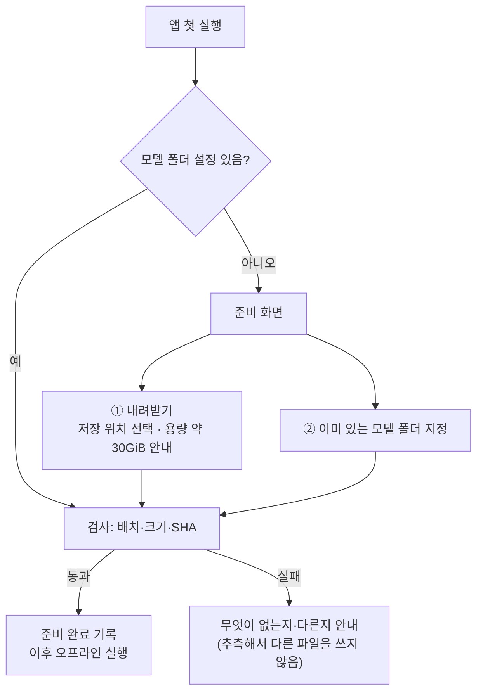

# 설치형 앱 패키징 준비 (2026-10-23)

> 지도 4절 병행 갈래(D-165·D-166). 새 GPU 시험·구매·외부 발송·공개 배포는 하지 않았다. 공유 캐시·기존 실행 환경은 지우거나 옮기지 않았다.
> 목표 형태: **무료 설치형 Windows 앱 + 최초 모델 준비, 준비 뒤에는 서버 없이 오프라인 실행**(사용자 결정 10/23).

## 결론

- **설치 방식은 '앱 + 최초 모델 준비'로 설계한다**(4절). 최초 준비는 ① 내려받기 ② 이미 있는 모델 폴더 지정 두 길이 있고, 준비가 끝나면 네트워크 없이 실행한다.
- **제품 의존 파일 목록은 '최소 목록'까지 확인했다**(2절). 완전한 목록이라고 확정하지 않는다.
  - 실행 관찰: 제품 단계가 실제로 연 모델 파일 11개(재시도 경로 포함). **첫 관찰은 GPU가 켜져 있었다(정정, 2-1).**
  - 조건부 경로(옷 바꾸기 재시도·머리색 복원·자동 보정·기억 연결) 관찰: 새 모델 파일 없음, 기억 연결은 사용자 데이터만(2-4).
  - 정적 확인: Qwen 작업 프로세스가 여는 파일(이번 관찰에서는 기존 결과 그림으로 대신해 실행하지 않음).
  - 조건부·미관찰: 실행 조건에 따라 열릴 수 있으나 이번에 지나가지 않은 경로.
- **경로 수정(모델만) 반영:** `GENAI_MODEL_HOME`(모델 폴더 한 곳)을 정하면 제품 모델을 그 아래 정해진 배치에서 찾는다(3절). 정하지 않으면 지금 경로를 그대로 쓴다 — 이 PC 동작은 바뀌지 않는다.
- 실행 환경 점검(1-3, CPU): **세 환경 모두 시스템 Python 3.10.6에 기대고**, Qwen 환경은 `.pth`로 주 환경 패키지를 쓴다(사실상 두 환경). 관절 분석 환경은 분리 유지(사용자 결정). Qwen 생성 호환은 GPU 확인 전.
- **모델 폴더 배치 확인(3-1, CPU):** 시험용 모델 폴더(복사본)만으로 제품 단계가 돌고 Qwen SHA 대조도 통과. 모델 폴더 밖으로 나간 것은 사용자 캐시의 HF 토큰 파일과 앱 폴더 파일뿐. WD 태거가 빠지면 안내 없이 진행되는 문제 → 준비 화면 검사로 막는다. 필수 파일 목록 초안 `configs/model_home_files.json`.
- **독립 실행 방식 추천: 공식 내장형 Python 3.10 두 벌(주·관절)**(4-1). 하위 프로세스 환경 변수는 필요한 이름만 명시적으로 넘기도록 코드 반영·CPU 검증(4-2). 제품 최소 패키지 목록 초안과 대조 도구(4-3). GPU 확인은 최종 패키징 검증 계획(4-4)에 넣었다.

## 1. 조사 목록 — 모델과 실행 환경을 나눈다

### 1-1. 모델 (용량·출처·라이선스는 HF 표시, 2026-10-23)

| 구성 요소 | 지금 위치 | 용량 | 출처·리비전 | 라이선스 | 제품 필요 근거 |
|---|---|---|---|---|---|
| Qwen-Image-Edit-2511(문자 인코더·VAE·설정 등) | `D:/genai-cache/models/Qwen-Image-Edit-2511` | 15.70GiB | Qwen/Qwen-Image-Edit-2511 @6f3ccc0b | Apache-2.0 | 정적(2-2) |
| Qwen 변환기 GGUF Q4_K_M | `D:/genai-cache/models/Qwen-Image-Edit-2511-GGUF/…Q4_K_M.gguf` | 12.34GiB | unsloth/Qwen-Image-Edit-2511-GGUF @0d33d969 | Apache-2.0 | 정적(2-2) |
| 머리 분할 체크포인트 l2d_sam | `D:\genai-cache\huggingface\models--24yearsold--l2d_sam_iter2` | 1.21GiB | 24yearsold/l2d_sam_iter2 | Apache-2.0 | **관찰**(옷 바꾸기·자세 장면) |
| 머리 분할 코드 see-through | `D:\genai-cache\tools\see-through` | 0.02GiB | shitagaki-lab/see-through @df019de5 | **확인 필요**(원본 LICENSE) | 정적(작업 프로세스가 코드 불러옴, .py는 관찰 대상에서 뺌) |
| WD 태거 v3 | `D:\genai-cache\huggingface\models--SmilingWolf--wd-vit-tagger-v3` | 0.35GiB | SmilingWolf/wd-vit-tagger-v3 @7f6b584d | Apache-2.0 | **관찰**(네 단계 모두) |
| 관절 분석 DWPose(easy-dwpose) | `D:\genai-cache\huggingface\easy-dwpose\checkpoints` | 0.33GiB | yzd-v/DWPose 가중치 | Apache-2.0 | **관찰**(입력 분석·옷 바꾸기·자세 장면) |
| 캐릭터 분할 anime-seg | `D:\genai-cache\huggingface\models--skytnt--anime-seg` | 0.16GiB | skytnt/anime-seg @493cb608 | Apache-2.0 | **관찰**(입력 분석) |
| 머리 검출 | **`\\192.168.0.109\win_g\genai-lab\outputs\…\model-cache\hub`** | (0.18GiB 중 일부) | deepghs/anime_head_detection @06604fee | MIT | **관찰**(입력 분석) |

**같은 캐시에 있지만 이번 관찰에서 열리지 않았고 제품 코드에서 참조도 찾지 못한 것:**

| 구성 요소 | 용량 | 판단 |
|---|---|---|
| deepghs/ccip_onnx(OpenRAIL) | 머리 검출 캐시 안 | 코드 참조 없음 → 넣지 않는 쪽. 다른 경로에서 쓰이는지 더 확인 |
| `models--yzd-v--DWPose`(두 번째 사본) | 0.33GiB | 제품은 easy-dwpose 쪽을 연다 → 넣지 않는 쪽 |

**시험 전용 — 넣지 않음:** 8단계 가속 LoRA(0.79GiB, D-141), 빌린 그림체 LoRA(0.22GiB, D-159·D-162), 손 검출(OpenRAIL, D-157).

### 1-2. 실행 환경 (Python — 이번 경로 수정 범위 밖)

| 환경 | 용량 | 쓰임(관찰) | 메모 |
|---|---|---|---|
| `D:\genai-cache\venv` | 5.93GiB | 작업실·분석·자세 장면 후처리(이번 관찰의 주 프로세스) | 시험 도구 등 개발용 패키지 함께 있음 |
| `D:\genai-cache\catvton-venv` | 0.83GiB | 관절 분석 하위 프로세스(easy_dwpose·onnxruntime) | 예전 CatVTON 이름이 남음 |
| `D:\genai-cache\qwen-test-venv` | 0.02GiB | Qwen 작업 프로세스(이번 관찰에서는 대신함) | `.pth`로 venv를 참조 |

- 주요 패키지 라이선스(설치본 LICENSE로 다시 확인): torch(BSD), diffusers·transformers(Apache-2.0), bitsandbytes·gguf·onnxruntime(MIT), **PySide6(LGPL-3.0 — 동적 연결 유지·교체 가능·문서 동봉)**.

### 1-3. 실행 환경 점검 결과 (CPU, 2026-10-23, D-169)

- 방법: ① 환경마다 `env_probe.py`를 격리 실행(`-I`)과 실제 실행 조건으로 돌려 기반 Python·`sys.path`·`.pth`·역할별 모듈 불러오기와 출처를 기록. ② 사용자 화면 단계(base4)와 시작 화면을 다시 돌리며 프로세스마다 실제 Python·불러온 모듈 위치·하위 프로세스 명령을 기록(`GENAI_OPEN_TRACE_MODULES`).
  - GPU 숨김(`-1`), Qwen 생성·머리 분할은 계속 기존 결과로 대신 → **Qwen 작업 프로세스·머리 분할 작업 프로세스는 실행 관찰이 없다**(불러오기 점검과 정적 확인만). Qwen 생성 호환은 GPU 확인 몫.
  - 원자료 `outputs/product-file-trace-20261023/env-probe/`, `env-base4/`, `env-startup/`.

| 확인 | 결과 |
|---|---|
| 기반 Python | **세 환경 모두 시스템 설치 Python 3.10.6(`C:\Program Files\Python310`)의 표준 라이브러리·DLL을 쓴다.** 환경 폴더만 복사해서는 다른 PC에서 돌지 않는다 → 설치형은 Python 자체를 함께 넣어야 한다(내장형 Python 등, 방식은 다음 결정) |
| Qwen 환경(`qwen-test-venv`) | 자체 패키지는 pip·setuptools뿐. `operation-venv.pth`가 **주 환경(`venv`) site-packages를 경로에 넣어** torch·diffusers·transformers·bitsandbytes·gguf·accelerate·safetensors를 모두 거기서 불러온다. 버전 계약(torch 2.9.1+cu128 등) 통과. → 사실상 주 환경과 같은 패키지 |
| `@app`(앱 자신의 Python) | 주 환경 Python을 고르게 된다. 위 결과대로 같은 패키지를 쓰는 셈이지만, **Qwen 생성이 그 실행 파일로 도는지는 GPU 확인 전** |
| 관절 분석 환경(`catvton-venv`) | easy_dwpose·onnxruntime 등 자체 패키지. 주 환경 참조 없음. 주 환경과 버전이 다름: **numpy 1.26.4 / 2.2.6, opencv 4.11 / 5.0, huggingface_hub 0.24.7 / 0.36.2** — easy_dwpose가 주 환경 버전에서 도는지는 확인 안 함(새 환경 설치가 필요) |
| 사용자 site-packages | 세 환경 모두 꺼짐(`include-system-site-packages = false`). 이 PC의 사용자 site(`%APPDATA%\Python\Python310`, 다른 프로젝트 패키지 다수)는 섞이지 않았다 |
| 프로세스별 모듈 출처(실행 관찰) | 작업실·파이프라인(주 환경), 특징 분석 하위 프로세스(주 환경), 관절 분석 하위 프로세스 5회(관절 환경) — **각자 자기 환경 모듈만** 불러왔다(경로 없는 내부 모듈 오탐 제외) |
| 하위 프로세스 시작 | 분석: `[pose_python 또는 analysis_python, genai_lab/studio_analysis.py, 모드, …]`, 작업 폴더 지정 없음(부모 것 물려받음), 환경 변수 **전부 물려받음**(PYTHONPATH 포함). 스크립트가 자기 위치로 저장소 루트를 경로에 넣는다. Qwen(정적): `[python_executable, -m, genai_lab.qwen_pose_worker, 요청]`, 작업 폴더 = 저장소 루트, **PYTHONPATH를 지운다**. 머리 분할(정적): `[analysis_python, -B, head_paste_worker.py, parts, 요청]` |
| 그 밖 | 각 프로세스가 `ver`(Windows 명령)를 한 번 실행한다(표준 platform 모듈). 주 환경 safetensors가 **0.9.0-rc.1(시험판)** 이다 — 재현 가능한 설치 목록에서는 고정 버전을 정해야 한다 |

**판단(설치형 구조 후보):**
- **환경은 둘로 둔다(현재 기준):** 주 환경(작업실·분석·Qwen) + 관절 분석 환경. 하나로 합치려면 easy_dwpose를 주 환경 버전(numpy 2 등)에서 확인해야 하고, 그 확인에는 새 환경 설치가 필요하다(승인 필요).
- Qwen 전용 환경은 따로 둘 이유가 기록상 없다(주 환경 패키지를 그대로 씀) — 합치는 쪽이 후보. 단 GPU 확인 전에는 바꾸지 않는다.
- 하위 프로세스에 물려줄 환경 변수는 앱이 정한다 → 4-2에서 반영(D-170).
- 설치 묶음 = 내장 Python 3.10 두 벌 + 주 환경 패키지 + 관절 환경 패키지 + 앱 코드 → 4-1(방식)·4-3(목록).
- **사용자 결정(10/23):** 관절 분석 환경은 분리 유지, easy_dwpose 주 환경 통합 시험은 보류. Qwen 환경도 지금 실행 경로 유지.

## 2. 제품 의존 파일 목록 — 근거별로 나눈다

### 2-1. 실행 관찰 (2026-10-23)

- 방법: 파일 열기 기록(파이썬 open 감사 + onnxruntime·safetensors·huggingface_hub·torch.load 감싸기, 두 번째 관찰부터 열린 핸들 표본 추가).
  - 도구 `scripts/product_file_trace/`, 원자료·요약 `outputs/product-file-trace-20261023/`(README 참고).
- **첫 관찰(정정 — GPU가 실제로 켜져 있었다):** PowerShell에서 `CUDA_VISIBLE_DEVICES`를 빈 값으로 설정하면 변수가 지워져 GPU가 보였다.
  - 머리 분할(l2d_sam)은 CUDA를 요구하는 코드라 GPU에서 4번 돌았다(각 최고 예약 5.08GiB). 이미지 생성은 아니다. 처음에 'GPU 사용 없음'이라고 적은 것은 틀렸다.
  - 단계: A 입력 분석(의상 있음, 79초) · B 기준 분석(의상 없음, 7초) · C 옷 바꾸기 파이프라인(68초) · D 자세·장면 파이프라인(111초, 피부 위반으로 재시도 경로까지) · S 작업실 시작 화면. Qwen 생성은 기존 B2 결과 그림(요청 34)으로 대신.
- **두 번째 관찰(GPU 숨김 확인):** `CUDA_VISIBLE_DEVICES=-1` + 시작 때 `torch.cuda.is_available()=False` 확인. Qwen 생성과 머리 분할(CUDA 필요)은 기존 결과로 **대신**하고 실행 폴더마다 표시했다. 결과는 2-4.

| 파일 | 단계 |
|---|---|
| WD 태거 `model.onnx`, `selected_tags.csv`(+ `refs/main`) | A·B·C·D |
| DWPose `dw-ll_ucoco_384.onnx`, `yolox_l.onnx` | A·C·D |
| l2d_sam `checkpoint-18000.pt` | C·D |
| anime-seg `isnetis.onnx`(+ `refs/main`) | A |
| anime_head_detection `head_detect_v2.0_s/model.onnx`, `model_type.json`(+ `refs/main`) — **네트워크 공유 폴더에서 열림** | A |
| 프로젝트 `configs/qwen_edit_settings.json`, `configs/studio_garment_warnings.json` | 시작·전 단계 |
| 프로젝트 `docs/FREE_GENERATION_CONTRACT.md`(trace에 SHA 기록) | D — **설치 묶음에 이 문서도 넣어야 한다** |
| 사용자 HF 토큰 파일 `~/.cache/huggingface/token` | A~D — huggingface_hub가 오프라인에서도 읽음. 제품 동작에는 불필요 |

### 2-2. 정적 확인 (코드에서 경로가 정해짐, 이번 관찰에서 실행하지 않음)

| 파일 | 근거 |
|---|---|
| `configs/qwen_model_files.json`(명세) + 명세의 모델 파일 27개(Qwen 폴더) | `qwen_pose_settings.validate_model_files` — **실행마다 전체 SHA 계산** |
| GGUF 파일 | 같은 함수 + `qwen_pose_worker` `from_single_file` |
| `configs/latent_rgb_preview.json` | 생성 과정 미리보기(`generation_preview.FACTORS`) |
| see-through 코드(`tools/see-through`) | `head_paste_worker` → `HeadSegmenter(semantic_repo, …)` |
| 캐릭터 기억 `%APPDATA%\GenAILab\character-memory` | 사용자 데이터(`character_memory`, 앱이 만든다 — 설치 묶음 아님) |

### 2-3. 조건부·미관찰 (열릴 수 있으나 아직 지나가지 않음 — 완전성 미확정)

- 팔·손 검사 실패 뒤 경로, 자세 골격 안내(`pose_guidance`, 제품 기본은 꺼짐)
- 머리 분할(l2d_sam)·Qwen 생성 단계: GPU가 필요해 두 번째 관찰에서는 대신함 → 첫 관찰(GPU 켜짐)과 정적 확인으로만 근거가 있다
- 저장(사용자 '저장' → 캐릭터 기억 등록·AI 표시 파일 쓰기) — 쓰기 경로라 이번 관찰(읽기) 범위 밖
- 핸들 표본으로도 잡히지 않는 파일(열었다 바로 닫은 C 확장 파일, 핸들 없이 매핑된 파일)

### 2-4. 조건부 경로 관찰 결과 (GPU 숨김, 2026-10-23)

| 장면 | 지나간 조건(실행 기록) | 기본 경로 밖에서 새로 연 파일 |
|---|---|---|
| 옷 바꾸기 재시도 | 첫 결과를 흰 그림으로 대신 → 머리 붙이기 실패("얼굴 특징점 부족") → 두 번째 seed 성공 | **없음**(WD 태거·DWPose만) |
| 머리색 복원 후보 | 10/23 GUI 결과 두 장: 두 시도 모두 머리색 위반 → `hair_restore` restored | **없음** — 보정은 코드(cv2)만 |
| 머리색 자동 보정 | 요청 35 M6: `hair_auto` auto_selected, 복원 후보도 생성 | **없음** |
| 기억된 캐릭터 연결 | 사용자 기억 **사본**으로 `auto_identity` → prefill = memory | 사용자 데이터만: `character-memory/characters/*.json`, `log.jsonl` |
| 사용자 화면 버튼 | 화면에 보이는 조작 7개: 캐릭터 선택·의상 선택·해제·이미지 생성·저장·원본 크기로 보기·장면 칸. 메뉴 없음 | — (개발 화면 기능으로 가는 버튼이 **보이지 않음**. 숨긴 위젯·단축키 경로는 미확인) |
| 기본 네 단계 다시(핸들 표본 추가) | A~D 모두 성공 | 핸들 표본에서 새 모델 파일 없음 |

- **열린 파일 = 그 경로에서 쓴 근거. 열리지 않은 파일 = 그 실행에서 안 썼다는 뜻**이다. 제품 전체에서 불필요하다는 뜻이 아니다.
- 사용자 기억 원본은 사본을 만들 때 **읽기만** 했다(수정 시각 10/22 그대로). 기억 사본은 저장소에 넣지 않는다.
- 핸들 표본이 알려 준 것: `D:\genai-cache`는 실제로 `D:\Model\genai-cache`를 가리키는 연결(정션)이다 — 설치형에서 경로를 비교할 때 실제 경로 기준으로 봐야 한다.
- 설치 파일 / 사용자 데이터 경계: 설치 묶음 = 모델(1-1)·프로젝트 설정(`configs/`)·`docs/FREE_GENERATION_CONTRACT.md`. 사용자 데이터 = `%APPDATA%\GenAILab\character-memory`(앱이 만들고 쓴다), 입력 그림, 실행 결과 폴더.
- 이번 관찰로 **넣을 모델 목록은 바뀌지 않았다**(1-1의 관찰 모델 + 정적 확인 Qwen 파일).

## 3. 경로 수정 — 모델만 (코드 반영, 2026-10-23)

- `genai_lab/model_home.py`: `GENAI_MODEL_HOME` → 모델 폴더 안 배치.

| 키 | 모델 폴더 안 위치 |
|---|---|
| Qwen 모델 폴더 | `qwen/Qwen-Image-Edit-2511` |
| GGUF | `qwen/Qwen-Image-Edit-2511-GGUF/qwen-image-edit-2511-Q4_K_M.gguf` |
| HF 캐시(WD 태거·anime-seg·l2d_sam) | `hf/` |
| DWPose | `dwpose/checkpoints` |
| 머리 검출 캐시 | `head-detection/hub` |
| see-through 코드 | `tools/see-through` |
| l2d_sam 체크포인트 | `hf/models--24yearsold--l2d_sam_iter2/snapshots/0b060831…/checkpoint-18000.pt` |

- `StudioRuntime` 기본값: 모델 폴더가 있으면 위 배치, 없으면 기존 경로(네트워크 공유 폴더 머리 검출 캐시 포함 — 이 PC 동작 그대로).
- `GENAI_STUDIO_RUNTIME` 설정 파일의 명시 값은 계속 가장 우선이다.
- Qwen 설정: 모델 폴더가 있으면 `configs/qwen_edit_settings.model_home.json`(모델 경로는 모델 폴더 기준 상대, 실행 환경 `@app` = 앱 자신의 Python)을 쓴다.
  - 기존 `qwen_edit_settings.json`과 경로 3개만 다르다(시험으로 고정).
  - `@app`은 임시 표기다. 앱 자신의 Python으로 Qwen 작업 프로세스가 도는지는 실행 환경 정리 단계에서 확인한다(지금은 GPU 확인 없음).
- 잘못된 모델 폴더(상대 경로·없는 폴더)는 추측하지 않고 오류로 알린다.
- 시험: `tests/test_model_home.py`(기존 경로 불변, 배치, 명시 설정 우선, 잘못된 값, 상대 경로 요건, 설정 차이 고정).

## 3-1. 모델 폴더 배치 확인 (CPU, 2026-10-23, D-171)

- 방법: 새 시험용 모델 폴더(`D:\genai-test\model-home-20261023`)에 3절 배치대로 **복사**(원본 캐시는 읽기만, 옮기거나 지우지 않음) → `GENAI_MODEL_HOME`으로 지정 → GPU 숨김 상태에서 점검 스크립트(`model_home_check.py`)와 제품 단계 장면(base4·옷 바꾸기 재시도·머리색 복원·자동 보정)을 돌리며 연 파일 기록.
  - 비교용으로 빈 모델 폴더, 분석 모델만 있는 폴더도 돌렸다(누락 안내 확인).
  - Qwen 생성과 머리 분할(GPU 단계)은 계속 기존 결과로 대신했다 → Qwen은 **파일 SHA 대조까지만**, 실제 불러오기·생성은 P5.
  - 원자료 `outputs/product-file-trace-20261023/model-home/`.

**결과:**
- **제품 모델 파일은 모두 시험용 모델 폴더에서 열렸다.** 공유 캐시(`D:\genai-cache\huggingface`)·네트워크 공유 폴더 캐시에서 연 모델 파일 0.
- Qwen 명세 27개 파일 + GGUF SHA 대조 통과(약 28GB, **199초** — 작업 프로세스가 실행마다 하는 검사와 같은 일, 이 PC D: 디스크·CPU 기준 한 번 측정. MEMORY_OPTIMIZATION_PLAN 10절 Q1의 첫 자료).
- 제품 단계 장면 4개 모두 성공.

**모델 폴더 밖으로 나간 경로:**

| 경로 | 종류 | 판단 |
|---|---|---|
| `C:\Users\<사용자>\.cache\huggingface\token` | **사용자 캐시** | huggingface_hub가 토큰을 찾느라 읽는다(오프라인이어도). 제품 동작엔 불필요 → **3-2에서 차단(접근 기록 0회 확인)** |
| `configs/qwen_edit_settings.model_home.json`·`qwen_model_files.json`·`studio_garment_warnings.json`, `docs/FREE_GENERATION_CONTRACT.md` | 앱 파일 | **앱 설치 폴더**에 들어갈 것. 개발 PC에서는 저장소(네트워크 공유)라 공유 폴더로 보일 뿐 |
| 실행 환경 파일(`D:\genai-cache\venv`·`catvton-venv`) | 실행 환경 | 패키지에서는 런타임 폴더(4-1). 모델 폴더와 별개 |

**구분(설치형):**

| 구분 | 들어가는 것 | 누가 만드나 |
|---|---|---|
| 앱 설치 폴더 | 런타임 두 벌, 앱 코드(`genai_lab`·제품에 쓰는 `scripts`·`gui_main.py`), `configs/`, `docs/FREE_GENERATION_CONTRACT.md`, 라이선스 고지 | 설치 프로그램 |
| 모델 폴더(사용자 지정) | 3절 배치의 모델·토크나이저·프로세서·설정(필수 목록 `configs/model_home_files.json` 초안 + Qwen 명세) | 최초 모델 준비(내려받기 또는 기존 폴더 지정) |
| 사용자 데이터 | `%APPDATA%\GenAILab`(캐릭터 기억 등), 입력 그림, 실행 결과 폴더 | 앱 실행 중 |

**제품 경로별 필수 파일(관찰·정적 근거):**

| 경로 | 필수 파일(모델 폴더 안) | 근거 |
|---|---|---|
| 입력 분석(의상 있음) | DWPose 2(`dwpose/checkpoints`), WD 태거(`hf/…wd-vit-tagger-v3` model.onnx·selected_tags.csv·refs), anime-seg(`hf/…anime-seg` isnetis.onnx·refs), 머리 검출(`head-detection/hub/…anime_head_detection` model.onnx·model_type.json·refs) | 관찰 |
| 기준 분석(의상 없음) | WD 태거 | 관찰 |
| 옷 바꾸기 | WD 태거, DWPose, 머리 분할(l2d_sam 체크포인트 + see-through 코드), Qwen(명세 27개: 토크나이저·프로세서·문자 인코더·VAE·스케줄러·설정 + GGUF) | 관찰 + 정적(GPU 단계) |
| 자세·장면 | 위와 같음(재시도·머리색 복원·자동 보정 경로에서 추가 파일 없음) | 관찰 + 정적 |
| 생성 과정 미리보기 | `configs/latent_rgb_preview.json`(앱 폴더) | 정적 |

**누락 시 안내(지금 코드):**

| 빠진 것 | 지금 사용자에게 보이는 것 | 판단 |
|---|---|---|
| Qwen 폴더·GGUF | "Qwen 모델 폴더을(를) 찾지 못했습니다: <경로>" — 생성 시작 전에 멈춤 | 안내 있음(조사 표기 다듬을 것) |
| DWPose | "설치된 자세 분석 모델이 없습니다: <경로>" — 입력 분석에서 멈춤 | 안내 있음 |
| **WD 태거** | **오류 없이 태그 0개로 진행**(기준 분석) — 자동 정체성이 비어 생성이 그대로 진행될 수 있음 | **안내 없음 → 3-2에서 막음**(시작 전 공통 검사 + 기준 분석이 실패를 빈 결과로 넘기지 않음) |
| anime-seg·머리 검출·머리 분할 | 하나씩 빼 본 시험은 아직 없음(분석은 첫 누락에서 멈춤) | 준비 화면 검사로 막는다. 개별 안내는 P3에서 확인 |

- **준비 완료 검사 기준(초안):** `configs/model_home_files.json`(분석 모델·머리 분할·see-through: 경로·크기·SHA) + `configs/qwen_model_files.json`·GGUF SHA. 준비 화면은 이 목록으로 '무엇이 없는지/다른지'를 파일 단위로 알려 준다(4절).

**패키지 사용 근거(목록에서 빼지 않음 — 독립 실행 확인 전):**

| 패키지 | 근거 | 지금 판단 |
|---|---|---|
| opencv-python / opencv-contrib-python | 불러온 cv2 파일 9개가 **contrib 판 기록과 모두 일치**(일반 판과는 2개 다름 — 나중에 설치된 contrib가 덮어씀). 코드에 contrib 전용 `cv2.ximgproc`(꼬리 복잡도 분석) 사용 | contrib가 실제 쓰이는 쪽. 일반 판 제거는 독립 실행 확인 뒤 |
| PySide6 분할 패키지 | 실제 불러온 Qt 파일은 Essentials(QtCore·QtGui·QtWidgets). Addons·Pdf·WebEngine의 근거는 함께 쓰는 `PySide6/__init__.py` 하나뿐 | 제거 후보, 독립 실행 확인 뒤 |
| setuptools | 불러온 것은 시작 때 `.pth`가 부르는 `_distutils_hack`뿐, 제품 코드 사용 근거 없음 | 제거 후보(내장형 런타임엔 그 `.pth`가 없다), 독립 실행 확인 뒤 |

## 3-2. 필수 모델 공통 검사 · 허깅페이스 토큰 차단 · 누락 안내 (코드 반영, 2026-10-23, D-172)

**공통 검사 `genai_lab/model_check.py`(준비 화면과 실제 실행이 같은 함수):**
- 목록: `configs/model_home_files.json`(분석 모델·머리 분할·see-through) + `configs/qwen_model_files.json`(Qwen 27개) + GGUF.
- 위치는 실행 설정(`StudioRuntime`·Qwen 설정)이 실제로 쓰는 곳 — 모델 폴더든 기존 개발 경로든 같은 검사.
- 흐름별 필수 구성: 의상 있음(outfit) = WD 태거·anime-seg·DWPose·머리 검출·머리 분할·see-through·Qwen, 의상 없음(staging) = WD 태거·DWPose·머리 분할·see-through·Qwen.
- 깊이: 실행 전 = 파일 있음·크기 같음(빠른 검사, 0.2초). 준비 화면 = `deep=True`(분석 모델 SHA + 기존 Qwen SHA 대조, 이 PC 213초).
- **사용자 화면 '이미지 생성'은 이 검사를 Qwen 설정 확인보다 먼저 부른다** → 빠진 모델을 한 번에 알리고, 분석·생성을 시작하지 않는다(`MissingModelFiles`, 성공으로 넘어가지 않음).
- 작업 프로세스가 실행마다 하는 Qwen SHA 검사는 **그대로**(이 검사로 대신하지 않음). 시간 비용만 기록: 199초(3-1)·213초(준비 화면 수준, 분석 모델 SHA 포함).

**안내 문구(필요한 모델 · 확인한 위치 · 할 일):**

```
필요한 모델 파일이 없거나 달라서 시작하지 않았습니다.
- 캐릭터 태그 분석 모델(WD 태거): 3개 파일 없음
  확인한 위치: <모델 폴더>\hf\models--SmilingWolf--wd-vit-tagger-v3
  · <파일 경로> (없음)  … 구성마다 3개까지, 나머지는 개수
할 일: 모델 준비를 다시 하거나(내려받기 또는 기존 모델 폴더 지정), 설정한 모델 폴더(GENAI_MODEL_HOME)가 맞는지 확인하세요. …
```

- 공통 검사 뒤에 있는 예전 안내도 같은 기준으로 고쳤다: WD 태거 준비 실패("인터넷 연결과 D:/genai-cache 여유 공간" → 확인한 위치 + 할 일), Qwen 설정 확인(조사 표기).

**WD 태거 누락 ≠ 태그가 안 나온 결과:**
- 기준 분석(`analyze_base`)은 태거를 불러오거나 실행하지 못하면(`None`) **멈춘다**(전에는 태그 0개로 조용히 진행). 태거가 돌았는데 태그가 없으면(빈 결과) 정상으로 진행.

**허깅페이스 토큰 차단:**
- 원인: huggingface_hub는 내려받기 요청 전에 `get_token()`으로 토큰 파일(`~/.cache/huggingface/token`)을 먼저 읽는다. 오프라인 설정(`HF_HUB_OFFLINE`)이나 `HF_HUB_DISABLE_IMPLICIT_TOKEN`으로는 막히지 않는다(설치본 0.36.2·0.24.7 코드 확인).
- 처리: 작업실 시작 때(`gui_main.py`, 무거운 라이브러리보다 먼저)와 하위 프로세스 환경(`child_environment`)에서 `HF_TOKEN`·`HUGGING_FACE_HUB_TOKEN`을 빼고 `HF_TOKEN_PATH`를 앱 데이터의 빈 경로(`%APPDATA%\GenAILab\hf-token-disabled\token`, 만들지 않음)로 둔다.
- **사용자 토큰 파일은 읽지도, 고치지도, 지우지도 않는다.**
- 확인(접근 기록): 빈 폴더·WD 없는 폴더·전체 폴더 점검과 제품 단계 실행 — **사용자 토큰 파일 열기 0회**(전: 매 단계 열림). 앱 쪽 빈 경로를 찾는 기록만 있고 그 파일은 생기지 않았다. 시험 `tests/test_hf_credentials.py`는 대조(막지 않으면 시험용 토큰을 읽음)와 차단(열지 않음)을 함께 본다.

**CPU 검증 범위 / 실제 GPU 실행:**
- CPU: 위 접근 기록, 누락 폴더 3종(빈 폴더·WD 없음·전체) 점검, 제품 단계 장면(GPU 숨김, Qwen 생성·머리 분할은 기존 결과로 대신).
- **GPU 실행: 하지 않았다.** Qwen·머리 분할 작업 프로세스를 이 변경과 함께 실제로 돌린 것은 P4·P5 몫.

## 4. 최초 모델 준비 설계 (설계만 — 구현 전)

**흐름(앱 첫 실행, 모델 폴더가 없을 때):**



| 항목 | 설계 |
|---|---|
| 내려받기 | 허깅페이스 저장소·**고정 리비전**·파일 목록(1-1)만. 받은 파일은 SHA 대조. 이어받기·취소 지원. 받기 전 라이선스 고지·동의 화면 |
| 기존 폴더 지정 | 사용자가 고른 폴더를 3절 배치로 검사. 배치가 다르면(예: 지금 개발 PC의 `D:\genai-cache`) 파일별 위치를 지정하는 대응표를 만들 수 있게 한다. **파일을 옮기거나 지우지 않는다** |
| 검사 | **공통 검사 `model_check.check_models(..., deep=True)`(3-2)를 그대로 부른다** — 실행 전 빠른 검사와 같은 함수·같은 목록. 결과(무엇이 없는지/다른지)를 파일 단위로 화면에 보이고, 준비·검사 기록을 남긴다(파일·크기·SHA·검사 시각). **작업 프로세스의 실행마다 검사(약 28GB SHA)는 그대로 둔다.** 크기·수정 시각이 같아도 내용이 같다는 보장은 없어서, 재검증 비용을 줄이는 변경은 측정과 변경 검출 정책을 갖춘 별도 과제로 다룬다(MEMORY_OPTIMIZATION_PLAN 10절 Q1) |
| 오프라인 | 준비 뒤에는 `HF_HUB_OFFLINE=1` 등으로 네트워크 없이. 이미 하위 분석 프로세스는 오프라인 설정으로 돈다 |
| 고지 | 1-1 라이선스 목록·고지문을 앱 '정보' 화면과 설치 폴더에 둔다. OpenRAIL 모델은 넣지 않는 쪽 |
| 저장 위치 | 기본은 사용자가 고른 드라이브. 용량 부족이면 시작 전에 알림 |

**결정이 남은 것:** 내려받기 출처(허깅페이스 직접 / 자체 배포 서버), 파일별 대응표 화면을 첫 판에 넣을지.

### 4-0. 최초 모델 준비 화면 — 1단계 구현 (2026-10-23, D-173)

> 범위(사용자): 기존 로컬 모델 폴더 선택 · 저장 · 공통 깊은 검사 · 결과 안내 · 재검사. **자동 내려받기·모델 이동·삭제·복구, SHA 정책 변경, 패키지 축소는 하지 않는다.**

| 항목 | 구현 |
|---|---|
| 화면 | `genai_lab/model_setup_ui.py` `ModelSetupWindow`: 폴더 선택 · 검사/재검사 · 검사 취소 · 결과 안내 · 작업실 열기 |
| 검사 | `genai_lab/model_setup.py`: 선택한 폴더 배치로 공통 검사(`model_check.check_models`, `deep=True`, 의상 있음 흐름 = 전체 구성)를 **별도 프로세스**(`python -m genai_lab.model_setup check …`)에서 실행 → 화면은 멈추지 않음. 진행 문장은 구성마다 표시 |
| 중복 실행 | 검사 중에는 검사·폴더 선택 버튼을 막고, 다시 시작 요청은 거절 |
| 폴더 바뀜·결과 혼동 | 결과에 실행 번호·검사한 폴더를 넣고, 지금 실행·지금 폴더와 같을 때만 받음(다르면 버리고 다시 검사 안내) |
| 취소·중단 | 취소 = 검사 프로세스 종료. 취소·비정상 종료·결과 파일 없음은 **저장하지 않음**. 창을 닫으면 돌던 검사도 끝냄 |
| 저장 | `%APPDATA%\GenAILab\model-setup.json`: 끝까지 마친 결과만. 문제 0 = `files_verified`, 문제 있음 = `files_check_failed`(안내 문구 함께). 검사 목록(`model_home_files.json`·Qwen 명세·GGUF SHA)의 지문을 함께 저장해, 목록이 바뀌면 다시 검사 |
| 두 검증 구분 | 화면·기록 모두 **'모델 파일 검증: 완료(있음·크기·SHA)'** 와 **'GPU 생성 검증: 아직 안 됨'**(`gpu_generation_verified: false`)을 따로 표시. 생성 검증은 첫 생성·P4·P5 |
| 작업실 연결 | 검증 완료 폴더에서만 '작업실 열기' → `GENAI_MODEL_HOME`을 그 폴더로 두고 작업실. **'이미지 생성' 전 빠른 검사(D-172)는 그대로** |
| 작업실 시작 판단(`gui_main.py`) | 사용자가 `GENAI_MODEL_HOME`을 정함 → 그대로 작업실 / 검증 완료 기록 → 그 폴더로 작업실 / 기록이 없어도 지금 경로가 빠른 검사 통과 → 작업실(**개발 PC 기존 방식 유지**) / 그 밖 → 준비 화면. `--model-setup`으로 준비 화면을 직접 열 수 있음 |

**CPU 검증(실제 검사 프로세스, 화면 없이 띄움, 기록은 시험용 파일 — 사용자 `%APPDATA%` 기록은 쓰지 않음):**

| 시험 | 결과 |
|---|---|
| 전체 시험용 모델 폴더 깊은 검사 | 184초 만에 `files_verified`, `gpu_generation_verified: false`, '작업실 열기' 켜짐. 검사 중 100ms 타이머가 기대의 91% 돌아 **화면이 멈추지 않음**. 구성마다 진행 문장 표시 |
| 같은 폴더 검사 40초 뒤 취소 | 검사 프로세스 종료, "검사를 취소했습니다. 저장하지 않았습니다." **기록 파일 없음** |
| WD 태거 없는 폴더 | 18초, `files_check_failed`(문제 31개: WD 태거 3 + Qwen), 안내에 모델·확인한 위치·파일·할 일, '작업실 열기' 꺼짐 |
| 검사 중 다시 시작·폴더 바꾸기 | 세 시험 모두 거절됨 |
| 이 PC 시작 판단(기록 없음) | `studio`, 모델 폴더 없음 → 지금처럼 기존 경로로 작업실 |
| 시험 코드(`tests/test_model_setup.py`) | 성공·중복·폴더 바뀜·취소·비정상 종료·다른 폴더 결과·실패 안내·목록 지문·시작 판단 |

- 발견해 고친 것: 검사 프로세스가 진행 문장을 Windows 기본 인코딩으로 내보내 화면에서 깨짐 → 검사 프로세스에 UTF-8 출력 지정.
- **GPU 실행: 없음.** 이 화면은 파일만 확인한다.

## 4-1. 독립 실행 패키지 방식 — 추천 (2026-10-23, D-170)

> 목표(사용자): **Python을 따로 설치하지 않아도 되는 독립 실행 패키지.** 관절 분석 환경은 분리 유지, Qwen 실행 경로는 유지.

**지금 구조에서 방식을 고르는 조건(1-3 관찰):**
- 하위 프로세스가 '다른 Python 실행 파일 + 파일 경로 스크립트' 또는 '`-m` 모듈'로 뜬다(분석 `studio_analysis.py`, 머리 분할 `outfit_edit_worker.py`, Qwen `-m genai_lab.qwen_pose_worker`).
- 실행 환경이 둘이다(주 / 관절 분석, numpy 등 버전이 다름).
- torch·diffusers·transformers는 실행 중에 모듈을 늦게 불러오는 것이 많다. PySide6는 플러그인 폴더가 있다.

| 방식 | 판단 | 이유 |
|---|---|---|
| **A. 공식 내장형 Python(embeddable, 3.10) 두 벌 — 추천** | 추천 | 지금의 '환경마다 다른 python.exe' 구조를 그대로 옮길 수 있다. 런타임마다 `python310._pth`로 경로를 고정하므로, 사용자 PC의 PYTHONPATH·사용자 site·다른 Python이 섞이지 않는다. 패키지는 빌드 때 그 폴더에 설치(`pip --target`)한다. 하위 프로세스 코드는 실행 파일 경로만 바꾸면 된다 |
| B. PyInstaller·Nuitka 묶기(freeze) | 비추천 | 파일 경로 스크립트·`-m` 작업 프로세스마다 따로 실행 파일을 만들어야 하고, 실행 코드도 바꿔야 한다. torch·diffusers의 늦은 import와 큰 용량 때문에 빠진 모듈을 찾는 시행착오가 크다 |
| C. 지금 venv 폴더 복사 | 불가 | `pyvenv.cfg`가 시스템 Python(`C:\Program Files\Python310`)을 가리켜 다른 PC에서 돌지 않는다(1-3) |
| D. conda-pack 등 | 보류 | 가능하지만 conda를 새로 들여야 하고, A로 충분하다 |

**A안 배치(초안):**

```
GenAILab/
  runtime-main/   python.exe(내장형 3.10) + python310._pth + Lib/site-packages ← packaging/requirements-main.txt
  runtime-pose/   python.exe(내장형 3.10) + python310._pth + Lib/site-packages ← packaging/requirements-pose.txt
  app/            genai_lab/ · scripts/(제품에 쓰는 것) · configs/ · gui_main.py · docs/FREE_GENERATION_CONTRACT.md · 라이선스 고지
  GenAILab.exe    작은 실행기(runtime-main\pythonw.exe app\gui_main.py) — 방식은 빌드 때 정함
모델 폴더(최초 준비, 4절) — GENAI_MODEL_HOME
사용자 데이터 — %APPDATA%\GenAILab
```

- 두 런타임의 `._pth`에 `app` 폴더를 넣는다. `._pth`가 있으면 모듈 경로가 그 파일 내용으로 고정되므로, 지금 Qwen `-m` 실행이 작업 폴더(저장소 루트)에 기대는 부분을 `._pth`의 `app` 줄로 대신한다(작업 폴더가 경로에 들어가는지는 빌드 때 P2에서 확인).
- 실행 설정: `pose_python = runtime-pose\python.exe`, `analysis_python = runtime-main\python.exe`. Qwen은 **지금 실행 경로 유지**(설정의 `python_executable`) — 패키지에서는 그 값이 `runtime-main\python.exe`가 된다. Qwen 전용 런타임은 만들지 않는다(지금도 주 환경 패키지를 씀, 1-3).
- 하위 프로세스 환경 변수는 앱이 정한다(4-2).
- 확인할 것(빌드·검증 때): VC++ 런타임 DLL(내장형에 vcruntime140 포함, 나머지 확인), PySide6 플러그인 경로, torch CUDA DLL(휠 안에 포함). NVIDIA 드라이버는 사용자 PC에 있어야 한다(설치 요건으로 안내).
- 용량(대략): 모델 약 30GiB(최초 준비) + 런타임 두 벌(현재 환경 기준 약 7GiB, 목록 정리 뒤 줄어듦).

## 4-2. 하위 프로세스 환경 변수 (코드 반영, 2026-10-23, D-170)

- `genai_lab/child_env.py` `child_environment()`: 부모 환경을 통째로 넘기지 않고 **필요한 이름만** 넘긴 뒤 제품 고정값을 덮어쓴다. 전부 지우지 않는다.

| 넘기는 것 | 이유 |
|---|---|
| Windows·사용자 폴더·임시 폴더·실행 경로: SYSTEMROOT·WINDIR·COMSPEC·PATH·PATHEXT·TEMP·TMP·USERPROFILE·APPDATA·LOCALAPPDATA·PROGRAMDATA·PROGRAMFILES 등, 프로세서 정보 | Python·torch·onnxruntime이 DLL·임시 파일·사용자 폴더를 찾는다. 표준 platform 모듈은 COMSPEC로 `ver`를 실행한다 |
| GPU·스레드: `CUDA_*`·`PYTORCH_*`·`NVIDIA_*`·`CUBLAS_*`·`CUDNN_*`, OMP·MKL·OPENBLAS·NUMEXPR 스레드 수 | 사용자가 정했으면 따른다 |
| 앱 설정: `GENAI_MODEL_HOME`·`GENAI_CHARACTER_MEMORY`·`GENAI_STUDIO_RUNTIME`·`GENAI_QWEN_SETTINGS`·`GENAI_VISION_SETTINGS`·`GENAI_STUDIO_DEVELOPER`, `HF_HOME`·`HF_HUB_CACHE` | 코드가 읽는 설정 |
| **고정값(덮어씀):** `HF_HUB_OFFLINE=1`·`TRANSFORMERS_OFFLINE=1`·`PYTHONDONTWRITEBYTECODE=1` | 오프라인 실행, 앱 폴더에 캐시 파일을 쓰지 않음 |

- **넘기지 않는 예:** `PYTHONPATH`·`PYTHONHOME`·`PYTHONSTARTUP`·`VIRTUAL_ENV`·`CONDA_*`, 다른 프로그램의 토큰 등. 개발 중 더 넘길 것은 `GENAI_CHILD_ENV_EXTRA`에 이름을 적을 때만(관찰 도구가 사용).
- 적용한 곳(제품 경로 4곳): 분석 실행기(`cpu_process`, 관절·특징), 머리 분할 작업 프로세스, 관절 검사, Qwen 작업 프로세스. 개발 화면 전용 호출은 바꾸지 않았다. `cpu_process`를 함께 쓰는 개발 기능(정체성 측정·마무리·비율)도 같은 구성을 받는다.
- **CPU 검증:** 부모에 시험용 변수(VIRTUAL_ENV·CONDA_PREFIX·PYTHONSTARTUP·임의 토큰)를 넣고 사용자 화면 네 단계를 다시 돌렸다(`env-base4-explicit`). 하위 프로세스 7개 모두 정상, 시험용 변수는 하나도 넘어가지 않음, 받은 변수 107개 → 40~41개. 실제 하위 Python 시작 시험(`tests/test_child_env.py`) 포함.
- PATH는 지금 부모 값을 그대로 넘긴다. 패키지에서는 앱 런타임 폴더 + Windows 시스템 폴더로 좁히는 것을 검증 계획에 넣는다(5절 이후 최종 검증).
- **상태: CPU 검증만 — 생성 검증 전.** GPU 작업 프로세스(Qwen·머리 분할)를 이 구성으로 실제 실행한 것은 아직 없다 → 최종 패키징 검증 계획(4-4) P4·P5.
- 이 PC에서 생성 중 문제가 생기면 작업 프로세스 기록(`worker.log`·`run.final.json`·`launcher.json`)을 근거로 판단한다. 이 변경을 원인으로 미리 단정하지 않는다(되돌릴 때도 기록으로 확인한 뒤).

## 4-3. 제품 최소 패키지 목록 (초안, 2026-10-23, D-170)

- `packaging/requirements-main.txt`(67개), `packaging/requirements-pose.txt`(24개) — 지금 개발 PC 환경의 버전 그대로 고정.
- 근거: 사용자 화면 단계를 실제로 돌린 프로세스가 불러온 모듈 + 작업 프로세스 불러오기 점검(Qwen 작업 프로세스의 함수 안 import, 머리 분할의 see-through 코드). 원자료 `outputs/product-file-trace-20261023/packages/`.
- 대조 도구 `scripts/check_product_packages.py`: 세 환경 모두 목록과 설치 버전 일치(문제 0). Qwen 환경도 주 환경 목록과 같음(.pth).
- **safetensors 0.9.0rc1(시험판)은 확인된 버전 그대로 고정했다.** 안정판 교체는 이번 정리와 섞지 않는다. 교체한다면 별도 과제로: 근거(시험판 사용 위험·안정판 출시 여부) + 검증 범위(GGUF·LoRA 불러오기, Qwen 생성 같은 seed 결과 비교 — GPU).
- 확인이 남은 것(목록에 표시): opencv 두 종류(cv2를 함께 제공 — 하나만 넣는 쪽), PySide6 분할 패키지(WebEngine·Pdf 등은 아마 불필요), setuptools(pkg_resources 사용 여부).
- 관찰하지 않은 지연 import는 빠질 수 있다 → 깨끗한 런타임에 목록대로 설치해 CPU·GPU 단계를 돌려 확정한다(4-4).

## 4-4. 최종 패키징 검증 계획 (GPU 포함 — 실행은 승인 뒤)

| 순서 | 검증 | GPU | 통과 기준 |
|---|---|---|---|
| P1 | 내장형 런타임 두 벌에 목록대로 설치(빌드 PC), `check_product_packages.py` — **10/23 배포 후보(복사 빌드)로 통과, 4-4-1 · 공식 내장형 3.10.6 후보로 다시 통과, 4-4-2** | 없음 | 문제 0 |
| P2 | 패키지 배치에서 CPU 단계(관찰 도구 `scenarios.py` base4·조건부 장면) — 시스템 Python을 PATH에서 뺀 상태 — **10/23 통과(base4), 4-4-1 · 내장형 후보로 다시 통과, 4-4-2** | 없음 | 모든 프로세스의 `sys.base_prefix`가 패키지 런타임, 시스템 Python·개발 venv 파일을 하나도 열지 않음 |
| P3 | 모델 폴더(`GENAI_MODEL_HOME`) + 시험용 캐시·사용자 폴더 분리 + 네트워크 끊고 CPU 단계 — **10/23 통과(연결 시도 관찰 0, 네트워크를 실제로 끊지는 않음), 4-4-1 · 내장형 후보로 다시 통과, 4-4-2** | 없음 | 공유 캐시를 열지 않음, 누락 파일 목록 0 |
| P4 | **머리 분할 작업 프로세스**(GPU 필요)를 패키지 런타임·명시적 환경 변수로 실행 — **10/24 내장형 3.10.6 후보로 통과(요청 37), 4-4-3** | 있음 | 분할 결과가 개발 환경 결과와 같음, 최고 예약 메모리 기록 |
| P5 | **Qwen 작업 프로세스를 주 런타임으로 연결하는 변경**의 검증: 설정 `python_executable`을 지금의 `qwen-test-venv`에서 주 런타임(`runtime-main\python.exe`, 개발 PC에서는 `@app` = 주 환경 Python)으로 바꾸고, 명시적 환경 변수(4-2)로 실행 — 사용자 화면 흐름 2줄(의상 있음·없음) — **10/24 내장형 3.10.6 후보로 통과, 개발 결과와 같은 그림(요청 37), 4-4-3** | 있음 | 생성 완료, 메모리 상한 6.5GiB 이하, 같은 입력·seed에서 개발 환경 결과와 비교(같은 버전이면 같은 그림을 기대 — 다르면 원인 기록). **이 검증 전까지 주 런타임 연결과 새 환경 변수 구성은 '생성 검증 완료'가 아니다** |
| P6 | PATH를 앱 런타임 + Windows 시스템 폴더로 좁혀 P4·P5 반복 — 요청 37 실행기가 처음부터 좁힌 PATH로 돌아 함께 확인 — **10/24 통과, 4-4-3** | 있음 | 같은 결과 |
| P7 | 다른 PC(깨끗한 Windows)에서 설치 → 최초 모델 준비 → 첫 생성(배포 호환성) | 있음 | 지도 다음 단계 |

## 4-4-1. P1~P3 결과 — 배포 후보 폴더로 (CPU, 2026-10-23, D-174)

> 범위(사용자): 소스 실행이 아니라 배포 후보 폴더의 실행기로. 시스템 Python·개발 환경·공유 캐시를 참조하지 않는지, 기존 설치는 지우지 않고 격리된 환경에서. 내려받기·파일 대응표는 보류. **P4·P5(GPU) 제외.**

**배포 후보(P1):** `D:\genai-test\배포 후보 GenAILab-20261023`(경로에 공백·한글) — `packaging/build_candidate.py`
- 내려받기 없이 **복사만**: Python 3.10.6 본체(시스템 설치본에서 실행 파일·DLL·표준 라이브러리만) + `python310._pth`, 패키지는 `packaging/requirements-*.txt`에 있는 배포만 각 설치 기록(RECORD)대로 기존 환경에서. 원본은 읽기만.
- 크기: runtime-main 5.72GiB(67개, 파일 42,650), runtime-pose 0.76GiB(24개, 파일 19,288), app(코드·configs·docs).
- 실행기 `GenAILab.cmd`: `GENAI_APP_HOME`을 설치 폴더로 두고 runtime-main으로 작업실.
- **P1 대조(`check_product_packages.py`, 배포 후보 런타임으로):** 두 런타임 모두 문제 0, 목록 밖 패키지 0.
- **발견 1 — `._pth`의 `import site`:** 넣으면 사용자 폴더의 Python 패키지(`%APPDATA%\Python\Python310\site-packages`)가 경로에 섞였다(이 PC: 다른 프로젝트의 torch 2.5.1 → 대조에서 버전 14·11개 다름). → **배포용 `._pth`에서 뺐다**(공식 내장형 기본값과 같음). 뺀 뒤 사용자·개발 경로 0.
- **발견 2 — `run.py` 누락:** `gui_main.py`가 저장소 루트의 `run.py`를 불러오는데 앱 파일 목록에 없었다(첫 시도에서 `No module named 'run'`). → 빌드 목록에 추가. 첫 시도 기록은 `p2p3/attempt1-missing-run-py/`에 보존.
- 최종 배포에서는 Python 본체를 공식 내장형 배포판으로 바꾼다(내려받기 승인 뒤). 라이선스 고지 동봉도 그때. → 10/23 내장형 후보 빌드·검증(4-4-2). 라이선스 고지는 설치 프로그램 단계에서.

**배포판 모드(코드, D-174):** `genai_lab/app_home.py` — 실행기가 알려 준 설치 폴더(`GENAI_APP_HOME`)의 런타임을 쓴다(관절 분석 = runtime-pose).
- 배포판은 개발 기본 경로(`D:\genai-cache` 등)로 넘어가지 않는다: 모델 폴더가 없으면 설치 폴더 안의 '모델 폴더 미설정' 자리를 가리켜 검사가 막는다. Qwen 설정도 모델 폴더용 파일.
- 배포판 첫 실행은 **검증 기록이 없으면 준비 화면**(개발 실행의 '지금 경로 빠른 검사 통과 → 작업실' 우회를 쓰지 않음).
- 준비 화면 첫 안내가 상황을 구분: 처음 / 기록된 폴더를 찾을 수 없음(옮겼거나 지움 — 새 위치를 고르라는 안내) / 검사 목록 바뀜 / 지난 검사 실패.

**격리 검증(P2·P3) — `packaging/run_isolated_check.py`:**
- 환경 변수를 처음부터 구성: PATH = 배포 후보 runtime-main + Windows 폴더(시스템 Python·개발 venv 없음), 사용자 폴더 = 가짜 폴더(`sandbox-profile-*`), GPU 숨김.
- 두 가지로 실행: **release**(배포용 `._pth` 그대로, 기록 도구 없음 — 기능 확인) / **trace**(기록 도구를 쓰려고 `._pth`에 `import site`를 임시로 넣고 sitecustomize 복사 — 가짜 사용자 폴더라 사용자 site-packages는 없음. 끝나고 원래대로 되돌림, 확인함).
- 모델 폴더: 시험용 모델 폴더를 **공백·한글 경로**(`D:\genai-test\모델 폴더 (공백 한글)\model home 20261023`)로 이름을 옮겨 쓰고 끝나면 원래 이름으로 되돌림(내용 그대로, 확인함).
- Qwen 생성·머리 분할(GPU 단계)은 계속 기존 결과로 대신(실행 폴더마다 표시).

| 단계(앱 실행 1회씩) | release | trace |
|---|---|---|
| 첫 실행(기록 없음) | 준비 화면("아직 준비되지 않았습니다") → 공백·한글 경로 폴더 선택 → 깊은 검사 219.7초 → `files_verified`, GPU 생성 검증 '아직 안 됨' → 작업실 열기 → 종료 | 같음(211.7초) |
| 재실행 | 기록으로 바로 작업실 → '이미지 생성' 전 빠른 검사 두 흐름 통과 → 제품 CPU 단계 4개 성공(관절 분석은 runtime-pose) → 종료 | 같음 |
| 모델 폴더를 옮긴 뒤 | 준비 화면 + "기록된 모델 폴더를 찾을 수 없습니다(옮겼거나 지웠을 수 있습니다): <경로> 옮겼다면 새 위치를 고르고 다시 검사하세요." | 같음 |
| 기록은 있는데 파일이 빠짐(WD 태거 없는 폴더, **시험용으로 직접 쓴 기록**) | 작업실은 열림 → '이미지 생성' 즉시 막힘, 분석 시작 안 함, 안내: WD 태거 3개 파일 없음 + 위치 + 할 일 | 같음 |

- 첫 release '재실행'은 제 진행 스크립트 버그(기록 도구 없을 때 표시 함수가 환경 변수를 요구)로 장면 단계가 돌지 않아, 고친 뒤 그 단계만 다시 돌렸다(첫 시도 기록 `report-second-attempt1.json` 보존).

**trace 판정(`packaging/analyze_isolated_trace.py`):**
- **금지 위치 접근 0**: 시스템 Python, 개발 환경(venv), 공유 캐시(`D:\genai-cache`·네트워크 공유 모델 캐시), 실제 사용자 폴더, 저장소 코드·설정. 허용 위치 372개 파일, 시험 입력 8개(저장소 outputs의 기존 결과·Downloads 참고 그림 — 앱 파일 아님).
- **프로세스 12개 모두 배포 후보 런타임**(`sys.base_prefix`가 후보 안, 후보 밖 모듈 0, 후보 밖 `sys.path` 0): 작업실·준비 화면·깊은 검사 프로세스·관절 분석(runtime-pose)·특징 분석(runtime-main).
- 하위 프로세스 명령: runtime-pose / runtime-main python.exe, PYTHONPATH 전달 없음. 표준 platform 모듈의 `ver`(Windows 명령)만 추가로 실행.

**오프라인 — 관찰 범위:**
- 설정: 하위 프로세스는 `HF_HUB_OFFLINE`·`TRANSFORMERS_OFFLINE` 고정(child_environment), 토큰 경로 차단(D-172).
- **연결 시도 관찰: 0건.** (1) 파이썬 감사 이벤트 `socket.connect`·`getaddrinfo`·`sendto`·`gethostbyname`·`urllib.Request`·`http.client.connect` — 모든 배포 후보 프로세스, (2) 프로세스별 운영체제 연결 표본(0.5초마다 TCP/UDP) — 원격 주소 있는 연결 0.
- 범위 밖: 0.5초보다 짧게 열렸다 닫힌 네이티브 연결, 배포 후보 밖 프로세스, 네트워크를 실제로 끊은 상태(방화벽·어댑터 차단은 시스템 설정이라 하지 않음), GPU 단계(Qwen·머리 분할 — 대신함).

**실행기(`GenAILab.cmd`)로 확인 — `packaging/launcher_check.py`(같은 격리 환경, 화면 없이 띄운 뒤 시작 판단 출력 확인하고 종료):**

| 경우 | 시작 판단(작업실 출력) | 실행 프로세스 |
|---|---|---|
| 새 사용자(기록 없음) | `setup` — "모델 폴더가 아직 준비되지 않았습니다…" | 배포 후보 runtime-main\python.exe |
| 검증 기록 있는 사용자 | `studio` — 공백·한글 경로 모델 폴더 | 같음 |
| 모델 폴더를 옮긴 뒤 | `setup` — "기록된 모델 폴더를 찾을 수 없습니다…" | 같음 |

- 작업실 시작 판단을 출력 한 줄로 남기도록 했다(`시작 판단: …`). 배포 런타임은 `PYTHON*` 환경 변수를 무시하므로(`._pth`) 파이프 출력 인코딩은 Windows 기본값일 수 있다.

**GPU 실행: 없음.** P4(머리 분할)·P5(Qwen 주 런타임 연결 + 명시적 환경 변수) 몫. 남은 것: 깨끗한 다른 PC(P7), 공식 내장형 Python으로 바꾼 최종 빌드(→ 4-4-2).

## 4-4-2. 공식 내장형 Python 후보 — 출처 검증·빌드·P1~P3 다시 확인·파일 목록 고정 (CPU, 2026-10-23, D-175)

> 범위(사용자): 승인한 파일 3개 내려받기·출처 검증, 새 배포 후보 빌드, 영향받는 CPU 경로 검증. 기존 후보·패키지 버전 유지. MD5는 공개값 대조용, 출처는 검증된 키 지문·서명 검증으로, 서명이 예상과 다르면 우회하지 않고 보고. **P4·P5는 요청서까지, GPU 실행은 별도 승인.** 개발 환경 재생성은 기본 절차에서 제외. 기존 결과와 먼저 비교하고, 오류·설명되지 않는 차이가 있을 때만 대조 실행 제안(런타임 외 조건 고정).

**내려받기(승인한 3개)** — 전용 폴더 `D:\genai-test\python-embed-3.10.6\`, 경로로만 다룸(그 폴더에서 실행하지 않음):

| 파일 | 출처 | 크기 |
|---|---|---|
| `python-3.10.6-embed-amd64.zip` | https://www.python.org/ftp/python/3.10.6/python-3.10.6-embed-amd64.zip | 8,585,728 B |
| `python-3.10.6-embed-amd64.zip.asc`(서명) | 같은 위치 `.asc` | 836 B |
| `stevedower.asc`(서명 키) | https://keybase.io/stevedower/pgp_keys.asc (python.org 서명 키 안내가 가리키는 곳) | 3,182 B |

**출처 검증 — 모두 예상대로(우회 없음):**
- MD5 `37303f03e19563fa87722d9df11d0fa0` = python.org 3.10.6 릴리스 페이지 공개값. (대조용일 뿐 출처 근거로 쓰지 않음)
- GPG(임시 키 저장소 `gnupg-temp` — 사용자 키 저장소는 건드리지 않음): `GOODSIG`, `VALIDSIG 7ED10B6531D7C8E1BC296021FC624643487034E5`(서명일 2022-08-01), 서명자 "Steve Dower (Python Release Signing)". 키 지문 = python.org 공개값.
  - 신뢰도 표시 `[unknown]`은 새로 들여온 키에 신뢰를 부여하지 않아서 나오는 정상 표시다(신뢰를 임의로 올리지 않았다).
  - 키의 두 번째 지문 `8E4CA3708D521D8056B1FD9DE314D10907F87583`은 암호화 전용 하위 키(용도 e). 서명은 주 키로 만들어졌다.
- Authenticode(zip을 따로 푼 확인용 폴더에서): python.exe·pythonw.exe·python310.dll·python3.dll = Python Software Foundation(유효), vcruntime140.dll = Microsoft(유효). 제품 버전 3.10.6. python310.dll은 이 PC 시스템 설치본과 해시 같음.

**Python 3.10.6 선택의 성격:** 지금 개발 환경(시스템 3.10.6)과 맞추기 위한 **패키징 검증용 선택**이다. 최종 배포용 Python 버전의 **보안 수정·지원 기간 적합성은 별도 확인 항목**으로 남긴다(아래 6 '별도').

**새 배포 후보(P1):** `D:\genai-test\배포 후보 GenAILab-20261023-embed` — `packaging/build_candidate.py … --embed-zip <검증한 zip>`. 기존 후보 `…-20261023`은 그대로 둠.
- 런타임 두 벌 모두 공식 zip을 그대로 풀고 `python310._pth`만 바꿈: `python310.zip`(표준 라이브러리) · `.`(확장 모듈) · `Lib\site-packages` · `..\app`, `import site` 없음(D-174 발견 1과 같은 이유).
- 패키지는 기존과 같은 방법·같은 원본(RECORD대로 복사): 주 67개(파일 42,650)·관절 24개(19,288), 빠짐 0.
- **기존 후보와 파일 단위 비교:** 패키지 파일(주 29,538·관절 15,091)·앱 292개·실행기 **모두 해시 같음**. 다른 것은 Python 본체뿐(기존: 시스템 설치본에서 고른 `DLLs\`·`Lib\` 638개 → 새: 공식 zip 26개 + `python310.zip`), `._pth`, 빌드 기록. → `outputs/product-file-trace-20261023/p2p3-embed/old-vs-embed-candidate.json`
- P1 대조(`check_product_packages.py`, 후보 런타임으로): 두 런타임 모두 문제 0·목록 밖 0. `sys.prefix`·`base_prefix` = 후보 런타임, `sys.path` = 위 4곳뿐, 사용자 site 꺼짐, OpenSSL 1.1.1n.

**P2·P3 다시 확인(`run_isolated_check.py`, D-174와 같은 절차·같은 시험 입력):**

| 단계 | release | trace |
|---|---|---|
| 첫 실행 | 준비 화면 → 공백·한글 경로 폴더 → 깊은 검사 230.9초 → `files_verified`, GPU 생성 검증 '아직 안 됨' → 작업실 | 같음(217.9초) |
| 재실행 | 바로 작업실 → 빠른 검사 두 흐름 통과 → 제품 CPU 단계 4개 성공 | 같음 |
| 폴더 옮김 | 준비 화면 + '찾을 수 없음' 안내 | 같음 |
| 파일 빠짐(시험용 기록) | '이미지 생성' 즉시 막힘 + WD 태거 안내 | 같음 |

- trace 판정: 금지 위치 접근 0, 프로세스 12개 모두 새 후보 런타임, 연결 시도 0(관찰 범위는 4-4-1과 같음).
- 실행기(`GenAILab.cmd`): 새 사용자 → setup, 검증 기록(공백·한글 경로) → studio, 폴더 옮김 → setup + 안내. 프로세스 = 새 후보 runtime-main.
  - 제 명령 실수로 '검증 기록' 경우 첫 시도는 모델 폴더 이름을 바꾸지 못한 채 돌아 setup이 나왔다(모델 폴더는 움직이지 않음, 기록 `verified-user-attempt1-folder-not-renamed.json` 보존). 이름을 바꾼 뒤 다시 돌려 studio 확인, 원래 이름으로 복구 확인.

**기존 실행 기록(D-174 run2)과 비교 — 설명되지 않는 차이 없음 → 대조 실행 제안 없음:**
- 제품 CPU 단계 결과 파일 67개: 56개 해시 같음. 11개는 기록 안의 후보·실행 폴더 이름(경로)과 걸린 시간, 경로가 들어간 설정 기록 SHA만 다름(경로를 맞추면 같음). release·trace 둘 다. → `compare-cpu-stages-*.txt`
- 연 파일: 기존 381 → 새 383. 늘어난 2개 = 두 런타임의 `python310.zip`. 나머지 차이는 무작위 임시 폴더 이름뿐(개수 같음). → `opened-files-diff.txt`
- 기록 줄 수 1,019 → 4,256: 표준 라이브러리를 zip에서 읽어 모듈마다 `python310.zip`을 여는 기록 3,237줄. 그 밖의 파일 열기 964건은 같음. → `opens-count.txt`
- 분류: 위 차이는 모두 **패키징 방식(본체 배치·폴더 이름)에서 나온 예상된 차이**. 생성 변동과는 무관(CPU 단계만, 같은 입력에서 결과 해시 같음).

**파일 목록 고정:** `packaging/freeze_candidate.py` — 빌드 직후 고정, P2·P3·실행기 확인 뒤 다시 대조해 **빠짐·추가·바뀜 0**(기록 도구를 넣었다 뺀 뒤에도 그대로). 고정 목록 `outputs/packaging-gpu-20261023/candidate-manifest.json.gz`: 파일 44,991개, 6.23 GiB, 지문 `4fe8cf0b60cc5ac2d9983f3544c25d4d81ab131c74d46679dde03f661726da03`(`__pycache__` 제외).

**P4·P5 요청서(요청 37, 승인 대기):** `outputs/packaging-gpu-20261023/codex_gpu_request_37.md`
- 비교 기준 = 요청 34(개발) 기록. P4 = 요청 34의 분할 5건을 같은 캔버스로, P5 = 사용자 흐름 2줄(A3 의상 없음·B2 의상 있음)을 같은 입력·같은 장면 seed·같은 설정으로. 새 품질 시험·설정 탐색 없음.
- 실행기 `packaging/run_candidate_gpu.py`(바깥: 고정 목록 대조 → 격리 환경 → 끝난 뒤 다시 대조) + `packaging/candidate_gpu_inner.py`(안쪽, 후보 runtime-main으로). 장면 seed 고정은 실행 안에서만 `choose_scene`을 바꿔 끼움(제품 파일 변경 없음).
- PATH를 후보 + Windows로 좁힌 상태라 P6도 이 실행으로 함께 확인한다.
- 차이 구분(패키징 문제 / 원인 미확정)과 대조 실행 제안 조건(런타임만 개발 환경으로, 그 밖은 고정)을 요청서에 미리 적었다. 대조는 승인 없이 돌리지 않는다.
- GPU 없이 미리 확인(`--dry`): 후보 대조 일치, 입력·캔버스 SHA·장면 문장 일치, Qwen·분할·관절 Python 모두 후보 안, 첫 실행 준비 검사 통과(225초). 기록 `outputs/packaging-gpu-20261023/dry/`.
- 10/24 판정 규칙 수정(D-177): 결과와 프로세스 종료 코드를 따로 기록(0이 아니면 정상 종료 아님), P4 결론 = 통과/검토 필요/예상 밖 실패(배열 차이는 실질적 차이 근거와 함께 검토 필요 → 해결 전 P5 자동 시작 안 함), 예정된 거절은 거절 자리까지 대조. **이 검증은 Python 3.10 기반 후보의 검증이며 최종 배포 승인이 아니다**(4-6).

**GPU 실행: 없음.** 남은 것: 요청 37(P4·P5·P6, 승인 뒤), 깨끗한 다른 PC(P7), 최종 배포용 Python 버전 확인(별도). → 요청 37 결과 4-4-3.

## 4-4-3. P4·P5·P6 결과 — 내장형 Python 3.10.6 후보 (GPU, 2026-10-24, 요청 37, D-178)

> **이 결과는 Python 3.10 기반 후보의 검증이다. 최종 배포 승인이 아니다**(최종 배포용 Python은 4-6에서 따로 정함). 실행 중 Python·패키지·후보 변경 없음.

| 단계 | 결과 | 프로세스 종료 | 후보 대조 |
|---|---|---|---|
| P4 머리 분할 | 5건 모두 통과(검토 필요 0, 예상 밖 실패 0) | 0 | 전·후 일치 |
| P5 Qwen 사용자 흐름 | A3(의상 없음)·B2(의상 있음) 생성·저장 완료 | 준비 0, 흐름 0 | 전·후 일치 |
| P6 좁힌 PATH | P4·P5가 후보 + Windows PATH로 돌아 함께 확인 | 위와 같음 | — |

- **P4:** 분할 4건은 `parts.npz` 파일 SHA까지 요청 34(개발)와 같다. A3 결과 분석은 개발과 같은 문구·단계·자리(`outfit_edit_worker.py` 37행 `segment`, `ValueError`)에서 거절 — 예정된 거절 재현. 최고 reserved 5.08GiB(개발과 같음). 분할 Python = 후보 runtime-main.
- **P5:** 준비 화면 깊은 검사 214.6초(문제 0) → 작업실 → 두 줄 생성·저장. A3 약 41분, B2 약 109분(제품 자체 재시도 1회 — 요청 34와 같은 이유 'skin'). 최고 reserved 6.37GiB(상한 6.5 이하), `memory_stopped` 0.
- **개발 결과와 비교: 차이 없음.** Qwen 시도 4개(A3 ②, B2 ①·②·② 재시도)의 raw 그림과 저장 그림 2장이 요청 34와 **SHA까지 같다**(다른 픽셀 0). CPU 준비 그림(qwen-inputs 6장)·모델 입력 파일·실제 호출 값(40단계, CFG 4, guidance 1, seed 42/43)·재시도 이유·선택 시도도 같다. 다른 것은 기록 안의 경로뿐(B2 ① `conditions.json`의 의상 참조 경로 2개 — 배포 위치 변경).
  - Claude 직접 대조(10/24): 종료 코드·후보 대조·P4 결론·raw 4장·저장 2장 SHA가 보고와 같음.
- **분류:** 패키징 문제 0, 원인 미확정 차이 0 → 개발 환경 대조 실행은 필요 없어 제안하지 않음.
- 확인된 것: Qwen 작업 프로세스를 주 런타임(`@app` = 후보 runtime-main)으로 연결하는 변경과 하위 프로세스 명시적 환경 변수(child_environment)가 **이 후보에서 개발과 같은 그림을 만든다.** 관절 분석 = runtime-pose. 띄운 셸의 GPU 변수 없음.
- 기록 문제 1건(판정 영향 없음): 바깥 요약 `run-report.json`의 `result.cases`가 비어 있었다(제 실행기가 흐름 상태를 잘못된 곳에서 읽음) → 고침(시험 추가). Codex는 흐름 기록·저장 파일·SHA·종료 코드를 직접 대조했다.
- 원자료 `D:\genai-test\gpu-p4-20261023`·`gpu-p5-20261023`, 보고 `outputs/packaging-gpu-20261023/codex_gpu_report_37.md`, 근거 `codex-evidence-37.json`·`codex-audit-37/`.
- 남은 것: 최종 배포용 Python 결정(4-6) → 바꾸면 같은 절차(P1~P6)를 새 후보로 다시, 깨끗한 다른 PC(P7).
- **기준 빌드로 보존(10/24, D-179):** 이 후보를 검증 기준 빌드로 둔다(릴리스 아님). 모든 파일 읽기 전용 속성, 고정 목록 대조 일치. 기록 `outputs/packaging-gpu-20261023/baseline-build.json`(위치·지문·Python 출처·앱 트리 해시·되돌리는 법). 앱 292개 중 1개(`scripts/audit_garment_delivery.py`)는 저장소에 추적되지 않은 파일이 빌드에 들어간 것 — 다음 빌드 도구에서 고침(4-6-1).

## 4-5. 브랜치와 반영 (사용자 기준 10/23)

> 10/24부터 main 반영 준비는 [MAIN_MERGE_PREP.md](MAIN_MERGE_PREP.md)에서 이어 쓴다(충돌·미완료 항목·결정 사항). 아래 표는 10/23 기준.

- 작업은 개발 브랜치 `codex/onepass-implementation`에 커밋·푸시한다. 푸시는 진행 중인 변경 보존이며 **릴리스·배포 완료가 아니다.**
- 기본 브랜치(`main`)에 반영할 때는 미검증 변경을 먼저 분리한다(제안):

| 변경 | 지금 동작에 미치는 영향 | 검증 상태 | main 반영 제안 |
|---|---|---|---|
| 모델 폴더(`GENAI_MODEL_HOME`, b37dd41a) | 설정하지 않으면 기존 경로 그대로 | CPU(배치·SHA·단계 관찰) | 함께 반영 가능 |
| 하위 프로세스 명시적 환경 변수(`child_env`, 139b0b5c) | **제품 경로 4곳에서 항상 적용** | 배포 후보(3.10)에서 P4·P5 통과(D-178). 개발 실행 경로의 GPU 확인은 이 검증에 들어 있지 않음 | P4·P5 통과 전에는 분리: ① 개발 브랜치에만 두거나 ② main에는 이전 동작을 기본으로 두고 새 구성을 설정으로 켜는 형태로 |
| Qwen 주 런타임 연결(`@app`·`runtime-main`) | 모델 폴더용 설정에서만 | 배포 후보(3.10)에서 P5 통과, 개발과 같은 그림(D-178) | 반영 가능 후보 — main 반영 여부는 사용자 결정 |
| 필수 모델 공통 검사(`model_check`, D-172) | 사용자 화면 '이미지 생성' 시작 전에 항상 — 빠지면 멈춤 | CPU(누락 폴더 3종, 이 개발 PC 기존 경로 통과 시험) | 함께 반영 가능(이 PC에서 통과 확인). 다른 배치의 PC는 P3에서 |
| 허깅페이스 토큰 차단(D-172) | 작업실 시작·하위 프로세스에서 항상 | CPU(접근 기록 0회) | 함께 반영 가능. Qwen 작업 프로세스와 함께 실제 실행은 P5 |
| 배포판 모드(`app_home`, D-174) | `GENAI_APP_HOME`이 있을 때만(실행기가 지정). 개발 실행은 그대로 | CPU(배포 후보 격리 검증 P1~P3) | 함께 반영 가능 |
| 관찰 도구·패키지 목록·문서 | 제품 동작 없음 | — | 함께 반영 가능 |

## 4-6. 최종 배포용 Python 버전 검토 (조사만, 2026-10-24, D-176)

> 사용자: 최종 배포용 Python의 지원·보안·패키지 호환성 조사를 지금 병행. **이번 검증 후보(내장형 3.10.6)의 런타임은 바꾸지 않는다.** 교체가 필요하면 변경 영향과 재검증 범위를 별도로 제시.

**결론: 3.10.6은 최종 배포에 쓰지 않는 쪽이 맞다 — 교체가 필요하다.** 3.10은 2026-10-01에 지원이 끝났다(보안 수정 없음). 3.10.6은 그보다도 오래된 판이다.

**지원 상태와 공식 Windows 설치 파일(내장형 포함)** — Python 개발 안내(devguide.python.org/versions)·python.org Windows 내려받기 쪽, 10/24 확인:

| 버전 | 상태 | 지원 끝 | 마지막 Windows 설치 파일 |
|---|---|---|---|
| 3.10 | 지원 종료 | 2026-10-01 | 3.10.11 (2023-04-05) |
| 3.11 | 보안 수정만 | 2027-10 | 3.11.9 (2024-04-02) |
| 3.12 | 보안 수정만 | 2028-10 | 3.12.10 (2025-04-08) |
| 3.13 | 보안 수정만 | 2029-10 | 3.13.17 (2026-10-21) |
| 3.14 | 버그 수정 | 2030-10 | 계속 나옴(약 2개월마다) |
| 3.15 | 버그 수정 | 2031-10 | 계속 나옴(첫 출시 2026-10-09) |

- 개발 안내 원문 요지: 보안 수정 단계에서는 "더 이상 설치 파일을 내지 않고" 소스만 필요할 때 낸다. → **내장형 배포판을 쓰는 앱이 보안 수정이 담긴 공식 설치 파일을 받을 수 있는 것은 버그 수정 단계 버전(지금 3.14·3.15)뿐이다.** 3.11~3.13의 내장형은 마지막 설치 파일 이후의 보안 수정이 빠진 채로 남는다.

**고정한 패키지 버전 그대로일 때 Windows 설치 파일(휠)이 있는 Python** — PyPI 공개 정보만 읽음(패키지는 내려받지 않음), torch·torchvision cu128은 PyTorch 색인에서 확인. 원자료 `outputs/packaging-gpu-20261023/python-version-review/`:

| 런타임 | 3.10 | 3.11 | 3.12 | 3.13 | 3.14 | 막는 패키지 |
|---|---|---|---|---|---|---|
| 주(67개) | 있음 | 있음 | 있음 | 있음 | **없음** | 3.14: numpy 2.2.6, onnxruntime 1.23.2, scipy 1.15.3 |
| 관절(24개) | 있음 | 있음 | 있음 | **없음** | **없음** | 3.13: numpy 1.26.4 / 3.14: numpy 1.26.4, onnxruntime 1.23.2 |

- 설치 파일이 있다는 것은 동작 확인이 아니다. 3.15는 패키지 쪽 설치 파일을 조사하지 않았다(첫 출시 2주).

**선택지** (결정은 사용자):

| 안 | 내용 | 패키지 버전 | 보안 수정 |
|---|---|---|---|
| A | 두 런타임 모두 3.14 | **올려야 함**: 주 numpy·scipy·onnxruntime, 관절 numpy(1.x → 2.x — easy_dwpose 호환 확인 필요)·onnxruntime | 공식 설치 파일로 받음(3.14가 보안 단계로 넘어가는 2027-10 무렵까지), 그 뒤 다음 버전으로 올림 |
| B | 주 3.13.17 · 관절 3.12.10 | 그대로 | 지금부터 공식 설치 파일 없음(3.12는 2025-04 이후 수정이 빠짐) |
| C | 3.10.6 유지 | 그대로 | 없음(지원 종료) — 배포에 맞지 않음 |

- **추천: A를 최종 배포 후보로 검토.** 공식 설치 파일로 보안 수정을 계속 받을 수 있는 유일한 안이다. 다만 패키지 버전을 바꾸므로 '버전 고정' 규칙에 따라 별도 과제로 한다(근거·검증 범위를 따로).
- B는 패키지를 바꾸지 않는 대안이지만 보안 수정 공백이 있다. 두 런타임의 Python 버전이 달라진다(지금 구조는 런타임이 따로라 가능).

**교체할 때의 변경 영향과 재검증 범위** (A·B 공통, 지금은 하지 않음):
- 내려받기: 새 내장형 zip(승인) + 같은 방법의 출처 검증(공개 해시 대조, 서명·키 지문, Authenticode). 3.14부터는 PGP 서명을 내지 않고 Sigstore 서명만 낸다(PEP 761) → 출처 검증 방법을 그에 맞게 바꿔야 한다(이번 GPG 절차를 그대로 쓸 수 없음).
- 빌드 도구: 내장형 파일 이름이 버전마다 다르다(`python3XX._pth`·`python3XX.zip`·`python3XX.dll`) → `build_candidate.py`를 버전에 맞게 일반화(코드 변경, 시험 추가).
- 패키지: 새 Python용 설치 파일로 다시 설치 → 패키지 파일·해시 전부 바뀜. A는 패키지 목록(`requirements-*.txt`)과 Qwen 버전 계약(`EXPECTED_VERSIONS`)도 바뀜.
- 시험 환경: 단위 시험은 지금 개발 venv(3.10)에서 돈다. 새 버전 코드 호환을 보려면 같은 버전의 시험 환경이 필요하다 — 개발 환경 재생성은 기본 절차가 아니므로 따로 승인받는다.
- 재검증: P1~P3(CPU) 전부 + CPU 단계 결과를 이번 기준과 비교(numpy 등이 바뀌면 분석 수치가 달라질 수 있어 판정 결과까지 비교) + P4·P5·P6(GPU) 전부 + 최초 준비 화면·실행기 + P7.
- 이번 요청 37 결과는 **패키징 방식**(공식 내장형 + `._pth` + 격리 환경 + 런타임 두 벌 + 파일 목록 고정)의 검증으로 남는다. 버전을 바꾸면 같은 절차를 새 후보로 다시 돈다.

### 4-6-1. Python 교체 설계 — 별도 변경 (설계만, 2026-10-24, D-179)

> 사용자: Python 교체는 별도 변경으로 설계. **새 후보의 전체 GPU 검증을 자동으로 시작하지 않는다.** 기준 빌드(내장형 3.10.6, 요청 37 통과)는 그대로 보존.

**고정 패키지를 그대로 둘 수 없는 이유(PyPI 공개 정보, 10/24):**

| 런타임 | 3.13 | 3.14 |
|---|---|---|
| 주 | 그대로 가능 | numpy 2.2.6 → **2.3.2 이상**, scipy 1.15.3 → **1.16.1 이상**, onnxruntime 1.23.2 → **1.24.1 이상** (각각 Windows 3.14 설치 파일이 처음 나온 판) |
| 관절 | numpy 1.26.4 → **2.1.0 이상**(1.x → 2.x — easy_dwpose 1.0.2 호환 확인 필요) | 위 numpy + onnxruntime 1.24.1 이상 |

- 위 버전은 '설치 파일이 있는 최소 판'이다. 실제로 고를 판과 다른 패키지의 연쇄 변경은 설치 계획 단계에서 정한다.

**변경 단위(각각 따로 커밋·검증):**

1. **버전 결정**(사용자) — 4-6 선택지 A(3.14)·B(주 3.13 + 관절 3.12).
2. **내려받기 승인 → 출처 검증** — 3.14는 PGP 서명이 없고 Sigstore 서명만 있다(PEP 761) → 검증 절차를 Sigstore용으로 새로 적는다(인증서 신원·발급자 대조). 공개 해시 대조, Authenticode는 지금과 같다.
3. **빌드 도구 일반화(CPU)** — 내장형 파일 이름이 버전마다 다름(`python3XX._pth`·`.zip`·`.dll`) → `build_candidate.py`가 zip 안 이름으로 판을 읽게. **앱 파일은 저장소에 추적된 파일만 복사**(기준 빌드에 미추적 파일 1개가 들어간 문제, D-179). 시험 추가.
4. **패키지 목록** — 새 판용 목록 파일을 따로 만든다(`requirements-*-py3XX.txt`). 지금 목록·기준 빌드는 바꾸지 않는다. 패키지는 개발 환경에서 복사할 수 없으므로(판이 다름) 새로 설치해야 한다 → 내려받기 승인 필요. Qwen 버전 계약(`EXPECTED_VERSIONS`)은 torch·diffusers·transformers·bitsandbytes·gguf가 그대로면 바뀌지 않는다.
5. **시험 환경** — 단위 시험을 새 판으로 돌릴 환경이 필요하다(개발 환경 재생성은 기본 절차가 아님 → 따로 승인).
6. **CPU 검증** — P1~P3 전부 + 기준 빌드와 비교: 패키지 대조, 연 파일·연결 시도, 실행기 3경우, **제품 CPU 단계 결과를 기준 빌드 결과와 파일 단위로 비교**(numpy·scipy·onnxruntime이 바뀌면 분석 수치가 달라질 수 있어 판정 결과까지 비교). 다르면 패키징 문제인지 판 변경 영향인지 나눠 기록.
7. **GPU 검증(P4~P6)은 자동으로 시작하지 않는다.** 6이 끝나면 요청서만 만들고 사용자 승인을 받는다. 비교 기준은 기준 빌드(요청 37)의 분할 배열·raw·저장 그림 SHA. torch 계열 판이 같으면 같은 그림을 기대하되, numpy·onnxruntime 변경이 앞단 분석(분할 입력·특징)을 바꾸면 그 차이부터 나눈다.
8. **되돌리기** — 기준 빌드와 시험용 모델 폴더를 그대로 두므로, 새 후보가 실패해도 기준 빌드로 돌아갈 수 있다.

**이번에 하지 않은 것:** 내려받기·설치·빌드·GPU 실행, 패키지 목록 변경, 빌드 도구 수정.

## 5. 배포 전 이미 정해진 일 (다른 문서)

- 노출 검사를 `"block"`으로 되돌리고 판정 방식을 다시 만든다(지도 보류 목록, D-158).
- AI 생성 표시(PNG 파일 정보)는 이미 저장마다 들어간다(D-152).
- 그림체 LoRA를 넣는다면 학습 자료의 앱 배포·오프라인 실행 권리를 확인한 뒤다(STYLE_TRAINING_DESIGN 6-3).

## 6. 다음 단계 후보

| 순서 | 내용 | GPU |
|---|---|---|
| ~~①~~ | ~~조건부 경로 CPU 관찰~~ — 2-4(10/23) | — |
| ~~②~~ | ~~실행 환경 확인(CPU)~~ — 1-3. ~~②-a 최소 패키지 목록~~ 4-3 · ~~②-b 하위 프로세스 환경 변수~~ 4-2 · ②-c 방식: 내장형 Python 두 벌 추천(4-1) · ②-d easy_dwpose 주 환경 통합: **보류**(사용자) · ②-e Qwen 생성 확인: 최종 검증 계획 4-4 P5 | — |
| ②-f | 패키지 목록 정리: opencv 둘 중 하나, PySide6 분할 패키지, setuptools 필요 여부(CPU — 깨끗한 런타임 설치로 확인) | 없음 |
| ~~③~~ | ~~모델 폴더 배치 재관찰~~ — 3-1. ~~HF 토큰 차단·필수 모델 누락 처리·안내~~ — 3-2(D-172). 남은 것: 네트워크를 실제로 끊은 상태 확인(P3) | 없음 |
| ④ | ~~최초 모델 준비 화면 1단계(기존 폴더 선택·깊은 검사·저장·재검사)~~ — 4-0(D-173). 남은 것: 내려받기(고정 리비전·SHA·라이선스 고지), 다른 배치 폴더의 대응표 | 없음 |
| ⑤ | 다른 PC 설치 → 첫 생성(배포 호환성) | 있음 — 승인 필요 |
| 별도 | 실행마다 모델 SHA 재검증 비용(측정 + 변경 검출 정책) | 측정 시 있음 — 승인 필요 |
| 별도 | 최종 배포용 Python 버전의 보안 수정·지원 기간 적합성(3.10.6은 패키징 검증용 선택, D-175) — 바꾸면 패키지 호환·P1~P5 재확인 범위를 함께 정함. **조사 4-6(10/24): 3.10 지원 종료 → 교체 필요, 추천 3.14(패키지 올림, 별도 과제)** | 바꾸면 있음 — 승인 필요 |

## 출처 (라이선스 표시, 2026-10-23 확인)

- [Qwen/Qwen-Image-Edit-2511](https://huggingface.co/Qwen/Qwen-Image-Edit-2511) · [unsloth/Qwen-Image-Edit-2511-GGUF](https://huggingface.co/unsloth/Qwen-Image-Edit-2511-GGUF) · [lightx2v/Qwen-Image-Edit-2511-Lightning](https://huggingface.co/lightx2v/Qwen-Image-Edit-2511-Lightning)
- [24yearsold/l2d_sam_iter2](https://huggingface.co/24yearsold/l2d_sam_iter2) · [shitagaki-lab/see-through](https://github.com/shitagaki-lab/see-through)
- [SmilingWolf/wd-vit-tagger-v3](https://huggingface.co/SmilingWolf/wd-vit-tagger-v3) · [yzd-v/DWPose](https://huggingface.co/yzd-v/DWPose) · [skytnt/anime-seg](https://huggingface.co/skytnt/anime-seg)
- [deepghs/anime_head_detection](https://huggingface.co/deepghs/anime_head_detection) · [deepghs/ccip_onnx](https://huggingface.co/deepghs/ccip_onnx)
