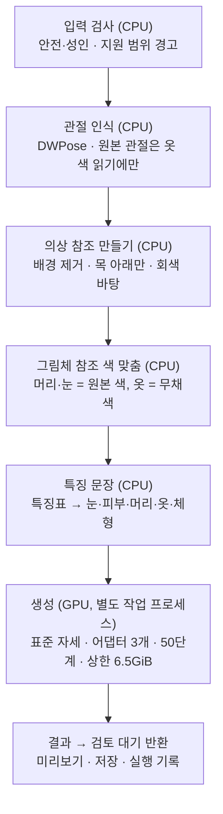

# 그림체 재해석 모드 — 앱 구조 설계 (초안, 2026-10-29)

> **한 줄 요약:** 앱에 두 번째 모드 **"그림체로 다시 그리기"**를 넣는다. 캐릭터 그림 1장을 넣으면 목표 그림체로 전신을 다시 그린다. 지금 앱의 Qwen 경로(옷 바꾸기 → 자세·장면)는 그대로 둔다. 이 문서는 **설계만** 다룬다. 코드는 사용자 승인 뒤에 만든다.
>
> **배포 전에 반드시 정할 것:** 참조 그림을 읽는 이미지 인코더(OpenCLIP ViT-H)는 모델 카드에 "배포된 사용은 범위 밖"이라고 적혀 있다(라이선스 자체는 MIT). 개발·시험은 지금 인코더로 하고, 배포 직전에 대체 방법을 정한다(8절, D-197).

- 올리는 기준: 6단계 중 **4 그림체 반영**(그리고 2 동일성, 6 새 입력 대응).
- 근거: D-192(두 경로를 역할별로), D-193(라이선스), D-194·D-195(이 PC 반복 시험, 성공 기준 통과 6/7), D-196(처음 보는 3명: 85·85·60).
- 근거가 된 시험 실행기: `outputs/style-training-prep-20261025/character-style-binding-20261027/local_batch_v5s.py`(설정 원본), `local_batch_v5u.py`(처음 보는 캐릭터).

## 1. 사용자 화면

| 모드 | 하는 일 | 우선하는 것 | 경로 |
|---|---|---|---|
| **A 옷·자세 바꾸기**(지금 있음) | 옷 바꾸기 → 자세·장면 | 동일성 | Qwen-Image-Edit (`run_outfit_pipeline` → `run_free_generation`) |
| **B 그림체로 다시 그리기**(새로) | 같은 캐릭터를 목표 그림체로 전신 1장 | 그림체 + 동일성 | SDXL(RealVisXL) + 자세 ControlNet + IP-Adapter 3개 |

- 화면: 참조 이미지 칸 아래에 모드 선택 두 개. B를 고르면 의상 칸은 숨긴다(B는 원래 옷을 유지한다).
- B의 결과 자세는 **고정 표준 서 있는 자세**다. 사용자 10/29: "인체만 맞으면 어떤 자세가 나와도 상관없다. 중요한 건 의상·헤어스타일·눈 색 등 동일성."
- 지금 화면 규칙(D-151)을 그대로 따른다: 사용자 화면은 확인 창 없이 자동 진행, 결과 미리보기 → 저장. 확인 창·판정은 개발 화면에만.
- A 결과를 B에 넣는 연결(옷을 바꾼 뒤 그림체로)은 이번 범위 밖이다. 두 모드가 각각 동작한 뒤 사용자가 고른다(10절).

## 2. 모드 B 흐름



| 단계 | 지금 시험에서 쓴 것 | 앱에서 | 상태 |
|---|---|---|---|
| 입력 검사 | 사람이 고름 | 기존 안전 태그 검사 + 지원 범위 경고(7절) | 재사용 |
| 관절 | `detect_pose_v001.py`(catvton 가상 환경) | 제품의 DWPose 경로(`original_body_pose`, 제품 환경에 이미 있음) | 옮기기 |
| 의상 참조 | 실행기 안 코드(anime-seg, 목 y − 2% 위 자름, 바탕 (214,210,202)) | 공통 함수로 분리 | 새로(작음) |
| 그림체 참조 색 맞춤 | `style_reference_colors.recolor_reference` + 5차 PLAN | 그대로. PLAN을 모듈 상수로 | 있음(시험 15개) |
| 특징 문장 | **Claude가 그림을 보고 씀**(자동 아님) | 특징표(`character_features`) + 캐릭터 기억에서 자동 조립, 개발 화면에서 고칠 수 있음 | **새로 — 가장 큰 미확인 지점** |
| 입력 묶음 | `character_style_inputs.prepare_character_style_bundle` | 그대로 | 있음, **커밋 안 됨** |
| 생성 | `character_style_conditioning` + 실행기에서 세 번째 어댑터를 우회로 붙임 | 세 번째(의상) 참조를 정식 인자로. 우회 제거 | 고치기 |
| 결과 | 결과 폴더 + batch-report.json | 기존 실행 폴더 기록(trace · outcome · preview.png) 형식 | 재사용 |

생성 고정값(D-195): seed 42, 50단계, CFG 5, 768×1024, DPM++ SDE Karras. 어댑터 강도 — 그림체 plus 0.7(`up.block_0`만) · 얼굴 plus-face 0.4 · 의상 plus 0.8(표준 자세 몸 영역 (230,240,540,1000)만). 자세 ControlNet 강도와 장면·그림체 문장은 T014 시험과 같음.

## 3. 공통 진입점과 계층

배포 목표(D-110): 공통 로직은 GUI·HTTP에 독립, 확인 창 대신 **검토 대기 반환**. 기존 `run_free_generation`과 같은 모양으로 만든다.

```text
run_style_redraw(request) -> StyleRedrawOutcome(state="review_pending" | "refused" | "failed", ...)
  request: 캐릭터 그림, 그림체 이름, 실행 폴더, (선택) 캐릭터 ID
```

| 계층 | 모듈(안) | 내용 |
|---|---|---|
| 화면 | `studio_product`(모드 선택 추가) | 모드 B 버튼·미리보기·저장. 판정·진단은 개발 화면만 |
| 진입 | `style_redraw_pipeline.run_style_redraw`(새) | 단계 순서, 실행 기록, 실패·거부 이유 |
| CPU 준비 | `style_redraw_inputs`(새) + `style_reference_colors` + `character_style_inputs` | 의상 참조·색 맞춤·특징 문장·입력 묶음 |
| GPU 작업 | `style_redraw_worker`(새, 별도 프로세스) + `character_style_conditioning` | 파이프라인 로드 1회, fp8 저장 + CPU 내려 두기, 단계마다 미리보기 |
| 기록 | 기존 실행 폴더 형식 | 입력·참조 SHA, 강도, 모델 리비전, 메모리 최고치 |

- 모드 A와 B는 같은 GPU를 번갈아 쓴다. **동시에 올리지 않는다.** 모드를 바꾸면 이전 작업 프로세스를 내리고 새로 띄운다(작업 프로세스 분리라 자연히 된다).
- 연구용 실행기(`local_batch_*.py`)는 그대로 기록으로 남기고 제품 코드에서 부르지 않는다(D-186 계층화).

## 4. 특징 문장 자동화 (가장 큰 미확인 지점)

- 시험 10명의 특징 문장은 모두 Claude 관찰이었다. 앱에서는 사람이 쓰지 않는다.
- 안: `character_features` 특징표(값·출처·상태, 재지 못하면 unknown)에서 눈·피부·머리·옷·체형 문장을 조립한다. unknown 항목은 문장에서 빼고 참조 그림에 맡긴다(시각 조건 우선 — 문장은 보조).
- 확인 방법(구현 뒤 첫 GPU 확인): 시험 10명을 **자동 문장**으로 다시 돌려 사용자 판정을 받는다. 기준: D-195·D-196과 같음(85% 이상 비율이 줄지 않고 50% 미만 없음).

## 5. 메모리·속도

- 이 PC(RTX 4060 8GB): 1장 약 60초(50단계 약 56초 + 준비), 최고 6.07~6.38GiB, 상한 6.5GiB(완화 안 함).
- 방식: UNet·ControlNet `enable_layerwise_casting(float8_e4m3fn → fp16)` + `enable_model_cpu_offload`.
- 파이프라인 로드는 작업 프로세스당 1회. 첫 생성은 로드 시간이 더 든다(미측정 — 구현 때 기록).
- 메모리 최적화 단계(ROADMAP 순서 2)에서 다시 잰다.

## 6. 모델

| 역할 | 모델 | 위치(시험용 모델 폴더) |
|---|---|---|
| 본체 | RealVisXL V5.0 | `base/realvis` |
| 자세 | xinsir controlnet-openpose-sdxl-1.0 | `extra/pose` |
| 참조 어댑터 | h94 ip-adapter-plus / plus-face (SDXL, vit-h) | `extra/ip/sdxl_models` |
| 참조 인코더 | OpenCLIP ViT-H-14 laion2B | `extra/ip/models/image_encoder` — **배포 전 결정**(8절) |
| 분할·배경·관절 | See-through SemanticSam, anime-seg isnetis, DWPose | 제품에서 이미 쓰는 것 |

`GENAI_MODEL_HOME` 한 곳에서 찾고, 최초 모델 준비 화면(D-173)의 필수 목록에 모드 B 모델을 **선택 항목**으로 추가한다(모드 A만 쓰는 사람은 받지 않아도 됨).

## 7. 지원 범위 경고 (시작 전에 알리고, 그대로 진행 가능)

| 경우 | 근거 | 알림 |
|---|---|---|
| 아래옷이 거의 안 보이는 상반신 그림 | D-196 N004(바지 색 전달 약함) | 아래옷 색·모양이 달라질 수 있음 |
| 옆을 민 머리 등 드문 머리 모양 | D-196 N004(투블럭 → 곱슬 단발) | 머리 모양이 흔한 형태로 바뀔 수 있음 |
| 양쪽 눈 색이 다름(짝눈) | SUPPORT_RANGE.md(그림체 재해석 경로 지원 범위 밖) | 눈 색이 한 가지로 될 수 있음 |
| 의상 참조에서 한 색이 넓게 차지함(예: 넓은 회색 바지 + 작은 조끼) | D-195 V002 | 작은 옷의 색이 넓은 색 쪽으로 끌릴 수 있음 |
| 기존 경고(앉은 자세·걸친 겉옷·기계 몸) | D-113 | 모드 A와 같은 문구 |

판정은 기존처럼 자동 태그·분할 면적으로 하고, 확실하지 않으면 알리지 않는다(잘못된 경고로 막지 않기).

## 8. 라이선스·배포 (배포 전 필수 결정, D-197)

1. **이미지 인코더(ViT-H).** 직접 바꿔 끼울 대체품은 없다 — 어댑터가 이 인코더에 맞춰 학습됐다. OpenAI CLIP도 카드에 같은 문구가 있다. 배포 직전 셋 중 하나:
   - (1) MIT 라이선스로 출처를 밝히고 넣는다(모델 카드 권고는 따르지 않음 — 사용자 판단).
   - (2) 배포 제한 문구가 없는 인코더(예: Google SigLIP, Apache-2.0)로 어댑터를 새로 학습한다(큰 비용).
   - (3) 인코더가 필요 없는 방식(그림체 LoRA·캐릭터 LoRA)으로 바꾼다(보류 목록).
   - (2)·(3)이면 D-195·D-196 판정을 다시 한다.
2. **그림체 참조 그림(target-02).** 출처·사용 허가가 기록에 없다(`style-review-20261026/README.md`: "목표 표현의 기준"). 앱에 넣어 배포하려면 허가된 그림이어야 한다(기준 4: 허가 자료). 대안: 사용자가 자기 그림체 그림을 넣는 방식(책임은 사용자) 또는 허가받은 그림을 기본으로 넣기.
3. RealVisXL(openrail++)의 사용 제한 조항을 앱 고지에 함께 넣는다. 원 배포처(CivitAI) 조건은 배포 전 따로 확인(STYLE_PATH_LICENSES.md).

## 9. 구현 순서 (승인 뒤, 한 단계씩)

| 단계 | 내용 | 확인 | 비용 |
|---|---|---|---|
| S1 | 커밋 안 된 시험 모듈 정리: `character_style_conditioning.py`·`character_style_inputs.py`·시험 2개 | CPU 시험 | 없음 |
| S2 | 세 번째(의상) 참조를 정식 인자로(두 어댑터 제한 우회 제거) | CPU 시험(호출 인자·마스크·강도 순서) | 없음 |
| S3 | `style_redraw_inputs`: 의상 참조·색 맞춤·특징 문장 자동 조립 | CPU 시험 + 시험 10명으로 입력 묶음 생성 | 없음 |
| S4 | `style_redraw_worker` + `run_style_redraw`(검토 대기 반환) | 이 PC GPU: 시험 10명을 자동 문장으로 → **사용자 판정**(4절 기준) | 전기만, 약 12분 |
| S5 | 개발 화면 연결 → 사용자 화면 모드 선택 | 화면 확인 + 처음 보는 그림 1~2장 | 없음 |
| S6 | 배포 결정(8절) | 메모리 최적화·배포 단계에서 | — |

각 단계는 이전 단계 확인 뒤에 시작한다. 코드는 Linux에서 고쳐도 되지만 **git add·commit은 Windows git**, 커밋 전 `git diff --cached --stat` 확인.

## 10. 사용자 결정 (2026-10-29)

1. 이 설계대로 **S1부터 구현** 시작.
2. 그림체: **(가) target-02 하나로 시작** — 배포 전에 사용 허가 확인(8절 2).
3. 모드 B 결과: **1장**.
4. 모드 A 결과를 모드 B에 넣는 연결: **하지 않음**.

### 진행

- S1(2026-10-29): `character_style_conditioning.py`·`character_style_inputs.py`·`scripts/prepare_character_style_inputs.py`·`tests/test_character_style_inputs.py` 커밋. CPU 시험 34개 통과(입력 묶음 19 + 색 맞춤 15). 코드 동작은 바꾸지 않음(빈 줄 하나 정리).
- S2(2026-10-29): 의상 참조를 정식 세 번째 어댑터로. 입력 묶음은 `outfit_path` + 주석 `outfit_sha256`·`outfit_box`(둘 다 있거나 둘 다 없음)를 받아 `outfit-reference.png`·`outfit-mask.png`를 만들고, `ConditioningOptions(outfit_scale=…)`이 있을 때만 세 번째 참조·마스크·강도를 붙인다(묶음과 강도가 어긋나면 거부). 실행 전 검사는 불러온 어댑터 수가 호출의 참조 수와 같은지 본다. 의상 참조가 없는 묶음은 예전과 같음. CPU 시험 41개 통과(새 7개). **실제 자료 대조:** T003·T017·N004에서 정식 경로가 밤사이 우회 방식과 문장·자세 지도·참조 3장·마스크 3개·강도·seed까지 같은 호출을 만듦(`parity.json`, 생성 없음).
- S3(2026-10-29): `genai_lab/style_redraw_inputs.py` — D-195 고정값(문장·강도·의상 영역·표준 자세·색 맞춤 계획)을 모듈 상수로, 얼굴 상자(DWPose 얼굴 점 x1.6), 의상 참조 만들기, **특징 문장 자동 조립**(`trait_rows`: 특징표 + 태그 + 자동 성별), 묶음 주석(`build_annotations`). 입력 묶음은 자동 측정(`automatic_measurement`)과 재지 못한 항목(`unmeasured`, 빈 문장 → 문장에서 빠지고 참조 그림에 맡김)을 받는다. CPU 시험 48개 통과.
  - 실제 10명 자동 문장(`s3-traits-auto-vs-manual.json`, Claude 손 문장과 나란히): 처음 결과에서 세 가지를 고침 — ① 일반 옷 낱말(pants·shirt)과 세부 낱말(소매·깃)이 6개 자리를 차지해 색 있는 옷(V002·T014 초록 조끼)이 잘림 → 같은 이름의 일반 낱말 빼기 + 세부 낱말 뒤로, ② 얼굴 밝은 면을 재 짙은 피부(V006)가 밝게 나옴 → L* 60~72는 낱말 없이 얼굴 참조에 맡김, ③ 드레드·투블럭 낱말이 없음 → 이 경로에만 드문 머리 모양 태그(dreadlocks·undercut·afro 등) 추가.
  - 남은 차이(S4 판정으로 확인): 성별은 자동 태그 추정(T017 남성, T014·V002 여성 등 — 맞는지 미확인), V007 눈 색은 태그가 못 잼(빈 칸), V007 머리 "afro", N004 바지 색 낱말 없음(의상 참조에 맡김).
