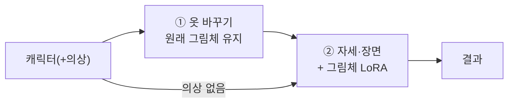

# 그림체 단계(완성 기준 4) 설계서 — 초안 (2026-10-22, 승인 전 · 같은 날 목표·평가 보완)

> 범위: 설계만. 내려받기·설치·학습·GPU 실행은 하지 않았다. 지도: [ROADMAP.md](ROADMAP.md) '지금 지도' 4절의 2번.
> 이 단계 중에 생기는 다른 문제는 보류 목록으로 보낸다(지도 6절 규칙).

## 결론

0. **목표(2026-10-22 사용자): 'AI가 가장 많이 학습한 그림체'가 아니라 'AI 그림 티(이질감)가 적은 그림체'다.**
   - Danbooru 계열 모델이 대량 생산한 화풍은 사람들이 "AI 그림"으로 바로 알아본다.
   - 허가된 그림체 여러 개를 골라 섞어서 그 화풍과 거리를 두는 것이 방향이다(0절).
1. **통과 기준은 이미 정해져 있다**(FLOW.md, D-109): "사용 허가를 받은 자료로 학습한 목표 그림체가 결과에 나타나면서 캐릭터·의상 특징도 유지. 학습 실행 성공만으로 통과 아님."
2. **권장 방법: 지금 모델(Qwen-Image-Edit-2511)에 그림체 LoRA를 학습해 ② 자세·장면 단계에만 건다.**
   - ②는 그림 전체를 새로 그리는 단계라 그림체가 들어갈 자리다.
   - ①은 원본 머리 픽셀을 붙이므로 그림체를 넣으면 머리와 몸의 그림체가 어긋난다.
   - 학습한 LoRA를 4비트(GGUF) 추론에 거는 방식은 가속 LoRA로 이미 해 봤다(D-141).
3. **장비가 가장 큰 제약이다.**
   - 이 모델의 LoRA 학습 참고 설정은 GPU 32GB급이다. 24GB에서도 메모리를 줄이는 공격적 설정이 필요하다고 한다.
   - **8GB에서 검증된 방법은 찾지 못했다.** 지금 PC(RTX 4060 8GB · RAM 48GB)로는 현실적으로 어렵다고 본다. 외부 GPU를 빌리는 쪽을 권한다.
   - 학습에는 원본 가중치(bf16, 약 40GB)도 따로 필요하다. 지금 PC에는 4비트(GGUF, 13GB)만 있다.
4. **가장 먼저 정할 것은 목표 그림체와 사용 허가된 자료다.** 자료가 없으면 이 단계는 시작하지 않는다.

---

## 0. 목표 다시 정의 (2026-10-22)

**목표:** AI 특유의 이질감이 적고, 캐릭터·의상 특징은 유지되는 그림체. 표기가 없어도 사람들이 AI 그림으로 알아보는 'AI 대량 생산 화풍'에서 멀어지는 것이 기준이다.

**AI 티 점검 목록**(사용자가 보여 준 예시에서 뽑음 — 판정 참고, 자동 판정 아님):
1. 머리카락에 굵고 하얀 광택 줄이 많음
2. 피부가 플라스틱처럼 매끈하고 번들거림(볼·허벅지)
3. 금속·천 등 여러 재질에 같은 반사광이 반복됨
4. 공중에 반짝이는 점, 윤곽 주변이 빛남
5. 색이 전체적으로 과하게 진함
6. 눈이 지나치게 선명하고 반짝임

원인으로 보는 것: Danbooru 계열 학습 모델(Animagine·Illustrious·NoobAI 등)의 기본 화풍을 많은 사람이 같은 설정으로 대량 생산했다. 그래서 '많이 학습한 화풍'일수록 AI 티가 난다(가설 — 판정으로 확인).

**AI 생성 표시와의 관계:** 그림이 자연스러운 것과 AI 생성 사실을 표시하는 것은 별개다. 저장 파일에는 AI 생성 표시를 항상 넣는다(D-152, 파일 정보 — 그림은 그대로).

## 0-1. 그림체 단계의 동일성 정의 (2026-10-22 사용자 확정)

사용자: "그림체가 바뀌면 왜 동일성이 깨지는 거야? 여러 작가의 팬아트를 보면 고유의 캐릭터성을 유지하면서 본인만의 그림체는 남겨 두는데."
→ 동일성은 그림체가 아니라 **캐릭터를 알아보게 하는 특징**에 있다(완성 기준 2 "특징 유지, 픽셀 아님"과 같은 뜻). 그림체가 바뀌는 것 자체는 실패가 아니다.

| 지켜야 할 것(동일성) | 바뀌어도 되는 것(그림체) |
|---|---|
| 머리색(색조), 머리 모양 윤곽(길이·묶음·앞머리), 눈 색, 머리 장식, 의상 디자인·색, 귀·꼬리·날개(개수·모양·색), 점·흉터 같은 고유 표시, 성별 | 선 굵기, 명암·채색 방식, 눈·얼굴을 그리는 방식, 얼굴·몸 비율(캐릭터 체형을 알아볼 수 있는 범위 안), 질감, 빛 표현, 색의 밝기·채도(색조가 같으면) |

**동일성이 실제로 깨지는 원인과 대책:**
1. **섞임:** LoRA가 학습 그림의 캐릭터 특징(얼굴형·머리 모양·눈 모양·머리색)까지 그림체로 배워, 새 캐릭터를 학습 캐릭터 쪽으로 끌어당긴다.
   - 대책: 학습 자료는 여러 캐릭터를 고르게(4-2 다양성).
   - 설명 문장에 캐릭터 특징을 적어 그림체와 분리한다.
   - 평가에서 '학습 그림 캐릭터를 닮아 감'을 따로 본다(5절 중단 조건).
2. **잣대가 그림체를 탐:** 지금 자동 검사는 머리색을 픽셀 색값(밝기 포함)으로, 피부를 밝기로 잰다. 채색 방식이 바뀌면 같은 색이라도 '바뀜'으로 잡을 수 있다.
   - 대책: 그림체 단계 판정은 위 표의 '지킬 것'으로 사람이 한다(최종).
   - 자동 검사는 그림체 단계 시험에서 색조 중심으로 보고, 밝기·채도 차이는 '확인 필요'로만 둔다. 코드 변경은 S3에서 한 요인으로, 기본값은 바꾸지 않는다.

## 1. 이미 정해진 원칙 (기존 문서에서 가져옴)

| 원칙 | 출처 |
|---|---|
| 허가 자료만. 학습 성공 ≠ 통과 | FLOW.md 완성 기준 4 (D-109) |
| 캐릭터·동물 특징·의상·그림체 자료는 역할별로 분리. 승인되지 않은 이미지는 학습 자료로 쓰지 않음 | REFERENCE_CONSISTENCY_POSTMORTEM.md |
| 캐릭터 정체성·의상·포즈를 한 LoRA에 함께 학습하지 않음 | REFERENCE_FIDELITY_POLICY.md P11 |
| 사용자가 결과를 고르는 것만으로 모델이 자동 학습되는 구조는 넣지 않음 | IMAGE_GENERATION_FLOW.md |
| 생성 조합 고정. 바꾸려면 한 요인씩, 8단계로 거르고 40단계로 확인 | D-140, D-144 |
| 캐릭터마다 맞추는 조정 금지 | D-104 |

이 문서가 새로 정하는 것은 "어떤 그림체를, 어떤 자료로, 흐름의 어디에, 어떤 방법·장비로"이다.

## 2. 흐름에서 넣는 위치

- **②에만 건다(권장).** ②는 기준 그림을 참고해 전체를 다시 그리므로 그림체를 바꿀 수 있다.
- ①은 원본 머리 픽셀을 붙이는 편집이다. ①에 그림체를 넣으면 머리(원래 그림체)와 몸(새 그림체)이 어긋난다.
- 2026-09 IMAGE_GENERATION_FLOW.md는 '앞단(기준 이미지 단계)'을 검토 방향으로 적었다. 그 뒤 흐름이 ①→②로 바뀌었으므로 이 문서에서 ②로 고친다(승인 시 그 문서에 주석을 단다).
- **예상되는 충돌:** ②는 동일성을 위해 원래 그림체의 기준 그림·머리 크롭을 함께 넣는다. 그래서 LoRA가 그림체를 끌고 가는 힘과 원래 그림체로 돌아가려는 힘이 부딪힌다. 평가에서 LoRA 강도 2단계로 확인한다(5절).

## 3. 방법 선택지

| | A. Qwen 그림체 LoRA 학습 **(권장)** | B. 학습 없이 그림체 참조 그림 추가 | C. SDXL LoRA 학습 + 덧칠 |
|---|---|---|---|
| 기준 4 충족 | 그대로 충족 | **아님**(학습이 아님). 비교용 대조군으로만 의미 | 충족하지만 모델이 하나 늘어남 |
| 장비 | 외부 GPU 24~48GB급 권장. 8GB 로컬은 검증된 방법 없음 | 지금 PC 가능. 그림 1장 추가 = 메모리 상한 근처(요청 25: 6.461/6.5GiB) | 8GB 로컬 가능 |
| 동일성 위험 | ②의 기준 그림·머리 크롭이 붙잡아 줌 | 같은 구조 | **큼**. 덧칠 단계에서 얼굴·머리·의상이 다시 흔들림. 예전 SDXL 경로 문제 재발 |
| 내려받기 | 원본 가중치 bf16(약 40GB) + 학습 도구(musubi-tuner 또는 ai-toolkit) | 없음 | SDXL 기반 모델(라이선스 조사: MERGE_CANDIDATES.md) + 학습 도구 |
| 추론 연결 | 4비트(GGUF) 추론에 LoRA 걸기. 가속 LoRA 선례(D-141) | 작업 프로세스 그림 수 변경 | 새 단계·새 작업 프로세스 |

- **학습 도구 후보:** musubi-tuner(kohya-ss, Qwen-Image-Edit-2511 지원, fp8·블록 교체로 메모리 절약), ai-toolkit(Ostris, 2511 참고 설정 32GB).
- **8GB 판단 근거:** 비슷한 모델의 12GB 사례가 "fp8 + CPU 블록 교체 20개 이상 + 512px"에서야 안정됐다는 보고가 있다. 8GB 사례는 찾지 못했다.
- 블록 교체를 쓰면 CPU 램에 원본 가중치(약 40GB)가 올라가야 해서, 지금 램 48GB로는 빠듯하다. 로컬 8GB 학습은 '불가능'이 아니라 **'검증 안 됨 · 매우 느리고 불안정할 가능성 큼'**이다.

### 3-1. 섞기(합성)

- LoRA 여러 개를 강도를 나눠 함께 거는 방식이다. 예: 그림체 X 0.5 + 그림체 Y 0.4.
- 지금 작업 프로세스는 LoRA 하나(8단계 가속용)만 건다. 여러 개를 걸려면 작업 프로세스·명세를 고쳐야 한다(S3, 기본 꺼짐).
- 섞으면 **각 LoRA의 라이선스 조건을 모두 지켜야 한다**(4-1 후보 표에서 관리). 학습 자료 출처는 더 흐려지므로, 학습 자료 설명이 없는 후보는 섞는 재료에서도 '확인 필요'로 표시한다.

### 3-2. 학습 없이 설정만으로 줄이는 대조군

- 그림체 단계 시험 안에서만, 한 요인씩: ② 지시문에 '광택·반사광·반짝이 줄이기' 문장(예: matte shading, no glossy highlights, no sparkles) 추가.
- 생성 조합 고정 규칙(D-140)에 따라 제품 기본값은 바꾸지 않는다. 효과가 있으면 그때 사용자 결정으로 올린다.

### 3-3. 맛보기 LoRA 시험(S0.5)과 오염 방지 선 (2026-10-23 사용자 승인 "(가)")

**목적:** 직접 학습(외부 GPU 비용) 전에, 공개된 Qwen 그림체 LoRA 하나를 빌려 우리 흐름에 걸어 네 가지를 본다.
1. 효과 크기(3D 렌더 느낌 → 일러스트로 얼마나 바뀌나)
2. 동일성 섞임(0-1, 강도 0.6/1.0)
3. 기술 동작(LoRA 연결, 메모리 상한 6.5GiB, 시간)
4. 직접 학습 가치 판단

**오염 방지 선(시험 전 고정):**

| 오염 | 막는 방법 |
|---|---|
| 평가 기록 | 결과는 별도 폴더(`outputs/style-trial-*`)에 두고, 판정 기록에 `trial: style_lora_borrowed` 표시. 품질 기준선·운영 집계(요청 26~34)에 넣지 않는다 |
| 목표 | 판정 항목은 효과 크기·동일성 섞임·기술 동작만. 빌린 LoRA의 화풍을 '예쁨'·목표 그림체로 채택하지 않는다(AI 대량 생산 화풍일 수 있음 — 0절) |
| 제품 | 그림체 LoRA 선택지는 기본 꺼짐. 사용자 화면에서 켤 방법 없음. 빌린 LoRA는 제품 경로·설정에 연결하지 않는다(학습 자료 미공개 → 기준 4 증명 불가) |
| 대화 | 기준은 문서(ROADMAP '지금 지도', 이 설계서, DECISIONS). 맛보기가 끝나면 결과와 다음 결정을 이 절과 지도에 먼저 적는다 |

**실패해도 남는 것:**
- 기술 실패 → 직접 학습 때 LoRA 형식·버전 요건
- 약한 효과 → ②의 원래 그림 참조와 강도 문제
- 섞임 → 학습 자료 다양성 요건

## 4. 학습 자료 요건 (S1에서 CPU로 정리)

### 4-1. 후보 고르는 기준 — 'AI 대량 생산 화풍과의 거리'를 포함

후보(공개 LoRA·자료 묶음·직접/의뢰 그림)마다 표 한 줄로 정리하고 사용자가 고른다.

| 열 | 내용 |
|---|---|
| 이름·주소·대상 모델 | 예: Qwen-Image-Edit-2511용인지, 이전 버전(2509)용인지 |
| 라이선스 | 라이선스 파일 원문 확인(페이지 표시만으로 판단하지 않음), 의무(출처 표시·사용 제한 전달 등) |
| 학습 자료 설명 | 공개/미공개, 허가 근거 유무 — 미공개면 '허가 자료로 학습' 증명 불가로 표시 |
| **AI 대량 생산 화풍과의 거리** | **멀다 / 중간 / 가깝다.** 판단 근거: (1) 예시 그림에서 0절 AI 티 점검 목록 6개 중 몇 개가 보이는지, (2) Danbooru 계열 모델·LoRA에서 파생됐는지(카드에 적힌 기반 모델) |
| 용량·내려받기 | 내려받기는 고른 뒤 이름·출처·크기를 적어 승인 |

- 우선순위: 거리 '멀다' + 라이선스 명확 + 학습 자료 설명 있음.
- 거리 '가깝다'는 성능이 좋아 보여도 섞는 재료에서 뺀다(목표와 반대).
- 2026-10-22 1차 조사(미검증, 표 작성 때 다시 확인):
  - [prithivMLmods/Qwen-Image-Edit-2511-Anime](https://huggingface.co/prithivMLmods/Qwen-Image-Edit-2511-Anime): Apache-2.0 표시, 평면 셀 채색, 학습 자료 미공개
  - [autoweeb/Qwen-Image-Edit-2509-Photo-to-Anime](https://huggingface.co/autoweeb/Qwen-Image-Edit-2509-Photo-to-Anime): MIT, 이전 버전용
  - [PD12M](https://huggingface.co/datasets/Spawning/PD12M/blob/main/README.md): 퍼블릭 도메인·CC0, 사진·문화유산 위주(애니 거의 없을 것으로 봄)
  - Mitsua Likes: 허가 자료만으로 만든 모델, 라이선스 미확인 — 방향 참고

### 4-2. 자료 자체의 요건

- **허가 증빙:** 그림마다 출처표 한 줄(파일 · 작가/출처 · 허가 근거(직접 그림 / 허가 문서 / 라이선스) · 확인일). 근거가 없는 그림은 넣지 않는다.
- **양:** 20~50장, 같은 그림체.
- **다양성:** 여러 캐릭터·의상·자세. 한 캐릭터에 몰리면 그 캐릭터의 외형까지 학습한다(P11 위반).
- **평가 캐릭터 제외:** 평가 세트(N1·N2·K·M2·M3·M6·F5·M7)와 그 출처 그림은 학습 자료에 넣지 않는다.
- **안전:** 기존 안전 태그(노출·금지 태그) 자동 검사를 학습 자료에도 똑같이 적용하고, 걸리면 뺀다.
- **설명 문장(캡션):** 그림체 이름 한 단어(예: `style_xyz`) + 내용 설명. 그림체가 아닌 것(캐릭터 이름·옷)은 내용 설명에만 넣는다.
- **해상도:** 짧은 변 768px 이상(학습 해상도 512~1024 중 장비에 맞춤).

## 5. 평가 (시험 전에 고정)

**평가 세트:** 학습에 쓰지 않은 캐릭터 4명 × 장면 2개 = 8줄.
- 요청 29 세트 중 정상 2명(N1·K) + 알려진 실패 1명(M6) + 새 남성(M7)
- 장면 S1 공원 · S2 카페
- 같은 seed

**비교군:**
- LoRA 없음
- LoRA 강도 0.6
- LoRA 강도 1.0

8줄 × 3 = 24장 + 설정 대조군 8장 = 32장. 먼저 8단계로 거르고, 넘는 강도만 40단계로 확인한다.
- 주의: 8단계는 가속 LoRA를 쓴다. 그림체 LoRA와 겹쳐 걸 수 있는지는 S3에서 CPU로 먼저 확인한다.
- 안 되면 40단계만 쓴다(24장 × 약 35분 ≈ 14시간 → 줄 수를 줄여 다시 제안).

**비교군 추가:** 설정만 바꾼 대조군(3-2, LoRA 없음 + 광택 줄이기 문장) 8줄. 섞기(3-1)를 시험할 때는 단일 LoRA와 섞은 것을 다른 줄로 비교하고, 한 시험에 두 요인을 섞지 않는다.

**판정(사용자, 시험군을 가린 묶음 4~6장):**
- **AI 티: '자연스러움 / 보통 / AI 같음'**(0절 점검 목록을 판정 참고로 붙임) — 이 단계의 주 판정
- 그림체: 목표 그림체 예시 3장을 옆에 두고 '가까움 / 같음 / 멀어짐'
- 동일성: 0-1 표의 '지킬 것' 항목별(머리색 색조 · 머리 모양 · 눈 색 · 장식 · 의상 · 부위 · 고유 표시). '바뀌어도 되는 것'의 변화는 실패로 세지 않는다.
- 섞임: '학습 그림의 캐릭터를 닮아 감'(얼굴형·머리 모양이 원래 캐릭터가 아닌 쪽으로) 있음/없음
- 구조: 기존 판정 항목(심한 이상)

**통과(사전 고정):**
1. 한 강도(또는 섞기 조합)에서 'AI 같음' 판정이 LoRA 없음보다 2줄 이상 적고, 'AI 같음'이 늘어난 줄은 0
2. 같은 조건에서 그림체 '가까움' 6/8 이상
3. LoRA 없을 때 통과한 줄이 실패로 바뀐 줄 0
4. 새 구조 이상(얼굴·팔다리) 0
5. 메모리 상한 6.5GiB 초과 0(자동 완화 금지)

**중단:** '섞임'(학습 그림의 캐릭터를 닮아 감)이 2줄 이상이면 그 강도는 중단한다. 학습 자료의 캐릭터 편중을 의심하고 자료부터 본다. 그림체 때문에 얼굴 그리는 방식이 바뀐 것은 섞임이 아니다(0-1).

### 5-1. 그림체 평가 기준 (2026-10-23 사용자 제시·핵심 항목 확정)

> 이후 그림체 시험의 판정 항목은 이 기준을 따른다(위 5절의 그림체·동일성 판정 항목보다 우선). 평가 세트·통과 수치는 다음 시험을 설계할 때 이 기준에 맞춰 다시 정한다. 요청 36은 실행 전에 D-161 기준을 고정했으므로 그 기준으로 종료했다(D-162).

**1. 시각적 완성도** — 항목마다 `개선 / 변화 없음 / 악화 / 판단 불가`

| 항목 | 원하는 변화 | 성공으로 보기 어려운 결과 |
|---|---|---|
| 빛의 방향 | 광원 방향이 읽히고 얼굴·몸·옷에 일관되게 반영 | 부위마다 빛 방향이 다르거나 무작위로 밝아짐 |
| 입체적인 명암 | 얼굴·머리카락·옷의 형태가 그림자·밝기 차이로 드러남 | 전체가 어두워지거나 대비만 강해짐 |
| 머리카락 표현 | 머릿결·덩어리·광택 구분, 기본 배색 유지 | 머리색 변경, 번진 하이라이트, 플라스틱 질감 |
| 피부 표현 | 부드러운 명암으로 형태, 고유 피부톤 유지 | 피부톤 교체, 과도한 광택, 얼룩 |
| 의상 재질 | 천·가죽·금속 등 소재에 맞는 주름·반사 | 모든 소재가 같은 광택, 디자인 변경 |
| 색채 구성 | 기본색 유지 + 주변색·명암색 조화 | 화면 전체 채도만 높아짐, 고유색 소실 |
| 선과 세부 묘사 | 얼굴·장식·옷의 주요 형태가 명료하고 일관 | 선만 날카로워짐, 가짜 무늬·장식 추가 |
| 빛 효과와 배경 | 필요한 경우 역광·입자·배경 대비가 캐릭터를 돋보이게 | 효과가 얼굴·의상을 가림, 배경만 화려해짐 |

- 모든 항목을 강하게 적용하지 않는다. 서로 다른 표현(부드러운 채색 ↔ 강한 광택)은 목표 그림체에 맞춰 **시험 전에** 적용 여부를 정한다.
- **핵심 항목(2026-10-23 사용자 확정):** 우선 목표(참고 4번 — 단순 배경에서도 완성도가 드러나는 명암·머릿결·옷 주름과 재질)에 맞춰 `빛의 방향`, `입체적인 명암`, `머리카락 표현`, `의상 재질`. 나머지 넷(피부 표현, 색채 구성, 선과 세부 묘사, 빛 효과와 배경)은 기록만 하고 성공 판단에 넣지 않는다.

**2. 동일성 보호** — 항목마다 `유지 / 위반 / 가림·측정 불가`

| 반드시 유지 | 허용되는 변화 | 실패 기준 |
|---|---|---|
| 얼굴의 식별 특징 | 선·명암·피부 질감 표현 | 다른 인물처럼 바뀜, 얼굴 구조 일그러짐 |
| 눈색과 좌우 배치 | 조명 반사·하이라이트 | 오드아이 소실, 색·좌우 교체 |
| 머리 기본색·배색 위치·특징적 형태 | 명암·광택·머릿결 표현 | 분홍빛 소실, 배색 이동, 헤어스타일 변경 |
| 고유 피부톤 | 광원에 따른 국소 밝기·색 변화 | 조명으로 설명하기 어려운 전체 피부톤 변경 |
| 의상 디자인과 구성 | 주름·재질·채색 방식 | 의상 교체, 구성 요소 누락·추가 |
| 장식·귀·꼬리 등의 종류와 개수 | 자연스러운 가림과 원근 | 소실, 복제, 원본에 없는 부위 추가 |
| 지정된 체형·자세·구도 | 그림체에 따른 표면 표현 | 요청하지 않은 비율·자세·크롭 변경 |

- 픽셀 색이 다르다는 이유만으로 실패 처리하지 않는다. 고유 특징 변경과 조명·그림체 표현 차이를 구분하고, 판단이 어려우면 `검토 필요`로 남긴다.

**3. 참고 그림** (사용자가 대화에 첨부한 예시 1~4번)

| 예시 | 참고할 표현 |
|---|---|
| 1번 | 역광, 명암 대비, 머리 가장자리의 빛, 재질 반사 |
| 2번 | 선과 채색의 명료함, 색 조합, 장식적인 빛 효과 |
| 3번 | 절제된 색상, 부드러운 명암, 피부·옷의 질감 |
| 4번 | **우선 목표:** 단순 배경에서도 완성도가 드러나는 명암·머릿결·옷 주름과 재질 |

- 네 그림체를 한 번에 섞는 것이 목표가 아니다.
- 예시는 시각적 목표 설명용이며 **학습·재배포 허가 자료가 아니다.** 저장소에 넣지 않는다.

**4. 판정·종료**

| 구분 | 기록 방식 |
|---|---|
| 비교 대상 | 그림체 적용 직전 그림과 적용 후 결과를 같은 크기로 |
| 사용자 판정 | 자동 검사와 분리해 기록. 자동 위반 없음 ≠ 사용자 통과 |
| 성공 후보 | 미리 정한 핵심 항목이 개선 + 동일성 위반·새 왜곡 없음 |
| 실패 | 배경·채도만 변화, 동일성 손실, 세부 왜곡 |
| 속도 | 추가 변환 시간과 전체 처리 시간을 함께 기록. 허용 시간은 별도 확정 |
| 종료 | 목표 미달이면 강도·seed·다른 LoRA 탐색으로 자동 확대하지 않고 원인과 채택 여부를 보고 |

## 6. 단계와 승인 지점

| 단계 | 내용 | 누가 | 승인 |
|---|---|---|---|
| S0 | 후보 표(4-1: 라이선스 · 학습 자료 · AI 대량 생산 화풍과의 거리) 작성 → 사용자가 고름(하나 또는 섞을 조합) | Claude 조사(내려받기 없음) → 사용자 | 이 문서 승인 · 후보 선택 |
| S1 | 자료 정리(출처표 · 안전 검사 · 캡션 초안) | Claude, CPU | 출처표 확인 |
| S2 | 방법·장비 확정(A 권장, 외부 GPU 업체·비용) | 사용자 결정 | 비용 승인 |
| S3 | 내려받기(원본 가중치·도구) · 학습 · GGUF 추론 연결 CPU 확인 | Claude/Codex | 내려받기마다 승인(이름·출처·크기) |
| S4 | 평가 GPU(5절) | Codex | GPU 승인 |
| S5 | 제품 연결: 기본 꺼짐. 사용자 화면에 '그림체' 선택 1개 | Claude | 사용자 결정 |

## 7. 하지 않는 것

- 허가 근거 없는 그림, 특정 생존 작가 그림을 그 작가의 허가 없이 쓰는 것
- 생성 결과를 자동으로 학습 자료에 넣는 것(사용자 승인 결과도 S1 출처표를 거침)
- 그림체 단계 중 다른 문제(배경 무늬·옷 바꾸기 품질 등)를 고치는 것 → 보류 목록
- 메모리 상한 완화, 캐릭터별 LoRA

## 8. 위험

- **동일성:** ②의 원래 그림체 참조와 LoRA가 부딪혀 그림체가 약하게 나오거나, 강도를 올리면 얼굴이 바뀔 수 있다(5절에서 측정).
- **비용·시간:** 외부 GPU 비용, 원본 가중치 약 40GB 내려받기.
- **추론 메모리:** LoRA를 걸면 작업 프로세스 메모리가 약간 늘 수 있다(가속 LoRA 때는 문제 없었음).
- **권리:** 자료 허가를 증빙하지 못하면 학습을 시작하지 않는다.

## 참고 (2026-10-22 조사, 실측 아님)

- [kohya-ss/musubi-tuner — Qwen-Image 문서](https://github.com/kohya-ss/musubi-tuner/blob/main/docs/qwen_image.md)
- [RunComfy — Qwen-Image-Edit-2511 ai-toolkit 학습 안내](https://www.runcomfy.com/trainer/ai-toolkit/qwen-image-edit-2511-lora-training)
- [AI-Toolkit LoRA 학습 안내(참고 설정 VRAM)](https://localaimaster.com/blog/ai-toolkit-lora-training-guide)
- [DiffSynth-Studio — FP8 학습](https://diffsynth-studio-doc.readthedocs.io/en/latest/Training/FP8_Precision.html)
- [12GB 학습 사례(다른 모델, 같은 VAE 계열)](https://civarchive.com/articles/32566/how-to-train-a-krea-2-lora-on-a-12gb-gpu)
