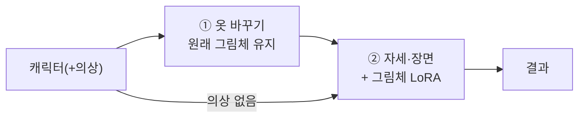

# 그림체 단계(완성 기준 4) 설계서 — 초안 (2026-10-22, 승인 전)

> 범위: 설계만. 내려받기·설치·학습·GPU 실행은 하지 않았다. 지도: [ROADMAP.md](ROADMAP.md) '지금 지도' 4절의 2번.
> 이 단계 중에 생기는 다른 문제는 보류 목록으로 보낸다(지도 6절 규칙).

## 결론

1. **통과 기준은 이미 정해져 있다**(FLOW.md, D-109): "사용 허가를 받은 자료로 학습한 목표 그림체가 결과에 나타나면서 캐릭터·의상 특징도 유지. 학습 실행 성공만으로 통과 아님."
2. **권장 방법: 지금 모델(Qwen-Image-Edit-2511)에 그림체 LoRA를 학습해 ② 자세·장면 단계에만 건다.**
   - ②는 그림 전체를 새로 그리는 단계라 그림체가 들어갈 자리다.
   - ①은 원본 머리 픽셀을 붙이므로 그림체를 넣으면 머리와 몸의 그림체가 어긋난다.
   - 학습한 LoRA를 4비트(GGUF) 추론에 거는 방식은 가속 LoRA로 이미 해 봤다(D-141).
3. **장비가 가장 큰 제약이다.**
   - 이 모델의 LoRA 학습 참고 설정은 GPU 32GB급이다. 24GB에서도 메모리를 줄이는 공격적 설정이 필요하다고 한다.
   - **8GB에서 검증된 방법은 찾지 못했다.** 지금 PC(RTX 4060 8GB · RAM 48GB)로는 현실적으로 어렵다고 본다. 외부 GPU를 빌리는 쪽을 권한다.
   - 학습에는 원본 가중치(bf16, 약 40GB)도 따로 필요하다. 지금 PC에는 4비트(GGUF, 13GB)만 있다.
4. **가장 먼저 정할 것은 목표 그림체와 사용 허가된 자료다.** 자료가 없으면 이 단계는 시작하지 않는다.

---

## 1. 이미 정해진 원칙 (기존 문서에서 가져옴)

| 원칙 | 출처 |
|---|---|
| 허가 자료만. 학습 성공 ≠ 통과 | FLOW.md 완성 기준 4 (D-109) |
| 캐릭터·동물 특징·의상·그림체 자료는 역할별로 분리. 승인되지 않은 이미지는 학습 자료로 쓰지 않음 | REFERENCE_CONSISTENCY_POSTMORTEM.md |
| 캐릭터 정체성·의상·포즈를 한 LoRA에 함께 학습하지 않음 | REFERENCE_FIDELITY_POLICY.md P11 |
| 사용자가 결과를 고르는 것만으로 모델이 자동 학습되는 구조는 넣지 않음 | IMAGE_GENERATION_FLOW.md |
| 생성 조합 고정. 바꾸려면 한 요인씩, 8단계로 거르고 40단계로 확인 | D-140, D-144 |
| 캐릭터마다 맞추는 조정 금지 | D-104 |

이 문서가 새로 정하는 것은 "어떤 그림체를, 어떤 자료로, 흐름의 어디에, 어떤 방법·장비로"이다.

## 2. 흐름에서 넣는 위치

- **②에만 건다(권장).** ②는 기준 그림을 참고해 전체를 다시 그리므로 그림체를 바꿀 수 있다.
- ①은 원본 머리 픽셀을 붙이는 편집이다. ①에 그림체를 넣으면 머리(원래 그림체)와 몸(새 그림체)이 어긋난다.
- 2026-09 IMAGE_GENERATION_FLOW.md는 '앞단(기준 이미지 단계)'을 검토 방향으로 적었다. 그 뒤 흐름이 ①→②로 바뀌었으므로 이 문서에서 ②로 고친다(승인 시 그 문서에 주석을 단다).
- **예상되는 충돌:** ②는 동일성을 위해 원래 그림체의 기준 그림·머리 크롭을 함께 넣는다. 그래서 LoRA가 그림체를 끌고 가는 힘과 원래 그림체로 돌아가려는 힘이 부딪힌다. 평가에서 LoRA 강도 2단계로 확인한다(5절).

## 3. 방법 선택지

| | A. Qwen 그림체 LoRA 학습 **(권장)** | B. 학습 없이 그림체 참조 그림 추가 | C. SDXL LoRA 학습 + 덧칠 |
|---|---|---|---|
| 기준 4 충족 | 그대로 충족 | **아님**(학습이 아님). 비교용 대조군으로만 의미 | 충족하지만 모델이 하나 늘어남 |
| 장비 | 외부 GPU 24~48GB급 권장. 8GB 로컬은 검증된 방법 없음 | 지금 PC 가능. 그림 1장 추가 = 메모리 상한 근처(요청 25: 6.461/6.5GiB) | 8GB 로컬 가능 |
| 동일성 위험 | ②의 기준 그림·머리 크롭이 붙잡아 줌 | 같은 구조 | **큼**. 덧칠 단계에서 얼굴·머리·의상이 다시 흔들림. 예전 SDXL 경로 문제 재발 |
| 내려받기 | 원본 가중치 bf16(약 40GB) + 학습 도구(musubi-tuner 또는 ai-toolkit) | 없음 | SDXL 기반 모델(라이선스 조사: MERGE_CANDIDATES.md) + 학습 도구 |
| 추론 연결 | 4비트(GGUF) 추론에 LoRA 걸기. 가속 LoRA 선례(D-141) | 작업 프로세스 그림 수 변경 | 새 단계·새 작업 프로세스 |

- **학습 도구 후보:** musubi-tuner(kohya-ss, Qwen-Image-Edit-2511 지원, fp8·블록 교체로 메모리 절약), ai-toolkit(Ostris, 2511 참고 설정 32GB).
- **8GB 판단 근거:** 비슷한 모델의 12GB 사례가 "fp8 + CPU 블록 교체 20개 이상 + 512px"에서야 안정됐다는 보고가 있다. 8GB 사례는 찾지 못했다.
- 블록 교체를 쓰면 CPU 램에 원본 가중치(약 40GB)가 올라가야 해서, 지금 램 48GB로는 빠듯하다. 로컬 8GB 학습은 '불가능'이 아니라 **'검증 안 됨 · 매우 느리고 불안정할 가능성 큼'**이다.

## 4. 학습 자료 요건 (S1에서 CPU로 정리)

- **허가 증빙:** 그림마다 출처표 한 줄(파일 · 작가/출처 · 허가 근거(직접 그림 / 허가 문서 / 라이선스) · 확인일). 근거가 없는 그림은 넣지 않는다.
- **양:** 20~50장, 같은 그림체.
- **다양성:** 여러 캐릭터·의상·자세. 한 캐릭터에 몰리면 그 캐릭터의 외형까지 학습한다(P11 위반).
- **평가 캐릭터 제외:** 평가 세트(N1·N2·K·M2·M3·M6·F5·M7)와 그 출처 그림은 학습 자료에 넣지 않는다.
- **안전:** 기존 안전 태그(노출·금지 태그) 자동 검사를 학습 자료에도 똑같이 적용하고, 걸리면 뺀다.
- **설명 문장(캡션):** 그림체 이름 한 단어(예: `style_xyz`) + 내용 설명. 그림체가 아닌 것(캐릭터 이름·옷)은 내용 설명에만 넣는다.
- **해상도:** 짧은 변 768px 이상(학습 해상도 512~1024 중 장비에 맞춤).

## 5. 평가 (시험 전에 고정)

**평가 세트:** 학습에 쓰지 않은 캐릭터 4명 × 장면 2개 = 8줄.
- 요청 29 세트 중 정상 2명(N1·K) + 알려진 실패 1명(M6) + 새 남성(M7)
- 장면 S1 공원 · S2 카페
- 같은 seed

**비교군:**
- LoRA 없음
- LoRA 강도 0.6
- LoRA 강도 1.0

8줄 × 3 = 24장. 먼저 8단계로 거르고, 넘는 강도만 40단계로 확인한다.
- 주의: 8단계는 가속 LoRA를 쓴다. 그림체 LoRA와 겹쳐 걸 수 있는지는 S3에서 CPU로 먼저 확인한다.
- 안 되면 40단계만 쓴다(24장 × 약 35분 ≈ 14시간 → 줄 수를 줄여 다시 제안).

**판정(사용자, 시험군을 가린 묶음 4~6장):**
- 그림체: 목표 그림체 예시 3장을 옆에 두고 '가까움 / 같음 / 멀어짐'
- 동일성·구조: 기존 판정 항목(같은 캐릭터 · 의상 · 머리색 · 부위 · 심한 이상)

**통과(사전 고정):**
1. 한 강도에서 그림체 '가까움' 6/8 이상
2. 같은 강도에서 LoRA 없을 때 통과한 줄이 실패로 바뀐 줄 0
3. 새 구조 이상(얼굴·팔다리) 0
4. 메모리 상한 6.5GiB 초과 0(자동 완화 금지)

**중단:** LoRA가 캐릭터 얼굴을 바꾸는 줄이 2줄 이상이면 그 강도는 중단한다(학습 자료의 캐릭터 편중 의심 → 자료부터 본다).

## 6. 단계와 승인 지점

| 단계 | 내용 | 누가 | 승인 |
|---|---|---|---|
| S0 | 목표 그림체 · 허가 자료 확정 | 사용자 | 이 문서 승인 |
| S1 | 자료 정리(출처표 · 안전 검사 · 캡션 초안) | Claude, CPU | 출처표 확인 |
| S2 | 방법·장비 확정(A 권장, 외부 GPU 업체·비용) | 사용자 결정 | 비용 승인 |
| S3 | 내려받기(원본 가중치·도구) · 학습 · GGUF 추론 연결 CPU 확인 | Claude/Codex | 내려받기마다 승인(이름·출처·크기) |
| S4 | 평가 GPU(5절) | Codex | GPU 승인 |
| S5 | 제품 연결: 기본 꺼짐. 사용자 화면에 '그림체' 선택 1개 | Claude | 사용자 결정 |

## 7. 하지 않는 것

- 허가 근거 없는 그림, 특정 생존 작가 그림을 그 작가의 허가 없이 쓰는 것
- 생성 결과를 자동으로 학습 자료에 넣는 것(사용자 승인 결과도 S1 출처표를 거침)
- 그림체 단계 중 다른 문제(배경 무늬·옷 바꾸기 품질 등)를 고치는 것 → 보류 목록
- 메모리 상한 완화, 캐릭터별 LoRA

## 8. 위험

- **동일성:** ②의 원래 그림체 참조와 LoRA가 부딪혀 그림체가 약하게 나오거나, 강도를 올리면 얼굴이 바뀔 수 있다(5절에서 측정).
- **비용·시간:** 외부 GPU 비용, 원본 가중치 약 40GB 내려받기.
- **추론 메모리:** LoRA를 걸면 작업 프로세스 메모리가 약간 늘 수 있다(가속 LoRA 때는 문제 없었음).
- **권리:** 자료 허가를 증빙하지 못하면 학습을 시작하지 않는다.

## 참고 (2026-10-22 조사, 실측 아님)

- [kohya-ss/musubi-tuner — Qwen-Image 문서](https://github.com/kohya-ss/musubi-tuner/blob/main/docs/qwen_image.md)
- [RunComfy — Qwen-Image-Edit-2511 ai-toolkit 학습 안내](https://www.runcomfy.com/trainer/ai-toolkit/qwen-image-edit-2511-lora-training)
- [AI-Toolkit LoRA 학습 안내(참고 설정 VRAM)](https://localaimaster.com/blog/ai-toolkit-lora-training-guide)
- [DiffSynth-Studio — FP8 학습](https://diffsynth-studio-doc.readthedocs.io/en/latest/Training/FP8_Precision.html)
- [12GB 학습 사례(다른 모델, 같은 VAE 계열)](https://civarchive.com/articles/32566/how-to-train-a-krea-2-lora-on-a-12gb-gpu)
