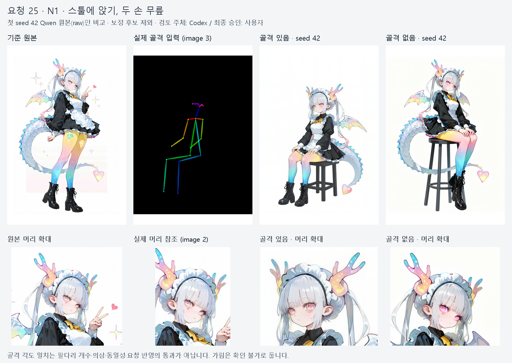
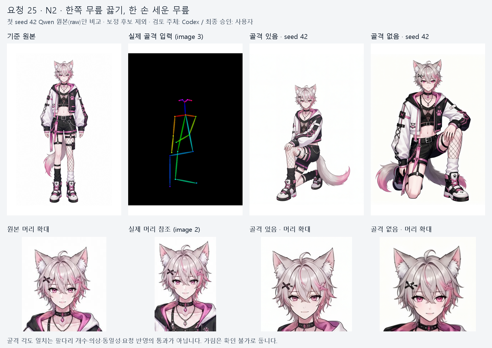
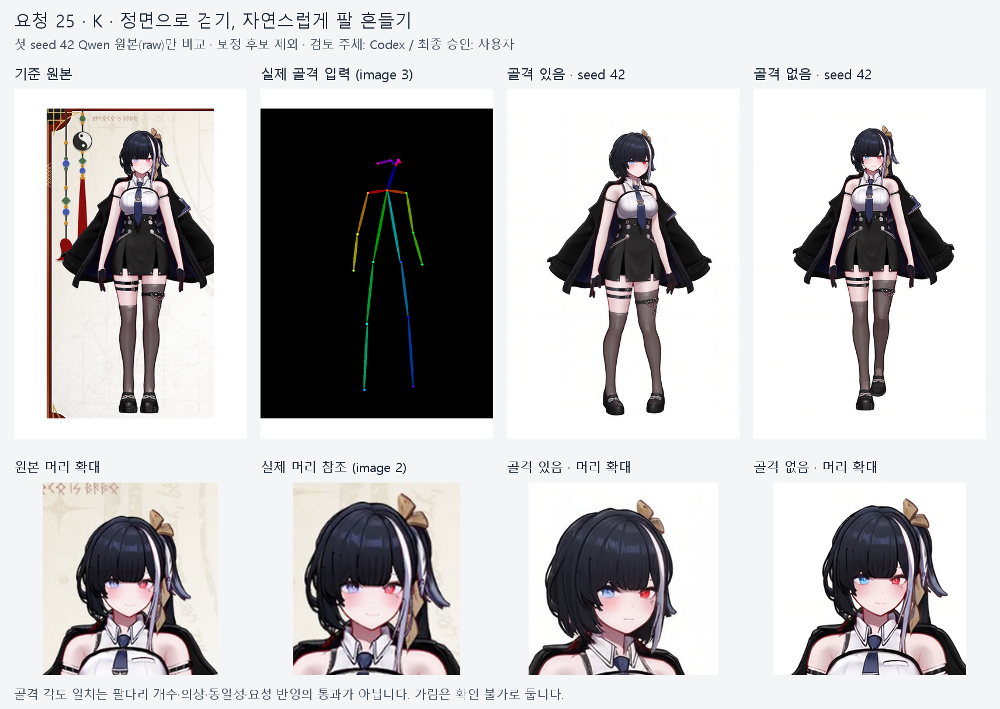

# 요청 25 — 자세 골격 유도 비교 결과

완료 — 실행은 정상 종료됐지만 효과가 일정하지 않고 K의 걷기가 약해져, 골격 유도 기본 꺼짐 유지를 권합니다.

실행 성공·자동 관찰·Codex 육안·사용자 최종 품질은 별개입니다. 사용자 판정과 두 결과 중 선택은 미기록이며 평가④는 보류입니다.

## 같은 seed 비교

모든 효과 비교는 첫 시도 seed42 Qwen raw만 사용했습니다. 원본·실제 머리 참조·골격·각 raw를 열고 장갑/꼬리도 확대했습니다. 나은 쪽은 Codex 의견입니다.

| 기준 | 골격 있음 | 골격 없음 | Codex 의견 |
|---|---|---|---|
| N1 앉기·두 손 무릎 | 자세 반영, 다리/부츠 분리 | 자세 반영, 부츠 겹침 큼 | 있음이 구분 쉬움. 둘 다 요청 반영 |
| N2 한쪽 무릎·손 세운 무릎 | 3/4 자세·꼬리 실루엣 명확 | 자세 반영, 좌우 꼬리 끝처럼 보임 | 있음 잠정 우세. 없음의 꼬리 전체 수/연결은 확인 불가 |
| K 정면 걷기·팔 흔들기 | 서 있는 모습에 가까움 | 앞뒤 보폭이 더 분명 | 없음 우세. 팔 흔들기는 둘 다 약함 |

여섯 raw에서 팔2·다리2의 배치가 보이고 명백한 추가 팔다리/머리 중복/심한 잘림은 관찰되지 않았습니다. N1의 부츠 겹침·N2의 가린 손을 추가/소실로 세지 않았습니다. 손가락 세부와 몸통 뒤 꼬리/날개 연결은 확인 불가입니다. N2 없음의 꼬리 구조 의심은 심한 이상 없음으로 확정하지 않았습니다. 마스크 연결 요소를 실제 부위 개수로 쓰지 않았습니다.

## 결과별 특징·의상 관찰

각 결과의 원본 대비 특징은 아래와 같습니다. 같은 캐릭터로 인지된다는 Codex 관찰은 완전 동일성이나 사용자 품질 승인과 다릅니다. 의상은 여섯 장 모두 일부 유지로 기록했습니다.

### N1-skeleton

팔2·다리2·부츠2의 배치. 손은 두 무릎에 있고 부츠가 분리돼 보임. 손가락 정확한 개수는 확인 불가.

- 은회색 양갈래와 청록/분홍 끝색 유지. 얼굴 윤곽·앞머리 세부 다름.
- 가지형 뿔2개와 메이드 머리띠 별개. 분홍/노랑/청록 남음. 실제 머리 참조 경계에서 큰 뿔 끝 잘림.
- 화면 오른쪽 날개만 분명함. 먼 날개는 가림으로 수·연결 확인 불가.
- 푸른 비늘 꼬리1개와 분홍/노랑 하트 끝 보임. 몸통 접합은 가림.
- 검은 소매/치마·흰 앞치마/커프·노랑 목리본·검은 부츠 유지. 프릴·다리 장식 단순화로 일부 유지.
- 스툴에 앉기·두 손 무릎 반영. 골격과 같은 쪽 3/4 회전.
- 머리 중복·추가 팔다리·심한 잘림 관찰 없음.

### N1-text

팔2·다리2·부츠2의 배치. 부츠가 크게 겹치나 추가 다리로 세지 않음.

- 은회색 양갈래·청록/분홍 끝색 남음. 눈이 원본보다 선명한 분홍. 얼굴/가닥 세부 다름.
- 뿔2개·머리띠 구분, 여러 끝색 유지. 참조의 뿔 끝 잘림은 짝 공통.
- 날개2개 보임. 몸통 연결은 가림.
- 푸른 비늘 꼬리가 의자 주위를 길게 감고 하트 끝1개. 크기/곡률 변화. 접합부 가림.
- 검은 옷·흰 앞가슴/커프·노랑 리본·부츠 유지. 허리 아래 앞치마가 크게 줄거나 접혀 보이고 프릴·다리 장식 감소.
- 스툴 앉기·두 손 무릎 반영. 반대쪽 3/4 회전과 큰 다리 겹침.
- 머리 중복·심한 잘림 관찰 없음.

### N2-skeleton

팔2·다리2·부츠2의 배치. 한 손은 세운 무릎, 다른 손은 교차 소매/몸에 가려 세부 확인 불가.

- 밝은 회색 바탕과 분홍 가닥/옆머리, 분홍 눈 남음. 세부 가닥/얼굴 다름.
- 귀2개·검은 X핀 보임. 핀 각도/크기는 완전 동일하지 않음.
- 회색/분홍 큰 꼬리1개가 오른쪽에 보임. 몸통 연결은 엉덩이/옷 뒤로 가림.
- 검정/흰색/분홍 재킷·망사 상의·반바지·체인·비대칭 양말·두 신발 유지. 버클/체인/무릎 분홍 표시/신발 세부 변화.
- 한쪽 무릎을 꿇고 세운 무릎 위에 손. 3/4 시점 반영.
- 머리 중복·추가 팔다리·심한 잘림 관찰 없음.

### N2-text

팔2·다리2·부츠2의 배치, 두 손 보임. 좌우 두 분홍 꼬리 끝처럼 보여 추가 꼬리/분기 의심. 전체 수·몸통 연결은 가려 확인 불가.

- 밝은 회색 바탕·분홍 가닥/옆머리·분홍 눈 유지. 얼굴/머리 비율과 가닥 배열 일부 변화.
- 귀2개·검은 X핀 보임.
- 확대에서도 좌우에 꼬리 끝처럼 보임. 가려진 하나의 꼬리인지 추가 꼬리인지 확정하지 않음. 사용자 확인 필요.
- 주요 검정/흰색/분홍 의상·망사/체인/비대칭 양말/신발 유지. 버클/끈/신발 형상 세부 일부 변화.
- 정면에서 한쪽 무릎 꿇기·세운 무릎 위 손 반영.
- 머리 중복·심한 잘림 관찰 없음. 꼬리 구조 의심으로 심한 이상 없음은 미확정.

### K-skeleton

팔2·다리2·신발2. 양발이 거의 같은 높이이며 서 있는 모양. 손가락/가린 엄지의 정확한 개수는 확인 불가.

- 검은 단발·흰 줄·화면 왼눈 청/오른눈 적색·금색 리본 남음. 옆머리/긴 리본 꼬리가 덜 보이거나 단순화/가림.
- 검은 코트·흰 상의·청회색 넥타이·치마·비대칭 끈·스타킹·신발 남음. 허리 단추/체인 배치 일부 변화.
- 검정 장갑과 붉은 테두리 남음. 원본의 모은 손가락과 달리 화면 오른손을 벌려 장갑 끝 윤곽 변화. half_gloves 자동 미검출을 장갑 소실로 쓰지 않음.
- 정면이나 보폭/걷기가 약하고 팔이 아래로 고정돼 자연스러운 팔 흔들기 불명확. 자동 match와 구분.
- 머리 중복·추가 팔다리·심한 잘림 관찰 없음. 동물 귀/꼬리/날개 추가 없음.

### K-text

팔2·다리2·신발2. 앞뒤 발과 다리가 겹치나 추가 다리로 세지 않음.

- 검은 단발·흰 줄·화면 왼눈 청/오른눈 적색·금색 리본 남음. 옆머리/리본 꼬리는 골격 있음보다 원본에 가깝지만 완전 동일은 아님.
- 코트·흰 상의·청회색 넥타이·치마·비대칭 끈/스타킹/신발 유지. 단추/가터/장갑 세부 일부 변화.
- 검정 장갑·붉은 테두리 남음. 손 자세/끝 모양이 조금 달라 완전 동일로 승인하지 않음.
- 골격 있음보다 앞뒤 보폭이 분명해 걷기에 가까움. 자연스러운 팔 흔들기는 여전히 약하거나 불명확해 일부 반영.
- 머리 중복·추가 팔다리·심한 잘림 관찰 없음. 동물 귀/꼬리/날개 추가 없음.

N1의 실제 머리 참조는 큰 뿔 끝이 경계에 잘려 있으며 두 비교 조건에 공통입니다. N2는 회색 바탕/분홍 가닥·옆머리가 남고 뚜렷한 새 원색 추가는 보이지 않지만 원본의 색 비중·배치 완전 일치로 승인하지 않았습니다. K 장갑은 검정/붉은 테두리가 보여도 손가락 벌림과 끝 윤곽 변화가 남습니다. 원본 의상 일부 유지 관찰을 의상 교체 문제 해결로 세지 않습니다.

## 자동 관찰과 육안 차이

골격 있음 세 장 모두 pose.skeleton_match=match입니다. 이는 관절 각도 관찰이며 팔다리 개수/요청 반영/품질 통과가 아닙니다. 특히 K는 각도 차이가 약1.7~6.8도여도 걷기가 약합니다. walking 골격 자체의 보폭/팔 표현이 약한 것이 원인 후보이나 이 한 seed 결과만으로 확정하지 않습니다.

모든 retry_items=[]이며 제품 재시도는 없었습니다. 이는 특징 보존 성공이 아닙니다. K의 머리/장갑 관련 미검출과 육안으로 보이는 단발/리본/장갑을 구분했고, N2 꼬리 미검출을 꼬리 없음으로 쓰지 않았습니다. garment_tags 변화도 실제 의상 변화와 일치한다고 간주하지 않았습니다. 요청24에서 꼬리가 머리 마스크에 섞여 색 비중을 왜곡했던 한계에 유의하여 자동 색 수치를 사용자 품질로 세지 않았습니다. 전체 자동 관찰은 evidence의 audit_rows에 보존했습니다.

## 실행·계약 검증

- 새 codex-preflight-25-rerun1 / free-r25-rerun1: 6건 완료, 모두 첫 seed42·selection_seed42, 재시도 없음. 완료 후 실행기/Qwen Python 프로세스 없음.
- 전체14,324.7초(약3시간59분). PyTorch 최고 reserved6.461GiB≤6.5GiB, memory_stopped 없음. 전용/공유 GPU 메모리 샘플은 없어 이 수치는 PyTorch 범위입니다.
- CPU 회귀174건 통과(55.97초), 계약51건 통과. 실제 checked() 함수에 plan.base 파일 경로를 넣은12개 요청과 잘못된 그림 수/seed/메모리/문구/부위/좌표/골격 픽셀 거부 검사 포함. 초기 UNC 수집·검색 경로·임시 폴더 준비 오류는 로그를 보존했고 환경 정리 후 통과했습니다.
- 완료된 실제 요청 감사132개 항목 통과: request/model_inputs/prompt.txt/run/memory, 입력/실제 VL·VAE 파생/모델27파일·GGUF/코드/설정/계약 SHA 확인. 저장 요청6개 CPU 검증·원본 머리 크롭6개 일치·골격3개 재그리기 픽셀 일치 확인.
- 짝별 차이는 image3과 승인된 골격 문장 하나뿐입니다. 나머지 UTF8 바이트/원본/참조/특징표/성별/부위/고유 메모/설정/연출/selection_seed가 같고 실제 VL·VAE image1·2 SHA도 같습니다. 실제 그림3장 대2장. 재시도가 없어 재시도 고정의 실행 비교는 해당 없음.
- 승인/실행 전·후/현재 HEAD44d63849ec4797f56b30346593ada4b3252725f3 및 잠금214개 SHA 일치. 현재 작업 트리는 깨끗하지 않습니다. docs/MEMORY_OPTIMIZATION_PLAN.md의10/10 GUI측정 문서 차이, 원래 시험 실행기의 수정, 미추적 파일이 있습니다. 운영 코드 유지와 HEAD/문서 차이를 구분했으며 실제 status/diff는 review-current-git-status.txt와 review-current-diff.patch에 보존했습니다.
- 이전 codex-preflight-25/free-r25는 시험 실행기 경로/캐릭터 이름 조회 키 오류로 Qwen0회에서 중단된 별도 실패입니다. 실제 조건은 바꾸지 않고 새 실행기의 이름 조회만 case 접두사로 수정했습니다. 이전 기록은 덮어쓰지 않았습니다.

추가 문장: Follow the body pose shown by the colored skeleton in image 3, with exactly two arms and two legs.

| 실행 | text encode 최고 reserved GiB | 생성/decode 최고 reserved GiB | 작업 프로세스 초 | 전처리 포함 초 |
|---|---:|---:|---:|---:|
| N1-skeleton | 6.451 | 3.281 | 2536.0 | 2730.1 |
| N1-text | 6.338 | 2.971 | 1891.4 | 2067.9 |
| N2-skeleton | 6.461 | 3.283 | 2561.3 | 2770.6 |
| N2-text | 6.359 | 2.971 | 1922.4 | 2112.5 |
| K-skeleton | 6.459 | 3.270 | 2447.4 | 2640.2 |
| K-text | 6.340 | 2.965 | 1805.4 | 1961.7 |

골격 있음 평균 2514.9초, 없음 1873.1초로 작업 프로세스 시간이 약10.7분 증가했습니다. 최고 reserved는 상한까지 약0.039GiB 여유이므로 다른 입력의 메모리 안전성까지 보장하지 않습니다.

## 비교 자료와 다음 결정

상단은 원본 | 실제 골격 | 골격 있음 첫 raw | 골격 없음 첫 raw, 하단은 원본 머리 | 실제 머리 참조 | 두 결과 머리 확대입니다. crop/확대·축소만 했고 색 변경/합성 없음. 출처/좌표/그림 SHA는 visual-input-check.json, judge/target.attempt/seed/raw SHA/source와 근거는 각 judgement.json 및 trace에 연결했습니다. 같은 Codex 기록은 중복하지 않습니다.

D130 hair_restored 후보는 N1-text/N2-skeleton/N2-text/K-skeleton에 별도로 존재합니다. 이번 효과 비교·Codex 판정은 해당 보정 후보가 아니라 첫 raw입니다. seed43이나 자동 선택 순서를 품질 순서로 쓰지 않았고 보정 후보도 사용자 선택 전입니다.

기존 세 캐릭터·한 seed의 작은 비교입니다. 구조 오류 감소/일반화/70% 품질 기준 달성으로 확대하지 않습니다. image3과 그 문장의 묶음 효과여서 각각의 원인으로 분리할 수 없습니다. K의 자세 경직과 추가 시간 때문에 기본 꺼짐 유지 권고입니다. 운영 코드 변경·추가 GPU 생성·설치/다운로드·커밋/푸시는 하지 않았습니다. 이후 원하면 walking 골격의 실제 보폭/팔 표현을 CPU로 점검하는 설계부터 검토할 수 있습니다.

사용자 품질 미판정, 평가④ 보류.

자동화 상태: gpu-25 삭제 완료. 중복 완료 알림을 중단했습니다.

사용자 확인: N1·N2·K 각 쌍의 팔/다리 개수·겹침, 요청 자세, 같은 캐릭터, 의상 유지, 심한 이상과 더 나은 쪽(골격 있음/없음/둘 다 실패)을 알려 주세요. N2 없음의 꼬리 연결/중복도 확인 부탁드립니다.
